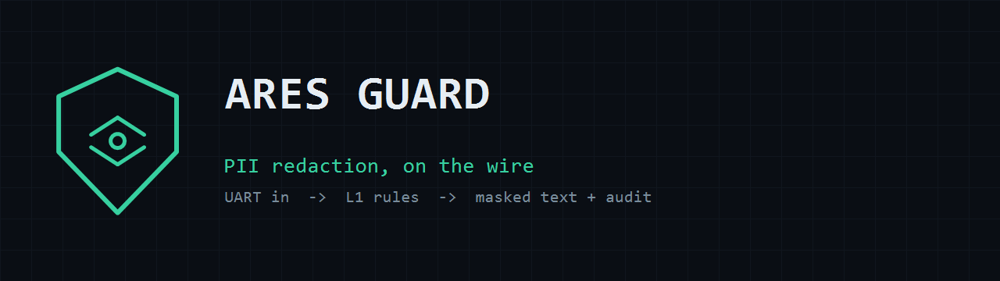

# QS



```
    _    ____  _____ ____     ____ _   _    _    ____  ____
   / \  |  _ \| ____/ ___|   / ___| | | |  / \  |  _ \|  _ \
  / _ \ | |_) |  _| \___ \  | |  _| | | | / _ \ | |_) | | | |
 / ___ \|  _ <| |___ ___) | | |_| | |_| |/ ___ \|  _ <| |_| |
/_/   \_\_| \_\_____|____/   \____|\___//_/   \_\_| \_\____/
```

*PII redaction, on the wire —— 串口进，脱敏文本 + 审计行出。*

单仓库单线：`guard/` —— **隐私守门人（PII 脱敏网关）**。PC 金标 + Verilator 一致性 +
已上板的串口原型，目标板 **盘古 200Pro+（PG2L200H）**，25 MHz。

## 快速开始

```powershell
cd guard
make test                     # 本机：11 组回归
make ner-check                # NER：16 条门槛

.\tools\build_guard.ps1       # 出位流（约 1 分钟）
.\tools\program_guard.ps1     # JTAG 烧板（断电即丢，上电要重烧）

python tools\serial_host.py -p COM9 --repl                        # 交互
python tools\serial_host.py -p COM9 --file examples\demo1_offer.txt   # 跑样例
make web                      # 浏览器演示台 http://127.0.0.1:8777
```

## 板上实测（当前位流）

| 项 | 值 |
|---|---|
| 资源 | **20,879 / 159,800 LUT（13.07%）· 3,814 FF · 6.0 DRM · 17 APM · 1 PLL** |
| 时序 | WNS **+4.40 ns** @25 MHz（TNS 0）→ Fmax ≈ 28.2 MHz |
| 位流 | `guard/generate_bitstream/guard_board_top.sbit`（9,188,552 B） |
| 串口 | 115200 8N1，帧边界 = LF 或空闲 2.6 s |
| 自检 | `tools/board_smoke.py` **12/12**；`examples/` 5 条段落 demo 逐字符验过 |

## 文档

| 文件 | 内容 |
|---|---|
| [guard/README.md](guard/README.md) | guard 总览：状态、怎么跑、目录、硬约定 |
| [guard/TODO.md](guard/TODO.md) | 下一步与已知限制 |
| [guard/docs/board-bringup.md](guard/docs/board-bringup.md) | 上板手册：烧写、串口第一测、故障表 |
| [guard/docs/board-uart.md](guard/docs/board-uart.md) | 板级设计：协议、掩码策略、资源、踩坑记录 |
| [guard/docs/l2-int4.md](guard/docs/l2-int4.md) | L2 语义层 + NER 数据通路 |
| [guard/docs/ubuntu-ner.md](guard/docs/ubuntu-ner.md) | NER 训练交接书 |
| [guard/web/README.md](guard/web/README.md) | 浏览器演示台 |

## 分工

| 目录 | 作用 |
|---|---|
| `guard/rtl` | 可综合 RTL：`l1/` 规则与替换、`l2/` 语义与 NER、`board/` 串口/摘要/顶层 |
| `guard/host` | 金标（纯 Python/numpy）：规则、合并、掩码、NER 整数推理、板级协议 |
| `guard/tools` | 构建、烧写、训练、评测、串口上位机、网页数据生成 |
| `guard/sim`、`guard/tests` | Verilator testbench / 单测 |
| `guard/data`、`guard/models` | NER 语料与 INT8 模型产物 |
| `guard/web` | 浏览器演示台（纯静态，无构建） |
| `guard/vendor` | 第三方（ARES 核等），来源见 `PROVENANCE.md` |

## 约定

- 数字必须可复现：`make test` / `make ner-check` / `tools/board_smoke.py`；
- RTL 只写可综合子集（`logic` / `always_ff` / `always_comb` / 函数）；
- 金标与 RTL 逐字节一致，不一致优先信金标；
- 脱敏 1:1（输出字节数 = 输入），位流 JTAG 灌 SRAM，**断电即丢**。
