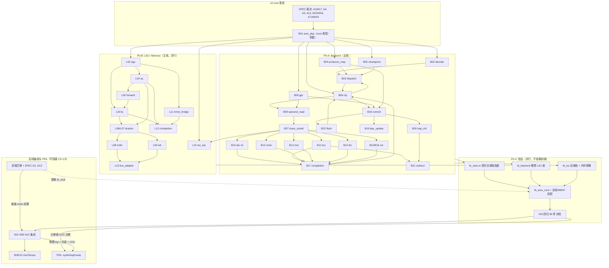

# ARES RTL Implementation Plan

> **Status**: v0.14 / 2026-10-27 / **共享 L2 SoC 主线；已在本地 `base_core` 工作区移植远端 LSU 修复、双核 CoreMark 入口与 shadow checker，保留原生 C5。L2-M1 为部分完成，完整双核 SoC／默认入口／DMA／软件及板级 PPA 尚未验收。**
> **v0.14 变更（修复与验证设施集成）**：以 `ed5b2a4` 为本地基线，移植 `l2-cache` 至 `1fbe654` 的相关增量；按相关增量移植，保留原生 C5，不覆盖为旧 adapter 路径。纠正“共享 L2 数据破坏”诊断：远端 `003586e` 定位为投机 AGU 对齐断言误报，检查移到 LSU 的 LQ lookup 边界；不增加未对齐访问能力。引入双退休计数、按 lane 顺序判定 a0/EBREAK、hart1 参考模式、L2 逐响应／写回影子检查和 c1 dirty eviction 用例；本地补齐错误计数累计、失败／超时非零退出、完成时统计锁存与短镜像正负验证。本地原生 C5 完整单双核 CoreMark 通过，单核 2.0468、双核聚合 4.0935 CoreMark/MHz，17,202 个 L2 响应／写回检查零错误；完整 M1 仍未关闭。当前执行记录见 `docs/l2_integration_results.md`；下一阶段详见 `docs/next_steps_implementation_plan.md`。以下版本条目是历史记录。
> **v0.13 变更（用户确认主线）**：共享 L2 的 ARES SoC 成为后续实现、系统验证和板级交付主线；JYD `student_top`／板级顶层保留作平台资源、回归与历史基线，不再要求先完成旧单核路线才推进 L2。明确规划选择与实际默认构建的差异，重排 L2 数据正确性、完整互连／启动／中断、默认入口迁移、DMA／XIF／软件与板级签核任务。此次提交只改文档，未切换 Makefile／Vivado 默认顶层或实现缺失硬件。
> **v0.12 变更（合并后进度同步）**：以本地 `base_core` 的双父合并提交 `943d160` 为代码基线，更新资产、阶段状态、SPEC 当前处理范围和后续任务。补记两级 TAGE／uTAGE／mBTB、缓存 BRAM IP、物理启动、共享 L2、per-hart IRQ／FENCE、CLINT／PLIC 与真实前端 Tensor IRQ 验证；删除当前清单中的重复开发项。原单核门禁与双核 AMP 扩展分开记录；不把 CoreMark 历史结果、模块单测或短程序通过当作完整系统／PPA 签核。以下版本条目为历史记录。
> **v0.11 变更（C5 执行）**：用户冻结未知 JALR 继续推测、独立 pred_npc／原样 metadata、FTQ 前完整 GHR 快照、独立恢复通道、块内多个不跳转 CFI、首版 IROM-only。真实 CPU／SoC 接入、协议 TB、预测器关闭配置、两套 ISA 回归和镜像拆分已验收；详见 `docs/fe_contract_migration.md`。以下 v0.10 及更早说明为历史记录。
> **v0.10 变更（当前进度校准）**：更新实际资产、阶段状态、板级 baseline 前置条件和下一步任务；记录 JYD SoC/Vivado 生成器及 miniTensor 导入/整理的完成边界。250MHz 是综合约束目标，WNS=-9.888ns；没有 ARES post-route 签核结果。C1/C2 的评审/覆盖率遗留仍保留，不把功能通过等同于所有评审与性能验收完成。
> **v0.9 变更（C2 M2b 执行）**：新增 DCache/MSHR/WB/MMIO 全套 —— `rtl/memory/dcache_arrays.sv`(L07)、`dcache_top.sv`(L06)、`mshr.sv`(L08)、`wb_buffer.sv`(L09)、`mmio_bridge.sv`(L11) 与 4 个单元 TB（`tb_dcache_arrays/tb_wb_buffer/tb_mshr/tb_mmio_bridge`）；`lsu_top` 由 M2a 单 beat staging 收敛为真 DCache 通路；`lq.sv` 增加纯附加 waiter 令牌端口（`lq_wait_pending/tag/epoch`）；M2b 接口冻结见 `LSU_INTERFACES.md` §9–§14，决策见 `docs/m2b_decisions.md`（**misaligned 明确不支持**）。`tb_lsu` 扩为 DCache 通路（hit/miss/refill/Dirty Victim WB/Store Overlay 早接管/RETRY/kill/令牌复用/MMIO + 最终内存镜像）。**证据**：`make lint-lsu` 0 warning；`tb_lsu` 4852 checks / 1006 completions / 0 mismatch；`tb_mshr` 1 205 618 checks（states 6/6, transitions 13/13）、`tb_mmio_bridge` 187 659 checks（3/3, 7/7）、`tb_dcache_arrays` 63 167 checks、`tb_wb_buffer` 26 706 checks（4/4, 4/4），16/32/64B 三档均通过；ISA 回归 36/36。集成期修复 6 处 RTL 缺陷（见 §9.4b）。**PPA 未验证**（SPEC-M10）。
> **v0.8 变更（C2 M2a + C3 执行）**：新增 `rtl/memory/LSU_INTERFACES.md`（M2a 接口冻结）、`rtl/common/lsu_pkg.sv`、LSU 模块 `lsu_agu/lq/sq/store_forward/lsu_completion/line_adapter/lsu_top` 与 7 个自检 TB（`rtl/memory/test/unit/`）、C3 的 `rtl/top/ares_core_top.sv` 与重写的 `sim/rtl/tb_ares_core.sv`；`make lint-lsu`/`make unit-lsu` 新门禁。**ISA 回归 36/36 PASS**（FE 桩）；执行状态、集成期缺陷与遗留项见 §9.4/§9.5。
> **v0.7 变更（C0 评审结论）**：core 范围评审通过 —— **D-C0-01 不实现 illegal Trap**、**D-C0-03 `MUL_LATENCY` 默认改为 3**（时序余量优先，menuconfig 可退回 2）、**D-C0-13 新增（SPEC-A13 关闭）：`HAS_MISA/HAS_MTVAL/HAS_MCYCLE` 默认全部关闭**，其余 [C0] 条目按 `docs/c0_decisions.md` 冻结。C0 出口判据全部满足（`ares_pkg` 冻结、`make lint` 0 warning、`fe_stub` 可编译并自检、裁决项书面结论、TB 内存模型契约），**进入 C1/C2**。
> **v0.6 变更（可配置参数 + 裁决确认）**：新增 Kconfig 风格配置机制（`configs/Kconfig` + `scripts/kconfig/ares_kconfig.py`，`make menuconfig`/`defconfig`/`oldconfig`/`savedefconfig`/`loaddefconfig`/`showconfig`/`test-config`），`MUL_LATENCY`（2/3，默认 2）与 `LINE_BYTES`（16/32/64，默认 32）改为菜单可配置并在 `ares_pkg.sv` 中读取（无配置时回退冻结默认）；`tb_ares_pkg` 每次运行校验并打印生效配置。**D-C0-01 已确认：不实现 illegal-instruction Trap**（方案 (c) 关闭），见 `docs/c0_decisions.md` D-C0-01/D-C0-12。
> **v0.5 变更（C0 执行）**：C0 交付物已全部落地 —— `rtl/common/ares_pkg.sv`（core 共享包）冻结；`rtl/backend/test/fe_stub.sv`（F0 契约合规取指桩）+ `tb_fe_stub.sv` 自检；`sim/rtl/tb_mem_beat_if.sv`/`tb_mmio_if.sv`（TB 内存模型）+ `rtl/memory/test/tb_mem_model.sv` 自检；`sim/Makefile` 增加 `ARES_RTL=1` 分支、`lint`/`lint-all` 与单元 TB 目标；根目录新增 `Makefile`（`lint`/`lint-all`/`tb-fe-stub`/`tb-mem-model`/`isa`）。C0 的 core 侧 SPEC 裁决（A1/M17、A4、A3、A12、M15/M16、A7/A8/A9）书面化于 `docs/c0_decisions.md`，**待 core 范围评审确认**；D3/D11/D12 只登记、不阻塞 core。实测：`lint-all` 0 warning，`tb-fe-stub`/`tb-mem-model` 均 HIT GOOD TRAP。
> **v0.4 变更（优先级）**：按讨论结论把 **Backend（P0-A）与 Memory/LSU（P0-B）定为最高优先级并同时开工**；验证用「SV 行为级 FE 桩 + 现有 C++ DPI 内存模型」与前端解耦（新方案文档 `docs/core_verification_flow.md`）；前端迁移降为 **P2**（只影响 C5 真实前端对接）、SoC 与 miniTensor 为 **P3**（延后）；§4（优先级/依赖/顺序）与 §9（C0–C6 阶段计划）已重写。
> **v0.3 变更**：按「先聚焦 core」要求重排 §9（C0–C5，SoC/miniTensor 移入延后项），并新增前端迁移交接文档 `docs/fe_contract_migration.md`。
> **v0.2 变更**：并入对现有前端 RTL 的独立审计结论（21 项）→ 新增规范缺失 SPEC-M18–M23、歧义 SPEC-A15–A17、接口不一致 SPEC-I6、以及**现有 RTL 缺陷** SPEC-D1–D13（§7.6，其中 D1/D2 阻塞联调）。§6.2 F09、C0/C1、§8.1 V01、附录 A 已同步更新。
> **Scope**: 含共享 L2 的 ARES SoC（RV32IM + M-mode + miniTensor 目标）；当前以已合并的双 hart AMP 原型推进。原单核 C0–C6 是复用资产与历史验收记录，当前主线任务／出口见 §9.7a–§9.9。
> **Purpose**: 把 `docs/microarch/` 中已批准的微架构规范转换为**可执行的 RTL 实现计划**：
> 模块清单、依赖顺序、跨模块接口/握手/时序契约、每模块的职责与完成判据、规范缺陷登记、验证策略、分阶段实施步骤。
>
> **本文档不做的事**（按任务约束）：
>
> 1. 不修改任何现有微架构规范（`docs/microarch/*.md`、`README.md`、`sim/README.md`）；
> 2. 不编写 RTL；
> 3. 不擅自补充未定义的微架构行为——所有规范缺口在 §7 登记为待决项，并给出候选方案与影响面，**不代替架构决策**；
> 4. 严格区分「规范缺失/矛盾（必须由架构作者裁决）」与「RTL 可自由选择的实现细节」（§7.3 白名单）。
>
> **权威性顺序**（冲突时）：
> `frontend_backend_contract.md`（FE↔BE 唯一规范性定义，见 `backend.md` §18、`frontend.md` §8）
> \> `backend.md` / `memory.md` / `frontend.md` / `miniTensor.md`
> \> `frontend-integration.md`（已过期，见 SPEC-C1）
> \> 本文档（仅用于排期与工程组织）。
>
> **落地约定**：本文档中标注 **「待决 SPEC-xx」** 的行为在对应 SPEC 项关闭前不得写入 RTL；
> 标注 **「FREE-xx」** 的项目属于 RTL 内部自由选择，可直接实现。

---

## 当前进度与执行入口（2026-10-27）

**验证时基线**：本地 `base_core` HEAD 为 `ed5b2a465d93688ef78ca2b8968e2673051f2904`，
其代码合并基线为 `943d160`（父提交 `330733a` 与 `19d0128`）。2026-10-27 在工作区移植
远端 `l2-cache`（已核对 tip `1fbe654`）的相关修复／验证增量，保留原生 C5、BRAM IP 和
已有板级代码；未合并远端分支历史。验证发生在提交前工作区，后续提交以 Git log 为准。当前移植验证见
[`l2_integration_results.md`](l2_integration_results.md)，2026-10-25 的回归记录仍按历史范围保留。

**主线决定（2026-10-25）**：用户已明确选择 **含共享 L2 的 ARES SoC**。
后续默认仿真、系统测试与 FPGA 交付应围绕 L2 SoC 建立；JYD 的 PLL／复位／UART／BRAM／
CDC／原引脚与既有工程设置作为可复用板级资源，`student_top` 继续作参考与回归对象。
主线选择不等于默认入口已迁移：

| 层次／入口 | 当前实际构建 | L2 状态／计划 |
| --- | --- | --- |
| `make sim/run/isa` | `tb_ares_cpu` → `ares_cpu_top`，IROM＋DPI 内存 | 无共享 L2；保留 Core 功能回归，默认系统仿真待迁移 |
| Vivado 默认 `soc`／现有 board manifest | `student_top` OOC／`rtl/board/top.sv` → JYD 平台 | 无共享 L2；是历史平台入口，不是新的主线系统交付 |
| `unit-coremark` | `ares_frontend_l2_top`，单核原生 C5／I/D→共享 L2 | 完整 100 iterations 通过：48,856,291 cycles／2.0468 CoreMark/MHz；仍需外部 `DMEM` |
| `unit-2core-coremark` | 双核原生 C5／私有 L1／32KiB L2，带 shadow checker | 完整 100 iterations 通过：聚合 4.0935 CoreMark/MHz，shadow 零错；`COREMARK_ARGS=+H1EN=0` 选择单 hart 参考；不包含在 `make all` |
| `test-coremark-harness` | 已构建的两个 CoreMark TB 二进制＋短 RV32 镜像 | 验证成功／失败、缺镜像、超时、单 hart 参考及双 hart 完成条件；不替代完整 CoreMark |
| `unit-l2-frontend` | 单／双真实 FE＋共享 L2 自检 TB | 已通过短程序；作为主线初始门禁，尚非完整 SoC |
| 目标主线 SoC | L2 hart＋共享存储、MMIO／CLINT／PLIC／启动／UART，后续 tensor／DMA／软件 | 完整系统顶层、默认仿真和板级入口均待实现与验收 |

**验收边界**：原 C0–C3、C5 功能门禁作为回归保持，旧 C4、C6 未关闭；主线完成度按
§9.8 的 L2-M0…M6 逐项验收，不把单核 5/7 门禁当作新主线完成率。
既有严格 >200MHz 的规划要求继续保留，250MHz 是约束请求而非达成值；L2 SoC 的
最终配置、资源预算和时钟约束需针对完整顶层明确。若需调整频率要求，必须另行裁决，
不能把多核清单的 100–125MHz 建议视为已批准降标。Core 内 XIF 的后续方向继续保留；
先复用 MMIO adapter 推进系统，不据此宣告 XIF 已实现或永久取消。详见
[`c4_execution_decisions.md`](c4_execution_decisions.md) 与
[`multicore_l2_checklist.md`](multicore_l2_checklist.md)。

| 范围 | 已完成／实际证据 | 尚未完成 |
| --- | --- | --- |
| Backend／LSU／Core | Backend **6 个 TB**、LSU **12 个 TB**、基础 **3 个 TB**；真实 FE 与桩 ISA 各 **36/36**；CIQ states 4/4、必要非自环 transitions 6/6，IRQ 恢复 PC 直接检查，Issue 等价 100,000 向量 | 板级性能／资源及更广覆盖率、系统集成评审 |
| 前端 | 两级 TAGE／uTAGE、mBTB、RAS／Loop 与 C5 双路训练／独立恢复整合；默认 **9 个 TB**，bimodal／tournament／utage／tage-no-ras **4 组配置各 2 个 TB** 通过；S2／FTQ checkpoint 边界有定向测试 | SC、目标吞吐／预测收益、所有历史 SPEC 的完整关闭与板级时序 |
| JYD／物理板级 | 真实 CPU／IROM；SoC 总线 2864 checks、自主程序 25 retires；`rtl/board/top.sv`、manifest、PLL／分域复位、UART、裸机镜像；板级模型 26 帧／2 次启动、ECALL／MRET、回显和失锁复位通过 | 约束／CDC 审查、最新设计完整综合／route、实板运行；物理顶层尚未接入 miniTensor |
| 缓存／Vivado | 数据阵列 BRAM IP 配方与普通仿真模型；既有 BMG／RAMB36E1 验证 10/10、数据探针 34 RAMB36；合并后工程生成器 10/10、镜像拆分 3/3；16／32／64B 仿真比较已完成 | 既有 IP／数据探针证据不是合并版全板 PPA；三档面积／Fmax 比较未完成，默认保持 32B |
| Hart／中断／Fence | HART_ID／mhartid、MSIP／MTIP／MEIP、MEI > MSI > MTI；P0 33 checks；FENCE／FENCE.I 串行化、LSU 排空与提交脉冲；CLINT 56 checks、PLIC 88 checks | CLINT／PLIC 接入完整双核 MMIO／中断系统；FENCE.I 脉冲尚未驱动 ICache invalidate，不声明完整代码更新可见性 |
| 共享 L2／双 hart | 默认 **32KiB（128 sets × 4 ways × 64B）**，write-back／write-allocate，一次一个事务；L2 17 checks、双 FE model 4 checks；原生单／双真实 FE＋L2 冒烟分别 25／25+25 retires | 原生 C5 完整单双核 CoreMark 通过（单核 2.0468／聚合 4.0935），shadow 17,202 响应零错；M1 镜像生产链／随机反压／复位／压力尚缺；最终 128KiB／8-bank／MSHR／WBQ／QoS、SPM、Mailbox、双核启动与 MMIO xbar |
| miniTensor／RT-Thread | miniTensor 独立回归历史 9/9；MMIO→CV-X-IF 控制路径；Tensor IRQ adapter 26 checks，真实 FE／IROM CPU IRQ 38 retires（CV-X-IF slave 为行为模型）；RT-Thread Nano 3.1.5 及旧 BSP 已导入 | Core 内 XIF、双 tensor、真实共享内存 DMA／可见性、ARES BSP／RTOS 启动和系统负载验收 |

**排期依据**：本节与 §9 是当前状态；带日期的旧执行结果继续作为历史证据。
§7 保留问题发现时的原文，当前关闭范围由 §7 的 v0.12 对照表限定。
已交付物理 top／manifest、独立 DCache TB、IRQ 直接断言与 CIQ 状态覆盖，不再安排重复开发。

```bash
make lint-all lint-backend lint-lsu lint-soc lint-mt lint-board lint-l2
make tb-ares-pkg tb-fe-stub tb-mem-model
make unit unit-lsu unit-frontend unit-frontend-modes unit-soc unit-board
make unit-l2 unit-l2-frontend unit-fe-adapter
make unit-mt-irq unit-mt-cpu-irq unit-clint unit-plic
make isa isa-stub
make test-config test-vivado test-images
```

这些入口在合并验证中分组执行并通过。初轮 `make all` 在已通过基础／Backend／LSU／L2
之后因 ccache 的沙箱写入限制中断；剩余项提升权限重跑通过，不能把初轮 `make all`
的退出状态记为成功。miniTensor 本体 9/9、缓存厂商模型 10/10 属之前执行的证据，
未在此次合并中重跑。

**CoreMark／旧问题更正**：远端 `003586e` 已记录单核及双核 AMP 的完整 CoreMark 通过，
并以 21,981 个 L2 响应／dirty writeback 零 mismatch、2,768,013 条退休流比较定位旧故障。
原约 44.7ms 的“数据破坏”推断不成立：检查投机 AGU 地址的自然对齐断言误报；修复将检查移到
LSU 的 live LQ lookup 边界，store 维持 COMMITTED drain 检查。**LQ lookup 本身不等于退休／提交**，
不能由该修复推导出所有错路径访问、MMIO 和全转发路径的对齐验证均已覆盖。
旧单核 `21,229,636 retires / IPC=0.425063` 是 TB 双退休少计，修正为
`31,348,582 / IPC=0.627666`；`49,944,724 cycles / 2.0022 CoreMark/MHz` 不变。
远端双核聚合记录为 `3.9978 CoreMark/MHz`，属 legacy adapter 路径历史结果，不能直接作为
本地原生 C5 的分数。本轮本地单核为 48,856,291 cycles／2.0468 CoreMark/MHz，双核为 48,857,613／48,857,616 cycles、聚合 4.0935；各 hart 31,349,223 retires，shadow 17,202 响应零错。输入哈希和验证边界统一见
[`l2_integration_results.md`](l2_integration_results.md)。

**当前门禁**：移植源代码、单次长程序和 shadow checker 不等于 L2-M1 全部验收。
仓库内自包含软件镜像生产链、默认几何＋固定 seed 压力、随机反压、复位旧事务隔离和
L1/L2 行宽边界仍须完成；详见新版下一阶段计划。不再以“先修 c1 数据破坏”作为既定任务。

**PPA**：历史 OOC（250MHz 请求，WNS=-9.888ns）与首个真实 FE 板级综合
（226116 LUT／110.95%，WNS=-35.600ns）是不同设计，不能直接比较优化收益。
BRAM IP 与选择逻辑优化后，没有最新合并版完整综合／routed 签核，不能报告当前 Fmax。
历史数据和两次停止的全板运行见 [`c4_execution_results.md`](c4_execution_results.md)。
当前可从新输出目录重建 `soc`／`core` OOC 或使用已交付 board profile 继续实现；完整
板级流程必须携带有效 IROM／DRAM COE、manifest 和约束，见 §9.6 及
[`../fpga/vivado/README.md`](../fpga/vivado/README.md)。
生成配置、日志和报告不跟踪进 Git；验证记录按源码提交、配置、输入哈希与工具版本归档。

### C5 问题关闭范围与证据

- SPEC-C1/C2/C4/C5/I1：共享 `fe_pkg`、计数消费、独立 `pred_npc`、原样 metadata、双提交 credit/FIFO 和独立 Redirect 已落地；不再实现 `need_redirect`。基础恢复字段始终存在，TAGE／uTAGE metadata 按统一配置扩展，所有消费者使用同一共享类型。
- SPEC-A16：块内多个不跳转 CFI 保留完整 `ghr_before`；表索引 metadata 不被局部修正或快照覆盖。
- SPEC-D1/D2/D5/D11：块等待 IQ 接管、valid 镜像／计数消费、取消＋排空旧响应、分支方向不由 predecode 猜测等有定向测试；不据此整体关闭其他 D 类问题。
- SPEC-I2/I4：JYD IROM-only 桥已验收；L2 原型新增 AXI→128-bit I-port 桥，单／双真实 FE 冒烟通过，尚不代表通用 I/D/MT-DMA Fabric 或代码更新可见性完成。
- 合并版 IQ 535 checks、训练 FIFO 1821 checks、历史 10 checks、FE/BE 契约 601 条指令／32 次延迟响应、IROM 桥 36 checks、ICache 数据阵列 9958 checks、FTQ correction 6 checks、BPU S2 两次修正／4 checks 通过；局部修正次数随预测器配置变化，不作为固定门禁。
- L2 hart wrapper 直接连接原生两路训练／credit 与独立恢复 metadata；`fe_legacy_adapter` 仅保留独立夹具，14 checks 通过，不在当前 CPU／L2 取指主路径中。
- 真实 FE／桩 ISA 各 36/36，SoC 两个 TB、四组预测器配置均通过；SC、完整吞吐／预测收益、FENCE.I invalidate 和板级 PPA 另行验收；双核长程序本轮通过，完整 M1 压力门禁仍未关闭。

---

## 0. 术语、命名与模块 ID 约定

| 前缀 | 范围 | 目录 |
| --- | --- | --- |
| `F` | Frontend（已有 RTL + 契约改造） | `rtl/frontend/` |
| `B` | Backend（core 后端） | `rtl/backend/` |
| `L` | LSU / Memory 子系统 | `rtl/memory/` |
| `S` | SoC 集成、总线、外设、TB | `rtl/top/`, `rtl/soc/`, `sim/rtl/` |
| `V` | 验证基础设施（TB / 断言 / 脚本） | `rtl/*/test/`, `sim/`, `tests/` |
| `VX` | miniTensor 本体与 CPU/SoC 集成 | 当前本体位于 `miniTensor/rtl/`，验证位于 `miniTensor/tb/`；系统集成另见 §9.7 |

命名约定（不改变任何规范语义，仅为工程一致性）：

- core 保持 `clk`、同步高有效 `rst`；JYD SoC 已引入 CPU/50MHz 外设两域及 XPM CDC，板级时钟/复位与 CDC 签核仍受 SPEC-M8 约束，见 §9.6；
- 规范中的 `*_valid / *_ready` 信号沿用原文命名，**不得重命名**（契约 §2–§4、`fu_req_t`/`fu_completion_t` 等跨模块类型保持一致）；
- core 跨子系统类型已在 `ares_pkg` 冻结（C0）；`lsu_pkg` 只承载 LSU 内部 helper。C5 的 FE/BE 类型统一由 `fe_pkg` 提供；`ares_pkg` 只保留 Backend/LSU 类型。
- CIQ slot 用 4-bit `tag_t`；FE 侧 IQ 条目用 `iq_entry_t`；FU 请求/完成用 `fu_req_t`/`fu_completion_t`。

---

## 1. 输入基线（Baseline）

### 1.1 规范来源

| 文档 | 版本/状态 | 覆盖范围 | 在本文档中的角色 |
| --- | --- | --- | --- |
| `docs/microarch/frontend_backend_contract.md` | v1.1 / C5 integration baseline | FE↔BE 指令/Redirect/BPU Update 三个接口 + 同周期优先级 | **跨模块唯一权威**（契约） |
| `docs/microarch/backend.md` | Draft v0.45 | CIQ / Decode / Dispatch / Issue / FU / Completion / Commit / Flush / CSR / Trap | 后端权威 |
| `docs/microarch/memory.md` | v0.7.0 | LSU / LQ / SQ / DCache / MSHR / WB / Fabric 总线 / MMIO | 访存权威 |
| `docs/microarch/frontend.md` | Draft 1.4 | BPU / FTQ / IFU / ICache / IQ | 前端权威 |
| `docs/microarch/miniTensor.md` | 与 RTL 同步 | `mini_tensor_top` / CV-X-IF / UB / VPU / GEMM / Epilogue | 加速器权威 |
| `docs/microarch/frontend-integration.md` | 已过期 | 旧版 FE 接入说明 | **仅作 RTL 现状说明**，接口部分被契约取代 |
| `README.md`, `sim/README.md` | — | 仿真流程、DPI-C 面、**事实上的内存映射** | 集成/TB 依据 |
| `tests/abstract-machine/.../ares/*` | — | BSP 使用的 CSR、MMIO、EBREAK 约定 | 软件可见契约证据 |

### 1.2 现有资产清单（更新至 2026-10-25 / `943d160`）

| 资产 | 当前交付物 | 验证／边界 |
| --- | --- | --- |
| 共享类型／配置 | `rtl/common/{fe_pkg,ares_pkg,lsu_pkg}.sv`、Kconfig 工具 | 默认 MUL_LATENCY=3、LINE_BYTES=32；metadata 宽度按统一预测器配置校验 |
| Backend | `rtl/backend/`、6 个单元／集成 TB | C1 功能门禁保持；per-hart IRQ、FENCE、CIQ coverage、Issue 等价测试已合并 |
| LSU／Memory | AGU／LQ／SQ／DCache／MSHR／WB／MMIO／Line Adapter、12 个 TB | M2a+M2b、独立 DCache、`lsu_fence_idle`；JYD uncached profile 默认关闭 |
| CPU／仿真 | 默认 `ares_cpu_top`＋`tb_ares_cpu`；保留桩路径 `tb_ares_core` | 真实 FE／桩 ISA 各 36/36；不依赖旧 NPC |
| Frontend | BPU／FTQ／IFU／ICache／IQ、TAGE／uTAGE／mBTB、双提交训练及独立恢复 | 9 个 TB、4×2 配置用例；SC、吞吐／预测收益与 PPA 待验收 |
| JYD／板级 | `student_top`、`ares_soc_top`、`rtl/board/top.sv`、UART、分域复位、固件与 `fpga/board.json` | SoC 与板级模型通过；物理 top 不实例化 miniTensor；完整实现／实板待验收 |
| Hart／中断 | 参数化 HART_ID、三类 M-mode IRQ、`soc_clint.sv`、`soc_plic.sv` | P0／CLINT／PLIC 分别 33／56／88 checks；完整双核路由尚未集成 |
| L2／AMP 原型 | `rtl/l2/`、`ares_2core_l2_top`、`ares_frontend_l2_top`、`ares_frontend_hart`、`ares_2core_frontend_l2_top`、AXI I-port 桥 | 默认 32KiB、单事务；FE model 与真实 FE 冒烟通过；CoreMark 长程序待复验 |
| miniTensor／RT-Thread | 本体、模型、驱动／旧 BSP、MMIO host adapter、Tensor IRQ；`rtthread-nano/` | 本体历史 9/9；合并版 IRQ 26 checks／CPU 38 retires；无 Core 内 XIF／真实 DMA／RTOS 闭环 |
| FPGA 工程／缓存 IP | `fpga/vivado/`、`scripts/vivado/`、BMG 数据阵列配方与模型 | 生成器 10/10；缓存厂商模型历史 10/10；合并版 PPA 未重跑 |

cpu-tests 与 AbstractMachine 保留在 `tests/`，回归共 **36 项（35 个 cpu-tests + dummy）**。
已交付的物理 top／复位／manifest 和独立 Timer 模块不能再列为“无实现”；剩余门禁是
实际板级签核、CLINT／PLIC 系统接线、双核启动／软件、CPU／DMA 可见性和加速器闭环。

**FE 审计现状**：原 21 项发现及后续 SPEC 仍保留追溯；C5 接入问题已按本节顶部范围关闭。
深预测器有 RTL 与定向测试，不等于 SC、目标吞吐或全部历史规范缺口已经验收。

### 1.3 基线结论

1. 后端与访存规范已达到「可开工」粒度：接口、状态机、同周期优先级、断言建议基本完整。
2. C5 已完成契约迁移与 IROM 接入，真实 FE 和桩都可独立跑 ISA 回归；完整 SoC 软件／DMA与板级 PPA 仍分开验收。
3. 原阻塞 core 开工的 SPEC-A1/M17、A4、A3、A12、M15/M16、A7/A8/A9 已在 C0 形成裁决。SoC 地址/总线/仲裁、取指连接（SPEC-M7/I2/M13/M20/M21）、CPU↔miniTensor 主机侧契约（SPEC-M6）及板级复位/时钟（SPEC-M8）仍需分范围关闭；JYD 局部例外已获授权，不代表通用问题全部关闭，也不重开已完成的 core 功能门禁。
4. FE 桩/Core/LSU/SoC/miniTensor 独立验证基础设施已落地并实际执行；保持已有功能门禁。器件、工程设置、XDC 快照和 IP 配方已提供；SPEC-M10 的剩余门禁是复核已交付板级接入、有效约束／CDC 与最新设计 post-route 时序签核。

---

## 2. 冻结配置（Configuration Freeze）

下表保留可复用的单核／L1 配置与原规范目标；共享 L2 主线实际原型与最终参数分别见 §9.7a。L2 最终容量／端口／时钟约束未由本次主线选择自动冻结，既有 >200MHz 规划要求保留，不能把多核建议当作已实现配置。状态列含义：
**[S]** 规范已冻结；**[P]** 规范给出参数/选项，需在实现前选定并记录；**[?]** 规范缺失（§7 待决）。

### 2.1 内核与前端

| 参数 | 值 | 出处 | 状态 |
| --- | --- | --- | --- |
| ISA | RV32IM，无 C 压缩（PC/指令均 32-bit） | 契约 §1 | [S] |
| XLEN / 地址宽度 | 32 / 32 | 契约 §1 | [S] |
| FETCH_WIDTH | 4 条/块 | frontend.md §1 | [S] |
| DECODE_WIDTH | 2 | 契约 §1、backend.md §5.1 | [S] |
| FTQ_NUM_ENTRIES | 16 | frontend.md §1 | [S] |
| IQ_DEPTH | Kconfig 当前默认 HEAD 2 + BODY 8 = 10；保持已有默认 | fe_pkg / configs/frontend/Kconfig | C5 基线 |
| ICache | 4-way / 64-set / 32B line / LRU；PC[10:5]=idx，PC[31:11]=tag | frontend.md §7.1 | [S] |
| ICache 取指窗口 | 单次 fetch 不跨 line；`line_offset > 16` 只返回本行剩余 | frontend.md §7.4 | [S] |
| ICache 总线 | 现有只读 `axi_if.master` 接口 | `axi_if`、IROM／L2 桥 | JYD／L2 局部连接已实现；通用 I/D/MT-DMA／ordering 仍属 SPEC-I2/M7，不宣称完整标准 AXI4-Lite 合规性 |
| BPU 结构 | Composer + 子预测器：F1 = uBTB + Bimodal，F2 = TAGE + SC + mBTB，F3 = RAS + Loop；**latency = 3 cycles、throughput = 1 prediction/cycle** | frontend.md §1/§3.0 | [S] 原目标；当前两级 TAGE／uTAGE／mBTB 已实现并接入，SC 和目标吞吐未验收（SPEC-M1） |
| Bimodal | PHT 1024 × 2-bit，索引 `pc[11:2]`，复位 WNTK | frontend.md §3.2 | [S] |
| Gshare | PHT 1024 × 2-bit，GHR_WIDTH=12，复位 WNTK | frontend.md §3.2 | [S] |
| Tournament | chooser 1024 × 2-bit，复位 WBM | frontend.md §3.2 | [S] |
| uBTB | 16 项 fully-associative（寄存器），useful 计数器替换 | frontend.md §3.2 | [S] |
| mBTB | 1024 项 set-assoc（SRAM），2–3 拍 | frontend.md §3.2 | 原目标保留；mBTB 已有 RTL／S2 修正测试，当前配置以 Kconfig 为准（SPEC-M1 未整体关闭） |
| TAGE / SC | F2/F3 方向修正器 | frontend.md §3.2 | TAGE／可选 uTAGE 已实现；SC 未实现，吞吐／预测收益待验收（SPEC-M1） |
| RAS / Loop | RAS（call/ret 覆盖）、Loop（迭代翻转） | frontend.md §3.2、RTL | [P] 具体参数（深度/表项）frontend.md 标 TODO |
| GHR | `ghr_spec`（推测）与 `ghr_commit`（提交）双份，12-bit | frontend.md §3.2、契约 §4 | [S] |

### 2.2 后端

| 参数 | 值 | 出处 | 状态 |
| --- | --- | --- | --- |
| CIQ | 16 entry，`tag_t = {slot_index[3:0]}`，valid-only 生命周期（无 generation） | backend.md §3/§4 | [S] |
| Entry 状态 | FREE / WAIT / EXEC / DONE | backend.md §3.1 | [S] |
| Dispatch | ≤2/cycle，连续前缀，`free_count = 16 - occupancy_count`，不借用本周期释放 | backend.md §5.1、契约 §2 | [S] |
| Serializing Dispatch Gate | CIQ 中有未退休 serializing → accept=0；head0 为 serializing → 只接受 head0 | backend.md §5.1 | [S] |
| Issue | ≤4/cycle，严格程序顺序连续前缀；端口预约一次完成，`issue_fire = issue_valid` | backend.md §8 | [S] |
| Serializing Issue Gate | `tag == commit_ptr` && `lsu_mmio_order_idle` 时单独发射 | backend.md §8.3、§16.3 | [S] |
| ALU | 2 端口（对称），latency=1，II=1，`can_accept=1` | backend.md §9.1 | [S] |
| BRU | 1 端口，latency=1，II=1 | backend.md §9.2 | [S] |
| SMUL | 1 端口，17×17 signed（Independent Fit），latency=1 | backend.md §9.3 | [S] |
| MUL | 1 端口，fully-pipelined，II=1，`MUL_LATENCY = 2 or 3` | backend.md §9.4 | **[S] 默认 3**（v0.7 裁决 D-C0-03；`make menuconfig` 可选 2） |
| DIV | 1 端口，radix-4 iterative，`can_accept = !busy \|\| completing_this_cycle` | backend.md §9.5 | [S] |
| CSR Unit | 1 端口，latency=1，II=1，独占 Commit lane0 | backend.md §9/§16 | [S] |
| LSU | 1 Issue Port + 1 Completion Port；2-wide Store Commit（与全局 lane 对应） | backend.md §9.6、memory.md §5.2 | [S] |
| Commit | ≤2/cycle，连续 DONE 前缀；GPR 2 写口（同 rd 时年轻者胜） | backend.md §14 | [S] |
| Producer Map | 32 项 {valid, tag}；x0 恒无效；Commit 同沿条件清除 | backend.md §6 | [S] |
| Branch Checkpoint | 每 CFI slot 一份 32 项 Producer Map 快照，冻结，恢复时校验 | backend.md §15.2/§15.3 | [S] |
| Kill | `kill[i] = valid[i] && age(i) > age(branch_slot)`，含 WAIT/EXEC/DONE | backend.md §15.1 | [S] |
| GPR | 8 读口 / 2 写口 | backend.md §1 | [S] |

### 2.3 访存子系统

| 参数 | 值 | 出处 | 状态 |
| --- | --- | --- | --- |
| Memory Issue Port | 1（Load/Store 共用），≤1/cycle | memory.md §1 | [S] |
| AGU | Input Register + pipelined AGU；`addr = src1 + imm` | memory.md §3 | [S] |
| LQ | 4 entry，bitmap 分配，乱序完成 | memory.md §1/§4.1 | [S] |
| SQ | 8 entry 统一环形（SPEC + COMMITTED） | memory.md §5.1 | [S] |
| Store Forwarding | byte-wise，覆盖 SPEC 与 COMMITTED | memory.md §4.2 | [S] |
| DCache | 默认 8 KiB，2-way，LINE_BYTES = 16/32/64（默认 **32**），Write-back + Write-allocate | memory.md §6.1 | [S]（默认值 [P]） |
| DCache RAM | 每 Way 1R1W，64-bit row，独立 Tag/Valid/Dirty/LRU | memory.md §6.1/§6.3 | [S] |
| MSHR | 2 entry，各带完整 refill buffer + Store overlay | memory.md §6.1/§6.4 | [S] |
| Writeback Buffer | 2 entry 完整 dirty victim line | memory.md §6.6 | [S] |
| Fabric Write Queue | 4 entry × 16B，按序出队，无 B 通道 | memory.md §6.7 | [S] |
| 下层总线 | 128-bit、16B 对齐、单笔 16B、无 burst/ID；共享读最多 1 outstanding | memory.md §6.7 | [S] |
| LSU Completion | 1 port，≤1/cycle，无 backpressure；Fast Path 直通 + 2-entry FIFO | memory.md §7 | [S] |
| Load Hit 目标时序 | 无争用时 C0 接收 → C3 发 Completion，3 个 Issue stall | memory.md §6.2 | [S]（目标，非保证） |
| MMIO | AGU 后地址分类，单 outstanding，req/rsp 全握手，Write Ack = 副作用完成 | memory.md §3.1 | [S] |
| 地址窗口 | 参数化 cacheable/MMIO 窗口，不重叠、不别名 | memory.md §3.1 | **[?] SPEC-M7** |

### 2.4 CSR / Trap / 中断

| 项目 | 值 | 出处 | 状态 |
| --- | --- | --- | --- |
| 特权 | 仅 M-mode；Zicsr 六指令 + ECALL + MRET | backend.md §16.1 | [S] |
| 必需 CSR | mstatus(0x300)、mie(0x304)、mtvec(0x305)、mscratch(0x340)、mepc(0x341)、mcause(0x342)、mip(0x344)、mhartid(0xF14) | backend.md §16.1 | [S] |
| 可选 CSR | misa(0x301)、mtval(0x343)、mcycle/mcycleh(0xB00/0xB80)（参数开关） | backend.md §16.1 | **[S] 默认全部关闭**（v0.7 裁决：D-C0-13，关闭时访问=不支持→仿真报错，B16 按 `HAS_*=0` 实现） |
| mtvec | 仅 Direct，MODE=00，BASE 4B 对齐 | backend.md §16.1 | [S] |
| 中断 | 每 hart 的 MEIP／MSIP／MTIP，优先级 MEI > MSI > MTI；保留 Drain-to-Boundary | `csr_file`／`be_trap_ctrl`，P0 TB | 10-25 已合并并单测；系统路由仍待集成 |
| Trap 优先级 | Reset > ECALL > MRET > BRU Recovery > IRQ Boundary | backend.md §17.3 | [S] |
| 指令支持边界 | illegal Trap、WFI、真正 misaligned 仍不支持；EBREAK 仅 TB 退出；FENCE／FENCE.I 已有串行化／排空及提交脉冲 | C0 裁决、10-25 P0 RTL／测试 | FENCE.I 未接 ICache invalidate，不声明完整自修改代码支持；SPEC-M19 仍开放 |
| EBREAK 退出 | 仅 TB 在非推测 Commit Head 边界识别，可选仿真 shadow | backend.md §16.1 | [S]（端口形态 **[?] SPEC-M9**） |

### 2.5 SoC / 集成（现有软件与仿真环境构成的**事实映射**，待正式冻结）

| 区域 | 地址 | 来源 | 状态 |
| --- | --- | --- | --- |
| 复位 PC / 程序起点 | `0x8000_0000` | 契约 §1、`ares.mk` `_program_start`、`frontend.sv` `RESET_VEC` | [S] |
| IROM（取指窗口） | `0x8000_0000` + 32 KiB | sim/README、`sim/csrc/memory.cpp` | [S]（事实） |
| DRAM（cacheable） | `0x8010_0000` + 256 KiB | sim/README | [?] SPEC-M7 |
| DRAM uncached 别名 | `0x8030_0000`（bit21 置位） | sim/README、memory.cpp `~0x00200000` | [?] SPEC-M7 |
| DRAM uncached 扩展 | `0x8040_0000 .. 0x80FF_FFFF` | sim/README | [?] SPEC-M7 |
| MMIO base | `0xA000_0000`：console +0x3F8、RTC +0x48/+0x4C、KBD +0x60、VGA +0x100、audio +0x200、disk +0x300 | `ares.h`、sim/README | [?] SPEC-M7 |
| 64-bit 计时器 | `soc_clint` 已实现 MTIME／per-hart MTIMECMP／MSIP，地址为模块内偏移 | `soc_clint.sv`，56 checks | SPEC-M12 部分完成；SoC 基址、时基、接线与 ARES BSP／RTOS 待验收 |
| RESET_MTVEC | 必须由顶层定义（契约 §1） | 契约 §1 | **[?] SPEC-M8** |
| 目标器件 / 时钟约束 | `xc7k325tffg900-2`；复用 JYD2025 `digital_twin.xpr` 综合/布线配置；CPU 时钟严格 >200 MHz | AGENTS.md、用户确认（2026-10-14），见 §9.6 | **SPEC-M10 部分解除**：生成器与 SoC OOC 综合已验证，板级接入/时序签核待完成 |

上表保留的是 Core 仿真/BSP 的事实映射和通用规范问题，不是当前 JYD 板级映射。
JYD `student_top` 已按用户授权使用 `0x8020_xxxx` MMIO 和 uncached 别名，通用 Core
默认 `0xA000_xxxx` 不变；完整 profile 见 `docs/jyd_soc_integration.md`。
当前 FPGA 的 DRAM 实际为 **256KiB**：扩展译码窗口 `0x8040_0000–0x83FF_FFFF`
仍映射低 18 地址位，不提供仿真中的 12MiB 物理存储。软件不得把缓存脏数据与别名/DMA
混用；完整模型/RTOS 容量和外存方案需要 C6 单独确认。

---

## 3. RTL 模块清单（Module Inventory）

> 列「状态」含义：**保留** = 现有 RTL 基本可复用；**改造** = 现有 RTL 需按契约修改；**新增** = 需要新写；**缺失** = 规范要求但当前无实现路径。
> 「规范出处」为权威章节；未标注 FREE 的接口/行为不得自行发明。
> Backend/Memory 清单中的规格和原始建议文件名保留；当前完成状态以本节标题及 §9 为准，不能把原「新增」开发动作当作尚无实现。

### 3.1 Frontend（`rtl/frontend/`，C5 已完成，深预测器已整合）

| ID | 当前文件 | 模块职责／已完成 | 剩余边界 |
| --- | --- | --- | --- |
| F01 | `rtl/common/fe_pkg.sv` | FE/BE 共享类型、原样预测 metadata、基础恢复字段与配置扩展 | 所有消费者必须使用同一配置，不能回退旧接口 |
| F02 | `bpu/bpu.sv`、`bpu_commit_queue.sv` | 两级预测／FTQ 修正、Commit 序训练、双路 credit、独立恢复 | 目标吞吐／性能待验收 |
| F03 | `bpu/direction/{bimodal,gshare,tournament,loop_predictor}.sv` | 方向预测与原样 metadata 训练，四组配置回归 | 不代表全部历史 SPEC 已关闭 |
| F04 | `bpu/target/ubtb.sv` | banked uBTB、平衡选择与边界测试 | 板级面积／时序待测 |
| F05 | `bpu/target/ras.sv` | Commit 序状态、恢复 checkpoint，存储结构已改造 | 板级 RAM 映射／资源仍需复核 |
| F06 | `direction/{tage,tage_pkg,tage_base_array,tage_tag_array,utage}.sv`、`target/mbtb.sv` | TAGE／uTAGE／mBTB 与 S2 修正，live checkpoint 生命周期测试 | SC 未实现，SPEC-M1／M18／M23 不自动整体关闭 |
| F07 | `ftq.sv` | correction／bypass、错误路径丢弃、full/pop 同周期边界 | 保持恢复与训练原样 metadata |
| F08 | `ifu/ifu.sv` | 流水取指／predecode、独立 pred_npc、旧响应隔离、多 CFI 快照 | 更广吞吐／边界验收继续保持 |
| F09 | `ifu/{icache,icache_data_way}.sv` | 双读／refill、版本化 BRAM IP、仿真模型 | FENCE.I invalidate、全板 PPA 未完成 |
| F10 | `iq.sv` | 连续前缀 valid、按计数消费，当前 HEAD2＋BODY8 | 配置变更继续跑契约门禁 |
| F11 | `interface/axi_if.sv`、`interface/axi_l2_bridge.sv`、JYD `ares_irom_bridge.sv` | JYD 只读 IROM 桥及 L2 原型 I-port 桥 | 通用 DMA／代码更新可见性仍待定义与验证 |
| F12 | `test/` 的 9 个默认 TB、`scripts/test_frontend_modes.py` | IQ／训练／恢复／S2／FTQ／IROM／ICache 验证 | 完整长程序、性能与板级验收另行执行 |

原 `fe_legacy_adapter.sv` 与其 14-check TB 保留为独立夹具；当前 CPU／L2 wrapper
直接使用原生 C5 恢复及两路训练接口。

### 3.2 Backend（`rtl/backend/`，C1 功能已落地）

| ID | 文件（建议） | 职责（简） | 规范出处 |
| --- | --- | --- | --- |
| B01 | `rtl/common/ares_pkg.sv`，依赖独立 `fe_pkg.sv` | Backend／LSU 的 tag／状态／FU／op／异常／CIQ／请求／完成类型；FE 类型只由 `fe_pkg` 定义 | backend.md §4/§10/§11、契约 §2.1/§3/§4 |
| B02 | `be_decode.sv` ×2 | 2-wide 译码：op/fu_type/rs/rd/imm/`csr_addr`/`csr_write_en`/`is_*`/CFI 类型核对 | backend.md §5、§16.2、契约 §2.1 |
| B03 | `be_dispatch.sv` | `iq_accept_count` 生成（free_count + serializing gate + IRQ drain + redirect）、依赖绑定、D0→D1 同周期顺序、checkpoint 写入 | backend.md §5.1/§5.2/§7、契约 §2/§5 |
| B04 | `be_producer_map.sv` | 32×{valid,tag}、commit clear、`dispatch_base_map`、validated checkpoint 恢复 | backend.md §6/§7/§15.3 |
| B05 | `be_checkpoint.sv` | 16×32 冻结快照、按分支 slot 写入/释放 | backend.md §15.2 |
| B06 | `ciq.sv` | 16 entry 状态机、指针（commit/issue/alloc）、occupancy、多写口 result 登记、依赖退休、kill | backend.md §3/§4/§12/§13/§14.5/§15 |
| B07 | `be_issue_sched.sv` | 4 候选连续前缀仲裁、端口预约、`can_accept`/credit 检查、SMUL/MUL 兼容选择、serializing 独占 | backend.md §8、§9.6.2 |
| B08 | `be_operand_read.sv` | 最多 8 源：RF 或 CIQ result、ready 判定（DONE && !exception） | backend.md §8.4 |
| B09 | `be_gpr.sv` | 8R/2W 架构寄存器堆，Commit 写口，同 rd 年轻者胜 | backend.md §1/§14.4 |
| B10 | `fu_alu.sv` ×2 | RV32I 整数运算，latency=1/II=1 | backend.md §9.1 |
| B11 | `fu_bru.sv` | 方向/目标解析、`actual_npc/taken/target` 登记、Recovery sideband | backend.md §9.2、契约 §3 |
| B12 | `fu_smul.sv` | Independent Fit 17×17 → 低 32 位 | backend.md §9.3 |
| B13 | `fu_mul.sv` | 参数化流水 MUL/MULH/MULHSU/MULHU | backend.md §9.4 |
| B14 | `fu_div.sv` | radix-4 迭代、abort、除零/溢出语义 | backend.md §9.5 |
| B15 | `fu_csr.sv` | CSR 读改写、旧值 Completion、`csr_write_data` 旁路、ECALL 异常登记 | backend.md §11.8/§16.2 |
| B16 | `csr_file.sv` | 必需/可选 CSR、字段掩码、复位值 | backend.md §16.1 |
| B17 | `be_completion.sv` | Completion Network：tag 校验（valid/EXEC/kill）→ 写 CIQ；FU 旁路字段登记；异常完成不可当普通结果 | backend.md §13、§11 |
| B18 | `be_commit.sv` | 2-wide 连续 DONE 前缀、GPR/CSR 写、Producer Map 清除、依赖退休、Store commit lane 握手、serializing 独占 | backend.md §14、§16.3 |
| B19 | `be_bpu_update.sv` | `bpu_update_credit` 登记、Commit 候选事件数约束、≤2 lane 事件生成与顺序 | 契约 §4、backend.md §14.5 |
| B20 | `be_trap_ctrl.sv` | ECALL/MRET、IRQ Drain FSM、`architectural_next_pc`、mstatus/mie/mip 时序 | backend.md §17.1/§17.2 |
| B21 | `be_redirect.sv` | 统一 Redirect 仲裁与 FE 事件输出（Reset > ECALL > MRET > BRU > IRQ） | backend.md §17.3、契约 §3 |
| B22 | `be_flush.sv` | kill mask 生成、CIQ 指针/occupancy 恢复、checkpoint 恢复、FU kill 广播 | backend.md §15.1/§15.4/§15.5 |

### 3.3 LSU / Memory（`rtl/memory/`，M2a+M2b 功能已落地）

| ID | 文件（建议） | 职责（简） | 规范出处 |
| --- | --- | --- | --- |
| L01 | `lsu_top.sv` | 后端可见端口汇聚：`lsu_can_accept/credit`、`issue_valid/fu_req_t`、kill、`load_head_valid/tag`、`store_commit_*`、`lsu_mmio_order_idle`、Completion | backend.md §9.6、memory.md §3 |
| L02 | `lsu_agu.sv` | Input Reg + 地址/大小/mask/对齐数据/`is_mmio` 分类 | memory.md §3/§3.1 |
| L03 | `lq.sv` | 4-entry bitmap、`older_store_mask`、forwarding snapshot、`result_valid`、MMIO Load 等待 | memory.md §4.1/§4.2 |
| L04 | `sq.sv` | 8-entry 环形、SPEC/COMMITTED、2-wide commit、head drain、credit | memory.md §5.1/§5.2/§5.3 |
| L05 | `store_forward.sv` | 按 SQ 顺序 byte-wise 并行比较与合并 | memory.md §4.2 |
| L06 | `dcache_top.sv` | C2 Lookup / C3 判定、R/W 端口仲裁、Hazard、LRU 更新仲裁 | memory.md §6.2/§6.3/§6.5 |
| L07 | `dcache_arrays.sv` | Tag/Valid/Dirty/LRU、1R1W Data RAM 封装、Way Lock | memory.md §6.1/§6.3 |
| L08 | `mshr.sv` | 2×MSHR：RESERVE→VICTIM_CAPTURE→READ_BEATS→INSTALL→WAKE、overlay、waiter | memory.md §6.4 |
| L09 | `wb_buffer.sv` | 2-entry dirty victim 捕获与写回 | memory.md §6.6 |
| L10 | `line_adapter.sv` | cache line ↔ 16B beat 拆分/合并、refill 组装、WB 发写 | memory.md §6.7 |
| L11 | `mmio_bridge.sv` | 单 outstanding 设备请求/完成、Write Ack 语义、设备顺序 | memory.md §3.1 |
| L12 | `lsu_completion.sv` | Fast Path 直通 + 2-entry Completion FIFO 仲裁 | memory.md §7 |

### 3.4 SoC / 集成（`rtl/top/`, `rtl/soc/`，子系统与扩展原型）

| ID | 当前交付物 | 实现范围 | 剩余边界 |
| --- | --- | --- | --- |
| S01 | `ares_core_top.sv`、`ares_cpu_top.sv` | Backend＋LSU；真实 FE／IROM CPU；HART_ID 与三路 IRQ | XIF、完整系统可见性未完成 |
| S02 | `student_top.sv`、`ares_soc_top.sv`、`rtl/board/top.sv` | JYD 真实 CPU／存储／外设；SoC 级 miniTensor adapter；独立物理启动顶层 | 物理 top 未实例化 miniTensor；完整双核 SoC 不存在 |
| S03 | 当前 profile 参数／`fpga/board.json` | JYD 地址、复位向量与板级源清单 | generic 双核 memory map／BSP 仍需冻结，未新增统一 `soc_pkg` |
| S04 | `perip_bridge.sv`、LSU profile | JYD 地址分类、miniTensor MMIO seam | 双核 MMIO xbar、SPM／Mailbox／CLINT／PLIC 基址与路由待做 |
| S05 | `ares_jyd_bus_bridge.sv`、`rtl/l2/l2_top.sv` | CPU 单主机队列与顺序；共享 L2 单事务 bring-up | CPU／MT-DMA 公平仲裁、owner／冷复位隔离／缓存可见性仍开放 |
| S06 | `soc_clint.sv` | 两 hart MSIP／MTIMECMP、64-bit MTIME，56 checks | 正式系统时基／映射／MTIP 接线、驱动和 RTOS 集成未验收；JYD 脉冲 Timer 保留 |
| S07 | JYD `ares_irom_bridge.sv`、FE `axi_l2_bridge.sv` | 同步 IROM 与共享 L2 I-port 适配 | I/D/MT-DMA／代码更新契约仍待系统验收 |
| S08 | `tb_ares_cpu`／`tb_ares_core`、JYD／board／L2／IRQ TB | 两套 ISA、SoC 自主启动、物理顶层模型与双真实 FE 冒烟 | 双核长程序、全系统压力与实板待验收 |
| S09 | `miniTensor/rtl/`、`ares_mt_host_adapter.sv` | 加速器本体、MMIO→CV-X-IF、mask／ack／level IRQ | Core 内 custom-0／Issue／Commit／kill／Result→CIQ 和真实共享 DMA 未完成 |
| S10 | `soc_plic.sv` | 32 sources／两个 M-mode contexts，88 checks | tensor／外设中断到两个 hart 的系统接线未完成 |
| S11 | `ares_2core_l2_top`、`ares_frontend_l2_top`、`ares_frontend_hart`、`ares_2core_frontend_l2_top` | 两核原型、独立 I/D 端口、AMP 数据偏移；单／双真实 FE 冒烟 | 中断／MMIO 仍为桩，不是已启动完整软件栈的双核 SoC |

### 3.5 验证基础设施

| ID | 交付物 | 说明 |
| --- | --- | --- |
| V01 | `rtl/frontend/test/` 的 9 个默认 TB＋配置脚本 | 已覆盖 IQ／训练／恢复／Local Redirect／S2／FTQ／IROM／缓存；继续保持有判别力的程序与边界用例 |
| V02 | 各模块 unit TB + SystemVerilog 断言 | 每模块「Verification requirements」见 §6 |
| V03 | 子系统 TB：`tb_backend.sv`（FE/LSU 桩）、`tb_lsu.sv`（后端桩）、`tb_soc.sv` | 解耦联调 |
| V04 | ISA 回归：`make -C tests/cpu-tests ARCH=riscv32-ares run`（36 项） | 真实 FE 与桩各 36/36；新增双核原型另行验收 |
| V05 | AM / RT-Thread 级测试（ECALL→mtvec→MRET、MTIP 中断、MMIO console） | backend.md §16/§17 |
| V06 | lint 流程：`verilator --lint-only`（每模块 + 顶层 + SVA） | AGENTS.md |
| V07 | PPA 流程：Vivado synth/impl + `report_timing_summary`/`report_utilization`/`check_timing` | 实际器件／设置已到位；SPEC-M10 剩余为完整板级签核 |

### 3.6 规范要求与当前剩余实现范围

| 项目 | 当前实现 | 剩余工作／关联 SPEC |
| --- | --- | --- |
| mBTB／TAGE／SC | mBTB、TAGE／uTAGE 已整合 | SC、目标吞吐、预测收益与规范差异评审（M1/M18/M23） |
| Fabric／L2／内存控制器 | JYD CPU 桥及 32KiB 单事务共享 L2 | 最终 L2 架构、SPM、I/D/MT-DMA 仲裁、写可见性、旧事务隔离（M7/M13/M20/M21） |
| Core 内 XIF | SoC MMIO host adapter＋IRQ | custom-0 译码、Issue、Commit／kill、Result→CIQ 及七项主机契约（M6/M22） |
| 复位／时钟 | 物理 top、PLL、分域复位和板级模型已交付 | 约束／CDC／完整实现签核、多主机冷复位隔离（M8/M13） |
| Timer／中断 | per-hart CSR、CLINT／PLIC 模块已有单测 | SoC 映射／时基／接线、驱动、RTOS 与双核中断闭环（M12） |

## 4. 优先级与依赖关系（共享 L2 SoC 为主线）

### 4.0 优先级分层（当前状态）

| 优先级 | 范围 | 当前任务／出口 |
| --- | --- | --- |
| P0／L2 正确性 | 默认几何下单核参考、双核长程序、响应 owner、dirty eviction | 保持已移植修复／长程序与 Core ISA 回归；补齐镜像生产链、固定 seed 压力、反压／复位及覆盖记录 |
| P1／完整 L2 SoC | I/D→共享 L2、MMIO xbar、CLINT／PLIC／Mailbox、启动／UART／复位 | 形成可启动并有真实中断／外设的系统，替换当前 L2 wrapper 中的桩 |
| P1／构建与板级迁移 | 主线 sim／ISA／manifest／Vivado profile／软件镜像 | 默认入口实际选择 L2 SoC，输出明确 DUT；JYD 仍提供独立参考回归，迁移前不可声称已切换 |
| P2／数据与软件闭环 | CPU／MT-DMA 可见性、缓存维护、tensor／ISR、ARES BSP／RTOS | 真实共享存储、IRQ 和 workload；保留 Core 内 XIF 后续方向并冻结其主机契约 |
| 持续门禁／PPA | Core／FE／LSU 回归，L2 配置／性能／资源／CDC／时序 | 可并行做资源探针；正式签核必须针对完整 L2 SoC，不先追旧 JYD 单核签核 |

当前关键依赖：**L2 长程序数据正确性 → 完整互连／启动／中断 → 主线默认入口与板级接入
→ DMA／软件／加速器系统闭环 → 完整 L2 SoC PPA 签核**。
已有 Backend／LSU／FE 是复用基础，JYD 资源迁移与独立小模块可并行；不重复开发已交付部分。

### 4.1 依赖图（原开发依赖，保留追溯）



### 4.2 分层与关键路径（原 core 开发依赖）

| 层 | 内容 | 并行度 | 说明 |
| --- | --- | --- | --- |
| **L0** | core 契约裁决 + `ares_pkg`（core 部分） + lint/TB 骨架 | 低（串行，阻塞全局） | 类型/编码不定则无法稳定开工 |
| **L1** | **P0-A Backend**（控制 + 执行单元）与 **P0-B LSU**（队列 + Cache + 总线） | **高（两条主线并行）** | 唯一共享物是 `ares_pkg` 与 §5.10 的 LSU 接口 |
| **L2** | 单元 TB：`tb_backend`（理想 LSU 桩）、`tb_lsu`（后端桩）、`fe_stub` | 高 | 每完成一个模块即接入，不等全做完 |
| **L3** | Core 集成：`tb_ares_core`（FE 桩 + 真 BE + 真 LSU + DPI 内存） | 中 | **不依赖前端**；直接跑 ISA 回归 |
| **L4** | ISA 回归（36 项自检）→ 定向并发/边界 | 串行门禁 | core 功能验收点 |
| **L5** | PPA（OOC 诊断→board synth/impl/route） | 串行门禁 | OOC 已执行；完整 board baseline 依赖 C5 必要交付与 SPEC-M10 剩余门禁 |
| **P2** | 前端迁移（FE 维护者）+ 替换 `fe_stub` | 可并行 | 不影响已完成的 L1–L4；解锁真实前端与 board baseline |
| **P3** | SoC 完善、miniTensor/RT-Thread | 可并行 | JYD SoC 与加速器源码已部分落地；真实系统闭环仍待完成 |

原 L0–L4 功能门禁及 P2 前端迁移均已完成；该表用于解释解耦关系，当前剩余执行顺序见 §9.9。

**关键路径（core）**：
`ares_pkg →（B09 GPR → B02 Decode → B06 CIQ → B04 Producer Map → B03 Dispatch → B08 Operand → B07 Issue → B17 Completion → B18 Commit → B22 Flush → B21 Redirect）→ tb_backend → tb_ares_core(fe_stub) → ISA 回归 → PPA`；
**并行关键路径（memory）**：`L02 AGU → L03 LQ/L04 SQ → L05 Forward → L12 Completion → L10 Line Adapter → L06/L07 DCache → L08 MSHR → L09 WB → L11 MMIO → L01 Lsu Top → tb_lsu → tb_ares_core`。
**原 C0–C3 的解耦边界**：前端、SoC、miniTensor、Timer／Fabric 不阻塞已完成的 core 功能出口；它们仍影响当前板级／C6／AMP 系统验收。

### 4.3 原开发顺序（历史排期；当前任务以 §9.9 为准）

1. **C0（P0）**：冻结 `ares_pkg`（core 部分）；关闭 core 侧 SPEC（A1/M17、A4、A3、A12、M15/M16、A7/A8/A9）；建 lint/TB 骨架；写 `fe_stub.sv` 骨架；把 `docs/fe_contract_migration.md` 交给 FE 维护者（**只登记，不阻塞**）。
2. **C1-A（P0-A 后端控制轨）**：B09 GPR → B02 Decode → B06 CIQ → B04 Producer Map → B03 Dispatch → B08 Operand Read → B07 Issue Sched → B17 Completion → B18 Commit → B22 Flush → B05 Checkpoint → B21 Redirect → B19 BPU Update → B20 Trap/CSR。
3. **C1-B（P0-A 执行轨，与 C1-A 并行）**：B10 ALU×2 → B12 SMUL → B13 MUL → B11 BRU → B14 DIV → B16 CSR File → B15 CSR Unit。
4. **C2（P0-B 访存，与 C1 并行）**：L02 AGU → L03 LQ → L04 SQ → L05 Store Forward → L12 Completion → **L10 Line Adapter + TB 内存模型（先打通最小读写闭环）** → L07 Arrays → L06 DCache → L08 MSHR → L09 WB → L11 MMIO → L01 Lsu Top。
5. **C3（P0-V 集成）**：`fe_stub` + `tb_ares_core` + 总线/MMIO 适配 → 跑 **36 项 ISA 回归（35 个 cpu-tests＋dummy，FE 桩自检）**；同时跑契约 §6 / backend §17.3 / memory §6.8 定向集。
6. **C4（P1）**：Vivado synth→impl→`route_design`：WNS/TNS/WHS/THS 全绿且时钟 **> 200 MHz**；不达标回到对应模块优化并重跑 C3。
7. **C5（P2，他人主责）**：FE 迁移完成后用真实 `frontend.sv` 替换 `fe_stub`，跑契约 §6 联调断言 + ISA 回归。
8. **C6（P3，延后）**：SoC 集成与 miniTensor（解锁条件见 §9.7）。

---

## 5. 跨模块接口、握手与时序契约

> 本节把散落在各规范中的接口集中成**实现契约**。每条都给出：信号、握手语义、时序/优先级、复位行为、必查断言、出处。
> **原则：优先复用已定义接口**——不新增信号语义；确需新增的（SoC Fabric、XIF、TB 观测面）在 §7 登记为待决。

### 5.1 全局时钟与复位契约

| 项目 | 契约 | 出处 |
| --- | --- | --- |
| 时钟 | 单一时钟 `clk`，所有模块同步上升沿；无 CDC（v1） | miniTensor.md §2.1、backend.md |
| 复位 | `rst` 同步高有效 **Cold Reset**：停止接收新请求；IQ/FTQ/在途请求/训练 FIFO/`ghr_spec`/`ghr_commit`/后端在途指令全部清空，所有 `valid` 置 0 | 契约 §1 |
| 复位一致性 | FE `RESET_VEC` 必须等于 BE `RESET_PC`；`RESET_MTVEC` 由顶层配置 | 契约 §1、SPEC-M8 |
| 内存侧复位 | 仅支持「CPU/LSU/Cache/Fabric/Memory Controller 协调的 Cold Reset」；Dirty Line、COMMITTED SQ、Pending Write **不保证保留**；重新放开 Read/Write 前必须取消/排空/隔离旧事务 | memory.md §6.7 |
| 不支持 | Warm/CPU-only Reset（需另定义 drain/flush/隔离协议） | memory.md §6.7 |

**必查断言**：复位后 1 周期内所有 `*_valid` 为 0；复位期间无总线请求输出；`RESET_VEC == RESET_PC`（编译期 `$fatal`）。

### 5.2 指令接口：FE IQ → BE Decode/Dispatch（权威：契约 §2）

| 信号 | 方向 | 宽度 | 语义 |
| --- | --- | --- | --- |
| `iq_valid` | FE→BE | 2 | 仅 `00/01/11`；低位 = 最老；**不得出现 `10`** |
| `iq_inst[2]` | FE→BE | `iq_entry_t`×2 | 每条指令的完整条目（见 §5.19） |
| `iq_accept_count` | BE→FE | 2 | `0/1/2`，**唯一消费依据**（旧版 `rready` 删除） |

**握手/时序规则**

1. `available_count = iq_valid[0] + iq_valid[1]`；仅对有效 slot 译码；`iq_inst[0]` 恒为更老候选。
2. `iq_accept_count <= available_count`，且只接受**连续前缀**（禁止跳过 slot0 消费 slot1）。
3. 周期末 FE 弹出 `iq_accept_count` 条，BE 将同样数量写入 CIQ 并按程序顺序更新 Producer Map。
4. `iq_accept_count` 由 BE **组合**产生，取决于 CIQ 容量、Serializing Dispatch Gate、IRQ Drain、全局 Redirect/Reset；**不依赖 FE 的后续 ready**。
5. `free_count` **不借用**本周期预计释放的 CIQ 容量（首版）；同周期正常 Commit 可通过 `dispatch_base_map` 影响依赖绑定。
6. `iq_accept_count=0` 时 FE 必须保持队首指令及 metadata 稳定（有效 Redirect/Reset 除外）；FE 可继续预取至自身缓冲满。
7. 允许组合路径 `iq_valid/iq_inst → Decode → iq_accept_count`。
8. `iq_entry_t.valid` 必须与 `iq_valid[i]` 一致；不得出现两套有效位判断。

**字段语义**（契约 §2.1）

- `pred_npc`：FE **最终修正后生效**的预测下一 PC（条件分支不跳转 = `pc+4`；跳转 = 生效目标）。BE BRU 只与 `actual_npc` 比较；**不得**用 `pred_meta.pred_target` 代替。
- `pred_meta`：**原始 BPU 预测**（`pred_taken/pred_target/pred_type` + 训练索引/chooser metadata + `ghr_before`）。Backend **原样保存并回传**，不得重新解码/压缩/重建。
- `pred_meta.ghr_before`：该 CFI **被预测前**的推测 GHR 快照（已含所有更老 CFI）；不得用块内共享的错误快照（当前 IFU 在首个预测跳转 CFI 后截断块（保留此前不跳转 CFI 的完整快照））。
- `cfi_type/is_cfi`：Predecode 识别的**实际**类型；Decode 必须与 `inst` 核对。
- 未知目标 JALR 的 `pred_npc=pc+4`，继续推测执行；BRU 仅在 `actual_npc != pred_npc` 时恢复，目标相等时不恢复。

**复位**：`iq_valid=0`，FE 丢弃全部内容。
**断言**：`iq_valid inside {00,01,11}`；`iq_accept_count <= $countones(iq_valid)`；接受 2 条时两 slot 均有效；FE pop 数 == BE CIQ allocate 数；`backend_redirect_valid |-> iq_accept_count==0`。

### 5.3 Redirect 接口：BE → FE（权威：契约 §3）

| 信号 | 方向 | 宽度 | 语义 |
| --- | --- | --- | --- |
| `backend_redirect_valid` | BE→FE | 1 | 单周期事件，**无 ready**，BE 内部已仲裁 |
| `backend_redirect_pc` | BE→FE | 32 | **正确目标 PC**（非分支 PC） |
| `backend_redirect_kind` | BE→FE | 1 | `REDIRECT_BRANCH` / `REDIRECT_ARCH` |
| `backend_redirect_ghr_before` | BE→FE | GHR_WIDTH | 仅 BRANCH |
| `backend_redirect_actual_taken` | BE→FE | 1 | 仅 BRANCH |

**规则**

1. BE 独占最终仲裁：`Reset > ECALL Trap > MRET > BRU Recovery > IRQ Boundary Redirect`，只输出**一个**获胜事件；PC 必须是 BE 已仲裁的正确目标。
2. 与 BE 的 `kill`/`Dispatch block` 同周期生效；该周期 `iq_accept_count=0`。
3. 周期末 FE 丢弃 IQ 中所有尚未 Dispatch 的旧路径指令、清 FTQ 与错误路径预测流水，并保证旧路径 IFU/ICache **在途响应不可再次入 IQ**（epoch/transaction 标识或 cancel+drain，标识复用不得混淆）。
4. 同周期 FE 的 Predecode/深级修正无效，不得覆盖 BE 目标 PC 或把旧块写入 IQ；Reset 最高优先。
5. `REDIRECT_BRANCH`：FE 以 `ghr_before` 为基准，计入 `actual_taken` 恢复 `ghr_spec`（禁止只用 `ghr_commit + actual_taken`）。
6. `REDIRECT_ARCH`：FE 以**本周期已接受的正常 Commit 更新之后**的 `ghr_commit` 重建 `ghr_spec`；覆盖 ECALL/MRET/IRQ 边界与取消中断后的重取指。
7. 恢复请求无 ready/retry/隐式接受延迟；FE 若需清空自身流水，应在事件当拍锁存 PC 并启动本地恢复。

**同周期优先级**（契约 §5，RTL 必须逐条实现）

| 情形 | 结果 |
| --- | --- |
| Reset + 任意活动 | Reset 胜，全部旧流无效 |
| BE Redirect + IQ Dispatch | accept=0，IQ 全清，BE 自行恢复 |
| BE Redirect + FE Local Redirect | BE 胜 |
| FE Local Redirect + IQ Dispatch | 已入 IQ 的较老正确指令正常 Dispatch；修正块按 §3.1 入队保留 |
| CFI Commit + BE Branch Redirect | 较老 CFI 正常提交事件先按 lane 接受；分支用其 `ghr_before` 恢复 |
| CFI Commit + ARCH Redirect | 先接受合法 Commit 训练/历史事件，再用更新后 `ghr_commit` 恢复 |
| IQ 空 / Serializing / IRQ Drain | `iq_accept_count=0` |

**断言**：`backend_redirect_valid |-> iq_accept_count==0`；Redirect 后旧 epoch ICache 响应永不写入 IQ；BE/FE 使用同一 Redirect PC；JALR 仅在实际下一 PC 与独立预测值不等时恢复。

### 5.4 BPU 训练接口：Commit → FE BPU（权威：契约 §4）

| 信号 | 方向 | 宽度 | 语义 |
| --- | --- | --- | --- |
| `bpu_update_credit` | FE→BE | 2 | FE 已登记的可用事件槽位数（0..2） |
| `bpu_update_valid` | BE→FE | 2 | 与两条 Commit lane 对齐，空 lane `valid=0` |
| `bpu_update[2]` | BE→FE | `bpu_update_t` | `{update_pc, actual_taken, actual_target, actual_cfi_type, pred_meta}` |

**规则**

1. **仅** `commit_fire[i] && is_cfi[i]` 生成事件；不在 BRU Resolution 训练，不训练已 squash 的 CFI；每个正常提交 CFI **恰好一次**。
2. `bpu_update_credit = min(2, FIFO_DEPTH - occupancy)`，取**周期初**占用量，**不借用**本周期出队空间；默认 `BPU_UPDATE_FIFO_DEPTH=8`（最小 2），FE 每周期最多处理 1 个训练事件。
3. credit 必须来自 FE **寄存状态**，不得组合依赖当周期 `bpu_update_valid`（防 BE→FE→BE 组合环）。
4. BE 在形成 Commit 连续前缀时，用**已登记** credit 约束候选前缀的 CFI 事件数，不得超额；credit 不足时阻止该 CFI 及其**年轻** Commit（允许不需要事件的较老 Commit）。
5. FE 按 lane0→lane1 接受事件并**立即**推进 `ghr_commit`（可一拍两条 CFI）；训练信息进入内部有界 FIFO，按 Commit 顺序训练（允许滞后，不得丢失/乱序）。
6. 正常 Branch/Trap/MRET/IRQ Redirect **不清空**已接受的训练 FIFO；仅 Cold Reset 清空。
7. `actual_target`：条件分支未跳转时仍为**分支立即数目标**（≠ `actual_npc=pc+4`），不得混用；仅 `actual_cfi_type == CFI_COND_BRANCH` 训练条件方向表。
8. 训练读写冲突、同表项连续更新由 FE BPU 自行串行化/旁路。

**断言**：`bpu_update_valid[i] -> commit_fire[i] && is_cfi[i]`；本周期事件总数 <= 当周期登记的 credit；lane 顺序入 FIFO；无丢失、无重复；`bpu_update_credit` 不组合依赖 `commit_fire/update_valid`。

### 5.5 Dispatch / Producer Map / Checkpoint 内部契约

| 契约 | 内容 | 出处 |
| --- | --- | --- |
| CIQ 容量 | `free_count = 16 - occupancy_count`；`free_count>=2` 收 2 条、`=1` 只收 head0、`=0` 停 | backend.md §5.1 |
| Serializing Dispatch Gate | CIQ 中有未退休 serializing → `accept_count=0`；head0 为 serializing → 只接受 head0；head1 为 serializing → 可同收 head0/head1 后暂停 | backend.md §5.1 |
| 依赖绑定 | 源 `{rs, src_used, src_dep_valid, src_dep_tag}`；无未提交 producer → `dep_valid=0`（Issue 读 RF）；有 → 绑定 `dispatch_base_map[rs].tag` | backend.md §5.2 |
| 同周期顺序 | `Commit clear → D0 源绑定 → D0 写者更新 → D1 源绑定 → D1 写者更新` | backend.md §7 |
| D1 源规则 | `!src_used \|\| rs==x0` → 无依赖；否则优先匹配 D0 的 `rd_wen && rd!=x0 && rd==rs` → `tag0`；否则查 `dispatch_base_map` | backend.md §7 |
| Producer Map 清除 | 仅 `commit_fire && rd_wen && rd!=x0 && producer_map[rd].valid && tag==committing_tag` 时清 | backend.md §6.2 |
| Checkpoint 写入 | 仅在该 CFI 成功 Dispatch 时写；D0 为 CFI 时先应用自身 rd 更新再快照；D1 为 CFI 时先应用 D0/D1 再快照 | backend.md §15.2 |
| Checkpoint 恢复校验 | `cp.valid && entry[id].valid && !kill[id] && !commit_free[id] && entry[id].rd_wen && entry[id].rd==r` 才恢复该寄存器，否则 `valid=0` | backend.md §15.3 |

### 5.6 FU 请求与取消契约（权威：backend.md §10，LSU 见 §9.6）

```systemverilog
// 已定义，不得修改字段语义
typedef struct packed {
  tag_t        tag;  op_t op;
  logic [31:0] src1, src2, imm, pc;
  logic [31:0] pred_npc;       // BRU only
  logic [11:0] csr_addr;       // CSR only
  logic        csr_write_en;   // CSR only
} fu_req_t;
```

| 契约 | 内容 |
| --- | --- |
| guaranteed-accept | `can_accept=1` 表示 FU 保证本周期末锁存请求；**不得组合依赖** `issue_valid`；`issue_valid -> can_accept`；`issue_fire = issue_valid`；无第二次 ready/retry/跨周期预约 |
| 端口可用 | ALU0/ALU1/BRU/SMUL/MUL/CSR 恒为 1；DIV：`!busy \|\| completing_this_cycle`；LSU：`lsu_can_accept` + 对应 `load_credit/store_credit > 0` |
| 预约顺序 | 按 I0→I3 连续前缀；`remaining[port]=fu_can_accept`；命中即清零该端口；首次失败即停（无 youngest-ready/age matrix） |
| SMUL/MUL | Issue 取得真实 operand 后判定 `smul_eligible`；满足时兼容 `SMUL\|MUL` 且**优先 SMUL**；`MULH*` 只走 MUL |
| 取消 | `kill_mask[15:0]` 广播；`operation_valid && kill_mask[tag.slot_index]` → 清 valid，此后**不得**产生有效 Completion（BRU 亦不得产生 Recovery） |
| Issue 抑制 | `recovery_valid` 周期禁止任何新 `issue_valid` |
| Serializing Issue Gate | CSR/ECALL/MRET 仅当 `tag==commit_ptr && lsu_mmio_order_idle && 源就绪` 时**单独**发射；该周期不发射其他候选 |

### 5.7 Completion 契约（权威：backend.md §11/§13）

```systemverilog
typedef struct packed { tag_t tag; logic [31:0] result; logic exception; exception_cause_t cause; logic [31:0] tval; } fu_completion_t;
```

1. 每个 `issue_fire` 且未被 kill 的 operation **恰好一次** `completion_valid`。
2. 被 kill 的 operation 此后不得产生有效 Completion；BRU 亦不得产生 Recovery。
3. Completion 最早在 `issue_fire` 的**下一周期**；单周期事件，无 `completion_ready`。
4. kill 与 Completion 同周期命中同一 operation 时 **kill 优先**。
5. FU 不直接改架构状态；结果先写 CIQ；LSU 仅对已获 Commit 授权的 Store 产生不可撤销访存副作用。
6. Completion Network 只接受 `completion_valid && entry[tag].valid && state==EXEC && !kill[tag]`；**不同 FU 可在同周期更新不同 Entry**（寄存器阵列 + per-entry write-enable，不做写口仲裁）。
7. 同一周期两个 Completion 命中同一有效 tag、或被 kill operation 仍产生有效 Completion → **协议错误**，由断言/`debug_allocation_generation` 捕获（验证环境专用，不进综合）。
8. 旁路字段（仅随对应 FU 的有效 Completion 登记）：CSR → `csr_write_data`；BRU → `actual_npc / actual_taken / actual_target`。**不修改通用 Completion 格式**。

### 5.8 Commit 契约（权威：backend.md §14）

| 契约 | 内容 |
| --- | --- |
| 宽度/前缀 | `COMMIT_WIDTH=2`；仅检查 `commit_ptr`、`commit_ptr+1`，形成连续 DONE 前缀；`commit1_fire -> commit0_fire` |
| 架构写入口 | GPR/CSR/Store 授权/异常状态**只**在 Commit 更新 |
| GPR 2 写口 | 同周期写 2 个；`commit0.rd == commit1.rd` 时年轻者最终获胜（等价先 commit0 后 commit1） |
| 依赖退休 | 周期初所有有效 WAIT Entry：`retire_src = dep_valid && ((dep_tag==commit0_tag && commit0_fire) \|\| (dep_tag==commit1_tag && commit1_fire))` → `dep_valid_next=0`；同周期 Issue 仍读旧状态 CIQ result；新 Dispatch 用 `dispatch_base_map` |
| Producer 清除 | 见 §5.5；`commit_fire` 语义为「成功正常提交」（非仅选中） |
| Store lane | 每 lane `i`：候选为 Store 时给 `store_commit_valid[i]/tag[i]`；LSU 回 `store_commit_ok[i]`（**不得**组合依赖 `commit_fire[i]`）；`commit_fire[i]` 需 `DONE && !exception && !kill && store_commit_ok[i]`；仅在两者同时有效时 LSU 接受不可撤销授权；同一沿释放 CIQ entry（不要求 DCache 当拍接收） |
| Serializing 独占 | CSR/MRET 在 lane0 提交，不允许同周期 `commit1_fire`；位于 lane1 时先提交较老 lane0，下周期再处理 |
| BPU credit 前置条件 | CFI 事件数不得超过已登记 credit（§5.4） |
| ECALL | 不 `commit_fire`，按 §5.15 触发 Trap |

### 5.9 Flush / kill_mask 契约（权威：backend.md §15）

| 契约 | 内容 |
| --- | --- |
| kill 定义 | `age(i)=(i-commit_ptr) mod 16`；`kill[i]=valid[i] && age(i)>age(recovery_branch_tag.slot_index)`；误预测分支自身不 kill；年轻 `WAIT/EXEC/DONE` 一律转 FREE |
| 指针恢复 | `issue_ptr=alloc_ptr=branch_slot+1`；`commit_ptr += commit_count`；`occupancy -= commit_count + squash_count`；`commit_ptr` 不回退 |
| FU 取消 | 流水 FU 可继续算但不得发有效 Completion；DIV 立即 abort 并尽快恢复 `can_accept`；BRU 不得发 Recovery；LSU 取消未提交 Load/Store 与待发 Completion，**已获 Commit 授权的 Store 必须保留** |
| 同周期优先级 | `Reset > Flush kill（仅年轻） > Completion > Issue（recovery 时禁止） > Dispatch（本周期禁止）` |
| surviving 依赖 | surviving 指令不重绑 `src_dep_tag`；同周期正常 Commit 命中者仍按 §5.8 清 `dep_valid` |
| Producer 恢复 | 用 validated checkpoint（§5.5），恢复写入优先于普通 Commit clear；Flush 周期无新 Dispatch |
| 全队列 kill | ECALL/IRQ Trap 与 MRET 走统一 Frontend Redirect + 全队列 kill/路径重定向，**不**做 Checkpoint 校验；`producer_map` 与未用 checkpoint 清空 |

### 5.10 Backend ↔ LSU 可见接口（权威：backend.md §9.6.1、memory.md §3）

| 方向 | 信号 | 后端可见语义 |
| --- | --- | --- |
| LSU→Sched | `lsu_can_accept` | 本周期可保证接收一条请求；**不组合依赖** `issue_valid` |
| LSU→Sched | `load_credit / store_credit` | 可预留容量；按周期初占用计算，**不借用**本周期释放 |
| Sched→LSU | `issue_valid / fu_req_t` | 已获端口与 credit；`issue_fire=issue_valid`；LSU 必须在该沿接收并保有 operation |
| LSU→Compl | `completion_valid / fu_completion_t` | 无 backpressure 单周期事件；每周期 <=1 |
| Commit↔LSU | `store_commit_valid[2]/tag[2]`, `store_commit_ok[2]`, `commit0_fire/commit1_fire` | 2 lane 与全局 Commit lane 一一对应；非 Store lane 不用对应 ok |
| BE→LSU | `kill_mask[15:0]` | 取消命中 CIQ slot 的未提交 operation |
| Commit→LSU | `load_head_valid/tag` | Commit Head 是 EXEC Load；MMIO 属性由 LSU 内部判定 |
| LSU→CSR/Commit | `lsu_mmio_order_idle` | 不存在未完成已提交 MMIO 副作用；**按已登记状态**产生，不组合借用本周期响应 |
| 内存序责任 | 普通可缓存 Load/Store 的先后、转发与等待**由 LSU 内部保证**；后端只查端口与 credit，不查 LSU 内部队列/地址状态 | backend.md §9.6.2 |
| Completion 语义 | Load：已完成字节选择/扩展的 32-bit 结果；Store execution：**不代表写入内存，也不代表已 Commit**；每周期 <=1；结果积压由 LSU 自留，不丢不重 | backend.md §9.6.3 |

**断言**：`lsu_can_accept` 与 `issue_valid` 无组合环；`store_commit_ok` 不依赖 `commit_fire`；`lsu_mmio_order_idle` 不组合依赖设备响应；kill 与 Completion 同周期冲突时 kill 优先且不发 Completion。

### 5.11 LSU 内部契约：AGU / LQ / SQ / Forwarding

| 契约 | 内容 | 出处 |
| --- | --- | --- |
| 入口预留 | `issue_fire` 时**原子**预留 LQ 或 SQ entry；Input Register/AGU 携带该 index，后续不得再分配 | memory.md §3 |
| LQ 生命周期 | 4-entry valid bitmap；`addr_valid && dep_ready` 才能确认 forwarding snapshot 并发起 lookup；`lookup_inflight/mshr_wait` 防重复发起；只有 Completion **实际发出**或 Flush kill 才释放 | memory.md §4.1 |
| older_store_mask | 新 Load 锁存 `sq_occupied_bitmap & ~sq_takeover_mask`；每次 takeover 对所有存活 LQ 清位；年轻 Store **不得**加入已有 mask | memory.md §4.2 |
| Forwarding | `dep_ready` 要求 mask 内所有仍有效 Store 的地址+数据就绪；按 SQ 逻辑顺序逐 byte 选择**最近较老 Store**；未覆盖 byte 取 Cache；快照锁存至合并完成 | memory.md §4.2 |
| 可见性边界 | 仅 `store_hit_write_fire \|\| store_overlay_fire` 可 `store_takeover`；takeover 沿前旧 Store 仍参与 forwarding，沿后 Cache/MSHR 承担可见性；byte 优先级 `Refill/Cache → Store Overlay → LQ snapshot` | memory.md §4.2/§6.5 |
| SQ 不变量 | `sq_commit_ptr=(sq_head_ptr+sq_committed_cnt) mod 8`；`sq_tail_ptr=(sq_head_ptr+sq_occupancy) mod 8`；空/满用计数判断 | memory.md §5.1 |
| SQ 指针更新 | `head+=t`、`commit_ptr+=c`、`tail+=a-k`、`occupancy+=a-t-k`、`committed_cnt+=c-t`，同沿原子；Flush 周期 `a=0`；credit 不用本周期释放空位 | memory.md §5.1 |
| Store Commit | 候选 tag 按全局 Commit lane 顺序匹配 `sq_commit_ptr` 起的连续 SPEC Store（跳过非 Store lane）；`store_commit_ok` 只查既有状态；实际更新只由对应 `commit_fire` 触发；新 COMMITTED 最早下周期 drain | memory.md §5.2 |
| DCache 接管 | 仅最老 COMMITTED Store 可 drain；Store hit 在写生效后 takeover；Store miss 走 Early Takeover（需 MSHR 保存数据并保证可见性），否则保持 COMMITTED 直至 refill；在途请求不重复发送 | memory.md §5.3 |

### 5.12 DCache / MSHR / WB 契约（权威：memory.md §6）

| 契约 | 内容 |
| --- | --- |
| 参数化 | `LINE_BEATS=LINE_BYTES/16`、`ROWS_PER_LINE=LINE_BYTES/8`、`INDEX_BITS=clog2(NUM_SETS)`、`OFFSET_BITS=clog2(LINE_BYTES)`、`TAG_BITS=32-INDEX-OFFSET` |
| Lookup 流水 | C2 两 Way 同步读并寄存 Owner；C3 判定 `LOAD_HIT / STORE_HIT / MSHR_ACCEPT / RETRY`；前台 <=1 Lookup/cycle |
| C3 跨周期校验 | 用**当前已登记**的 MSHR/Way Lock/WB 可见性/Pending Write 重新判定；命中锁定旧 Victim、未发布 Install、不可见 WB Line → `RETRY`；`mshr_bypass` 失效只能 `RETRY` |
| RETRY 语义 | 仅在 LSU 内重新仲裁，**绝不重复 Backend Issue** |
| R 端口仲裁 | 常规 Lookup 申请两 Way R（MSHR 旁路除外）；Capture 只申请 Victim Way；Lookup 优先，Capture 连续让行 4 次后提升优先级；不同 Way 可并行 |
| W 端口仲裁 | Pending Store Hit Write 与该 Way MSHR Install 竞争；同 Way 每周期最多写一个 Row；不同 Way 可并行；公平仲裁保证前进 |
| R/W Hazard | **同 Row 禁止同沿 R/W**（不论 byte mask 是否重叠）；Row 地址 = `set_index*ROWS_PER_LINE + line_offset/8`；不依赖 RAM read-during-write |
| MSHR 状态 | `FREE → RESERVE → (Dirty) VICTIM_CAPTURE → READ_BEATS → INSTALL → WAKE → FREE`；转移条件按 §6.4 表逐条实现 |
| 原子 RESERVE | C3 Miss 接受沿原子 RESERVE：MSHR + Way Lock +（Dirty 时）WB Entry；只有周期初可用且无 Pending Store Write/WB 风险才 `reserve_fire`，否则 `RETRY`（不借用同沿释放） |
| Capture 完成 | **最后一次 R grant ≠ Capture 完成**；全部 WB Row 写入才置 `capture_complete` |
| Install 发布 | `install_last_fire` 沿原子发布 Tag/Valid/Dirty（Dirty 由是否有 Store Overlay 决定）与 LRU；提前写入的 Row 不可命中；首版 WAKE 期间新同 Line Lookup 仍 `RETRY` |
| Overlay | 仅 `RESERVE/VICTIM_CAPTURE/READ_BEATS` 接收 Store Overlay；`store_overlay_fire` 同沿保存 `{mask,data}` 并触发 Early Takeover；`INSTALL/WAKE` 停止 Overlay |
| 单 Outstanding Read | 整个共享 Fabric 最多 1 个未完成 Read，锁存 owner（CPU MSHR / miniTensor），响应只交该 owner；下笔读等前笔完成 |
| MSHR 释放 | MSHR 释放不等待 WB 完成；WB 不依赖已释放 MSHR slot/tag；WB forwarding 是后续优化（不在 v1） |

### 5.13 128-bit Memory Bus / Fabric 契约（权威：memory.md §6.7）

| 信号 | 方向（Master 视角） | 宽度 |
| --- | --- | --- |
| `mem_rd_valid` / `mem_rd_ready` / `mem_rd_addr` | out/out/in | 1/1/32 |
| `mem_rsp_valid` / `mem_rsp_ready` / `mem_rsp_data` | in/out/in | 1/1/128 |
| `mem_wr_valid` / `mem_wr_ready` / `mem_wr_addr` / `mem_wr_data` / `mem_wr_be` | out/out/in/out/out | 1/1/32/128/16 |

**规则**：16B/beat、16B 对齐、无 burst/无 ID；WB/refill 拆成 `LINE_BEATS` 笔；`wr_fire = valid && ready` 原子接管一笔；Fabric 4-entry、16B/entry 有序写队列，`wr_ready` 仅在**已登记**空位且能可靠锁存时为 1，未握手时字段保持稳定；队列按接收顺序下发，同字节写不得乱序/丢失；无 B 通道；WB 的 beat 全部 `wr_fire` 后即可释放（不等物理写完成，数据与可见性责任转交 Fabric）；Fabric 只在「下层写已生效」或「下层明确保证已接管写对后续冲突读有序可见」时移除 Pending Write；**同周期冲突 Write 与 Read 按 Write 先于 Read**；Fabric 保持单 outstanding Read 与 owner 不变量；写队列出队不得被读饿死；无硬件 Cache 一致性，软件负责 uncached 地址与 flush。

### 5.14 MMIO 通路契约（权威：memory.md §3.1）

| 项目 | 契约 |
| --- | --- |
| 接口 | `mmio_req_valid/ready, write, addr[31:0], wdata[31:0], wstrb[3:0]`；`mmio_rsp_valid/ready, rdata[31:0]` |
| 完成语义 | 每次 `req_fire` **恰好一次** response；**Write Response 必须表示设备副作用真正完成**；不得把 `req_ready` 当作完成 |
| 顺序 | 同一时刻最多一个 MMIO 事务；不得越过更老 SQ Store；进入设备前需等待其达到 Cache/MSHR takeover 或 MMIO Write Ack |
| MMIO Load | LQ 等待 `load_head_valid && tag_match` 且较老已提交 Store 已接管、较老 MMIO Write 已响应，才发一次设备 Read；响应确认后才 Completion；Kill/旧响应不得重复交付 |
| MMIO Store | 执行阶段只登记 SQ 并产生一次 execution Completion；commit 后变 COMMITTED，作为 SQ Head 才发设备 Write；收到 Write Ack 才 takeover 释放；不依赖原 CIQ slot，绝不被 Flush kill |
| 地址 | AGU 按参数化物理窗口标记 `is_mmio`；窗口必须与 cacheable 范围不重叠、严禁别名；自然对齐 8/16/32-bit 小端 |
| `lsu_mmio_order_idle` | 当且仅当不存在已提交但未确认完成的 MMIO Store/设备请求；按周期初登记状态产生 |
| Timer | SoC 提供 64-bit `mtime/mtimecmp` 与同步化电平 `timer_irq=(mtime>=mtimecmp)`，接 Backend `mip.MTIP`；Cold Reset 可置 `mtime=0, mtimecmp=64'hFFFF_FFFF_FFFF_FFFF`；RV32 高低字访问顺序由驱动保证 |

### 5.15 CSR / Trap / IRQ 契约（权威：backend.md §16/§17）

| 契约 | 内容 |
| --- | --- |
| CSR 写使能 | `CSRRW[I]` 必写；`CSRRS/CSRRC` 仅 `rs1!=x0` 写；`CSRRSI/CSRRCI` 仅 `uimm!=0` 写；立即数为零扩展 `uimm[4:0]`，不读 GPR |
| rd=x0 | `CSRRW[I]` 不读 CSR 但仍写；`CSRRS/CSRRC[I]` 均读 |
| CSR Unit | Issue 后一周期读旧值，`new = src / (old | src) / (old&~src)`；旧值作普通 Completion`result`；同时登记`csr_write_data`；**真正写入只在独占正常 Commit 沿**（同沿`rd_wen` 提交旧值到 GPR） |
| 序列化 | Zicsr／ECALL／MRET／FENCE／FENCE.I 均置 `is_serializing` 且只在 Commit Head 单独 Issue；普通 CSR／Trap 等 `lsu_mmio_order_idle`，Fence 等 `lsu_fence_idle`（LQ／SQ 排空及 MMIO idle）；FENCE.I 的提交脉冲尚未触发 ICache invalidate |
| ECALL | CSR Unit 完成时登记 `DONE + exception(cause=11, tval=0)`；为 `commit_ptr` 时产生 `trap_fire`，**不**作正常退休；同沿写 `mepc=ecall.pc`、`mcause=11`、可选 `mtval=0`、`MPIE←MIE, MIE←0, MPP←M`；Redirect 到 `mtvec.BASE`；自身及年轻 Entry 全部取消，Producer Map/Checkpoint 清空 |
| MRET | CSR Unit 正常 Completion 后**独占 lane0** Commit；同沿 `MIE←MPIE, MPIE←1, MPP←M`，Redirect PC = 已提交 `mepc` |
| IRQ Drain | `irq_eligible = MIE && any_enabled_pending`，检查 MEIE/MEIP、MSIE/MSIP、MTIE/MTIP；检测后立即停新 Dispatch，继续允许现有 WAIT Issue / OoO Completion / 正常 Commit；Branch Recovery 照常；**仅当 CIQ 空、`lsu_mmio_order_idle=1` 且重检 `irq_eligible=1`** 才接受中断；条件已清除则 Redirect 到 `architectural_next_pc` 恢复 |
| 中断入口 | `mepc=architectural_next_pc`、`mcause` 按 MEI／MSI／MTI 为 `0x8000000B`／`0x80000003`／`0x80000007`、可选 `mtval=0`、`MPIE←MIE, MIE←0, MPP←M`、Redirect 到 `mtvec.BASE`；中断本身不退休指令；IB 丢弃旧预取；`mstatus/mie` 因 Commit 改变的条件在**随后周期**重估 |
| `architectural_next_pc` | 32-bit，Reset = `RESET_PC`；每次正常 Commit 按序更新为最年轻退休指令的真实后继（普通 `pc+4`、CFI 用 BRU 登记 `actual_npc`、MRET 用 `mepc`） |
| Redirect 优先级 | `Reset > ECALL > MRET > BRU Recovery > IRQ Boundary`；低优先者不得覆盖高优先者的 CSR/PC/CIQ next-state；Flush 优先于被 kill operation 的 Completion |

### 5.16 SoC 集成与地址映射（**事实映射，待冻结**：SPEC-M7）

- 软件/仿真已固定的事实：复位 PC `0x8000_0000`、IROM 32 KiB、cacheable DRAM `0x8010_0000`、uncached 别名 `0x8030_0000`、uncached 扩展 `0x8040_0000..0x80FF_FFFF`、MMIO `0xA000_0000`（console `+0x3F8`、RTC `+0x48/0x4C`）。
- memory.md §3.1 要求「SoC 参数化物理地址窗口」且与 cacheable 范围**不重叠**；§6.7 要求 CPU Cache Line Adapter 与 miniTensor uncached DMA 经**公平仲裁**接入同一 Fabric。
- 需在 `soc_pkg` 冻结：cacheable 窗口、MMIO 窗口、指令取指窗口、Timer 寄存器地址、ICache AXI 通道与 128-bit D 通道的关系（SPEC-I2）。

### 5.17 CPU ↔ miniTensor（CV-X-IF）契约（**规范缺失**：SPEC-M6）

miniTensor.md §4.1 定义了**加速器侧主要通道**（但仍有字段缺口，见 SPEC-M22）（`issue/register/commit/result` 四条通道、`accept=0` 拒绝、`commit_kill`、`result_ready` 反压、`rd=0`）。**CPU 侧完全未定义**，以下每一项都是 RTL 必须发明后才能开工的空白：

1. `custom-0` 指令在后端如何译码/归类（`fu_type`？`is_serializing`？是否占用 CIQ entry）；
2. `issue_valid/accept` 与 `be_issue_sched` 的端口/credit/can_accept 关系（是否作为第 9 个物理端口）；
3. `register` 通道的操作数来源（Architectural RF 还是 CIQ result）与时机（Issue 后几拍）；
4. `commit_kill` 的产生条件（kill_mask 命中？Redirect？Trap？）与「副作用开始前」的判定边界；
5. `result` 通道如何回到 CIQ/Commit（作为普通 Completion？延迟 Completion？`rd=0` 是否写 GPR）；
6. 加速器 uncached DMA 与 `lsu_mmio_order_idle`、`architectural_next_pc`、IRQ Drain、Fabric 单 outstanding Read owner 的关系；
7. 软件可见的完成／同步语义：虽已有 core-side FENCE 排空，仍需定义 DMA 完成、缓存 clean／invalidate 与 CPU 可见性的关系，不能用 FENCE 替代缓存一致性。

### 5.18 仿真观测/退出面（TB 契约，保持 `sim/csrc` 不变）

| DPI-C 入口 | 用途 | ARES 侧来源 |
| --- | --- | --- |
| `irom_read(addr)` | 取指读 | TB 的 AXI4-Lite 从端（ICache 通道） |
| `perip_read/perip_write(addr,data,mask)` | 数据端口（DRAM + MMIO；字节 lane 语义见 sim/README） | TB 的 128-bit D 通道 / MMIO Bridge 适配 |
| `retire_event_enqueue(valid,pc,pc_next,rd_wen,rd_addr,rd_data,env)` | 退休流（PC+GPR 跟踪） | `be_commit` 的仿真观测口（`ifdef CONFIG_SIMULATION`） |
| `ebreak()` | 测试结束 | 非推测 Commit Head 边界识别 EBREAK（可选仿真 shadow） |
| `interrupt_redirect(target)` | 中断重定向通知 | `be_redirect` 观测口 |
| `init_reg(data,idx)` / `get_npc_pc*` | 初始状态 / PC 可见性 | 顶层调试口 |

**要求**：观测逻辑不得进入综合路径（`ifdef`）；EBREAK 不得进入综合异常/执行协议（backend.md §16.1）。

### 5.19 共享包（`ares_pkg`／`fe_pkg`）类型清单（SPEC-I3）

| 类型 | 定义要点 | 出处 |
| --- | --- | --- |
| `tag_t` | `logic [3:0] slot_index`（valid-only 生命周期，无 generation） | backend.md §4 |
| `entry_state_t` | `FREE/WAIT/EXEC/DONE` | backend.md §3.1 |
| `fu_type_t` | `ALU0/ALU1/BRU/SMUL/MUL/DIV/CSR/LSU`（+ 未来 XIF，待 SPEC-M6） | backend.md §9 |
| `op_t` | 覆盖 RV32IM 全部算子 + CSR + ECALL/MRET 的编码（**编码值 FREE-01**，字段语义受规范约束） | backend.md §4/§9 |
| `exception_cause_t` | ECALL=11；machine software／timer／external IRQ=`0x80000003/07/0B` | 现有 CSR／Trap RTL、P0 TB |
| `queue_entry_t` | 见 backend.md §4（含 CFI/依赖/CSR/异常字段） | backend.md §4 |
| `fu_req_t` / `fu_completion_t` | §5.6/§5.7 原样 | backend.md §10/§11 |
| `iq_entry_t` | `pc, inst, pred_npc, pred_meta, cfi_type, is_cfi, valid` | 契约 §2.1 |
| `pred_meta_t` | 当前 RTL 在统一配置内固定布局：基础恢复字段始终存在，TAGE／uTAGE 按配置扩展；所有消费者共用 `fe_pkg` 并原样保存 | 契约 §2.1/§4、`fe_pkg`／`tb_ares_pkg`；不把旧宽度常量当通用布局 |
| `cfi_type_t` | `CFI_NONE(0), CFI_COND_BRANCH(1), CFI_DIRECT_JUMP(2), CFI_CALL(3), CFI_RETURN(4), CFI_INDIRECT_JUMP(5)`（命名按 frontend.md；SPEC-C3） | frontend.md §3.2 |
| `fe_redirect_kind_t` | `REDIRECT_BRANCH / REDIRECT_ARCH` | 契约 §3 |
| `bpu_update_t` | `{update_pc, actual_taken, actual_target, actual_cfi_type, pred_meta}` | 契约 §4 |
| 参数 | `CIQ_ENTRIES=16, ISSUE_WIDTH_MAX=4, COMMIT_WIDTH=2, DISPATCH_WIDTH=2, FETCH_WIDTH=4, DECODE_WIDTH=2, GHR_WIDTH=12, BPU_UPDATE_FIFO_DEPTH=8, LQ_ENTRIES=4, SQ_ENTRIES=8, MSHR_ENTRIES=2, WB_ENTRIES=2` | 各文档 |

---

## 6. 模块实现规格（Responsibilities / I/O / Dependencies / Scope / Verification / Completion）

> 通用约定：所有模块同步单时钟、同步高有效复位；所有跨模块接口语义见 §5，**不得自行更改**；每模块必须提供 `*_can_accept`/`valid` 等协议断言的 SVA（`ifdef SIMULATION`）。
> 「完成判据」= 该模块可宣告 done 的最低门槛（lint + 单元自检 + 定向断言 + 评审），不代替子系统/整机验证。

### 6.1 后端基础

#### B01 `ares_pkg.sv`（共享包，与 F01 合并）

- **职责**：唯一定义全部跨模块类型/参数（§5.19），供 FE/BE/LSU/SoC 共同 import；不包含任何逻辑。
- **输入/输出**：无端口（package）。
- **依赖**：SPEC-C1/C3/C4/C5/C34 决策结论。
- **实现范围**：`tag_t/entry_state_t/fu_type_t/op_t/exception_cause_t/queue_entry_t/fu_req_t/fu_completion_t/iq_entry_t/pred_meta_t/cfi_type_t/fe_redirect_kind_t/bpu_update_t` + 全部参数；禁止 `ifdef` 改变跨边界字段布局。
- **验证要求**：编译期断言（位宽/枚举一致性）；FE 与 BE 各自 import 同一文件；`$fatal` 检查 `RESET_VEC==RESET_PC`。
- **完成判据**：三类消费者（FE/BE/LSU 骨架）可同时编译通过；字段与 §5.19 表格逐项一致并评审确认。

#### B02 `be_decode.sv`（2-wide 译码）

- **职责**：把 `iq_inst[2]` 译成 `queue_entry_t` 的非依赖字段：`op/fu_type/rd/rd_wen/rs1/rs2/src_used/imm/is_branch/is_load/is_store/is_csr/is_fence/is_serializing/csr_addr/csr_write_en/actual_cfi_type`；核对 Predecode 给出的 `cfi_type/is_cfi` 与 `inst` 是否一致。
- **输入/输出**：in `iq_inst[2]`、`iq_valid[2]`；out 译码字段 + `decode_err[2]`（**行为待 SPEC-A1 裁决**）。
- **依赖**：B01；上游 F10/F08。
- **实现范围**：RV32IM 全指令 + Zicsr 六指令 + ECALL/MRET；`csr_write_en` 规则（§5.15）；`imm` 生成（I/S/B/U/J）；CFI 分类；x0 处理。**不实现未定义异常语义**。
- **验证要求**：对 35 个 cpu-tests 反汇编样本逐条译码正确；`csr_write_en` 六种组合定向用例；`rd=x0`/`rs1=x0`/`uimm=0` 边界；随机指令 vs 参考译码器（脚本级）。
- **完成判据**：译码字段 100% 覆盖测试通过；CFI 核对与 FE 契约断言一致；lint 无 warning。

#### B03 `be_dispatch.sv`

- **职责**：生成 `iq_accept_count`（`min(available, free_count, gate)`）；按 §5.5 顺序完成依赖绑定、Producer Map 更新、Checkpoint 写入；分配 `tag0/tag1` 并初始化 CIQ Entry。
- **输入/输出**：in `iq_valid/iq_inst`、`dispatch_base_map`、`free_count/occupancy`、`redirect_valid`、`irq_drain`、`serializing_pending`；out `iq_accept_count`、CIQ 写口、Producer Map 更新、Checkpoint 写口。
- **依赖**：B01/B02/B04/B05/B06；F10。
- **实现范围**：连续前缀分配；D0→D1 顺序；x0 不建依赖；**不借用**本周期释放容量；Flush/Redirect 周期禁止 Dispatch。
- **验证要求**：定向覆盖 `iq_valid=01/11 × accept=0/1/2`；serializing gate 三分支；IRQ Drain 期间 accept=0；D0/D1 同 rd；D1 源命中 D0；commit+Dispatch 同周期依赖绑定正确。
- **完成判据**：契约 §6 断言全绿；`accept_count` 组合路径时序无违例（综合后检查）。

#### B04 `be_producer_map.sv`

- **职责**：32×{valid,tag}；产生 `dispatch_base_map`（应用本周期 commit clear）；Checkpoint 恢复（validated）。
- **输入/输出**：in 全部 Dispatch 目的寄存器更新、`commit0/1_fire+tag+rd_wen+rd`、恢复请求 + checkpoint 快照；out `dispatch_base_map`、`producer_map`。
- **依赖**：B01；B05/B06。
- **实现范围**：§5.5 全部规则；`x0` 恒无效；恢复写入优先于 commit clear。
- **验证要求**：同周期 Commit+Dispatch 竞争；WAW/RAW 序列随机测试（脚本产生随机指令流 + 参考模型比对 `producer_map`）；恢复时 slot 已复用（应判无效）。
- **完成判据**：随机 10k 序列与参考模型 0 mismatch；断言 `valid -> entry[tag] 有效（除恢复/Flush 周期）`。

#### B05 `be_checkpoint.sv`

- **职责**：16×32 冻结快照；按 CFI slot 写入；Commit 不回写；恢复/释放。
- **输入/输出**：in Dispatch 的 CFI 快照写、恢复请求；out checkpoint 内容给 B04 校验。
- **依赖**：B01/B03/B04。
- **实现范围**：仅 CFI 建立；错误路径年轻 checkpoint 清除；`JAL/JALR` 自身 rd 包含在快照内。
- **验证要求**：分支误预测恢复后 `producer_map` 与「分支处冻结值」一致（参考模型）；连续两次恢复；分支自身 Commit 后 checkpoint 释放。
- **完成判据**：定向 + 随机测试通过；断言 `checkpoint_valid[i] -> entry[i].is_branch`。

#### B06 `ciq.sv`

- **职责**：16 Entry 存储（`queue_entry_t` + state + result）；`commit_ptr/issue_ptr/alloc_ptr/occupancy_count`；多 FU Completion 写口；依赖退休；kill/flush；候选读口（供 Issue/Commit）。
- **输入/输出**：in allocate、completion(s)、commit/retire、kill、checkpoint 恢复；out entry 读出（Issue 4 候选 + Commit 2 候选）、指针/occupancy、`free_count`。
- **依赖**：B01/B03/B17。
- **实现范围**：寄存器阵列 + per-entry write-enable（**不做**单写口 RAM 映射）；指针 mod 16；`occupancy` 5-bit；kill 转 FREE；不引入 generation。
- **验证要求**：CIQ 满/空、wrap-around、多 Completion 同周期不同 Entry、kill+completion 同周期、指针恢复（§5.9 公式）、`occupancy` 不变量（`occupancy = Σvalid`）。
- **完成判据**：断言 `occupancy == $countones(valid)` 永远成立；随机 flush/commit 混合 10k 周期无错。

#### B07 `be_issue_sched.sv`

- **职责**：取 `issue_ptr..+3` 候选；源就绪 + 端口 `can_accept`/credit + 顺序条件；连续前缀仲裁与端口预约；产生 `issue_valid/fu_req_t`；Serializing 独占发射。
- **输入/输出**：in 4 候选 entry、源 ready/操作数、各 FU `can_accept`、`lsu_can_accept/credit`、`lsu_mmio_order_idle`、`commit_ptr`、`recovery_valid`、`kill_mask`；out `issue_valid[8]` + `fu_req_t`。
- **依赖**：B01/B06/B08 + 全部 FU（can_accept）。
- **实现范围**：§5.6 全部；SMUL/MUL 兼容与优先；无 age matrix；`recovery_valid` 周期禁发；端口一次预约。
- **验证要求**：四候选所有前缀模式；FU 忙（DIV/LSU credit=0）阻塞前缀；serializing 独占；同周期 recovery+issue；随机 issue 序列与参考仲裁器比对端口选择。
- **完成判据**：断言（`issue_valid[i] -> prefix`、端口互斥、credit 不超额）全绿；时序上 4 候选 + 8 源查询可收敛（综合后检查）。

#### B08 `be_operand_read.sv`

- **职责**：为 ≤4 候选的 ≤8 源解析操作数：`src_dep_valid=0` → RF；`=1` → CIQ result（`DONE && !exception`）或等待；x0/未使用源常量 0；产生 `all_sources_ready`。
- **输入/输出**：in 候选 entry、GPR 8R、CIQ result 读口；out 8×32-bit 操作数、ready 掩码。
- **依赖**：B06/B09。
- **实现范围**：§5.5/§8.4 的 ready 表；producer slot 无效视为协议错误（断言），**不回退读 RF**。
- **验证要求**：依赖指向 WAIT/EXEC/DONE/exception/无效 slot 五态；同组 RAW（producer 为 WAIT）不可同周期发射；RF vs CIQ result 选择正确。
- **完成判据**：五态定向用例全过；断言 `dep_valid && entry[tag].valid` 在非 Flush 周期成立。

#### B09 `be_gpr.sv`

- **职责**：32×32 架构寄存器堆，8 读口 + 2 Commit 写口，x0 恒 0。
- **输入/输出**：in 8×rs、2×commit 写；out 8×rdata。
- **依赖**：B01；B18（commit）。
- **实现范围**：同周期同 rd 时年轻者胜（或写口优先级显式实现）；Issue 侧不依赖 RF read-during-write（有依赖时读 CIQ result）。
- **验证要求**：8R2W 冲突、同 rd 双写、x0 写忽略；RF 内容 vs 参考模型。
- **完成判据**：随机读写 10k 周期 0 mismatch；综合可推断分布式/Block RAM（无 latch）。

#### B10 `fu_alu.sv`（×2）

- **职责**：RV32I 整数运算（ADD/SUB/逻辑/移位/比较/LUI/AUIPC + immediate），latency=1、II=1、`can_accept=1`。
- **输入/输出**：in `issue_valid/fu_req_t`；out `completion_valid/fu_completion_t`。
- **依赖**：B01；B07。
- **实现范围**：组合运算 + 输出寄存器；`kill_mask` 清除在途 valid；无异常产生。
- **验证要求**：全算子边界（移位量 0/31、符号比较、溢出）；`can_accept` 恒 1；kill 同周期不发 Completion。
- **完成判据**：单元自检覆盖全部 op；`issue_fire -> next-cycle completion` 断言成立。

#### B11 `fu_bru.sv`

- **职责**：BEQ/BNE/BLT/BGE/BLTU/BGEU/JAL/JALR；计算 `actual_npc`、`actual_taken`、`actual_target`；`mispredict = (actual_npc != pred_npc)`；Recovery sideband。
- **输入/输出**：in `fu_req_t`（含 `pc/src1/src2/imm/pred_npc`）；out 普通 Completion（`pc+4` 结果）+ `actual_*` 旁路 + `recovery_valid/recovery_branch_tag/redirect_pc`。
- **依赖**：B01/B07/B21。
- **实现范围**：latency=1；不处理 instruction-address-misaligned（SPEC-A1）；被 kill 不发 Recovery；未知目标 JALR 不等待 BRU，目标不等才恢复。
- **验证要求**：六种条件分支 × 跳转/不跳转；JAL/JALR 目标；JALR 在 `actual_npc==pred_npc` 时不恢复；kill 与 recovery 同周期；`actual_target` 在未跳转分支仍为立即数目标。
- **完成判据**：定向用例全过；与 FE 联调时 Redirect 事件语义与契约 §3 一致。

#### B12 `fu_smul.sv`

- **职责**：Short-MUL：Independent Fit 判定 + 两操作数规范化到 17-bit signed + 17×17→34-bit 取低 32。
- **输入/输出**：in `fu_req_t`（MUL op）；out Completion。
- **依赖**：B01/B07/B13（兼容选择）。
- **实现范围**：`smul_eligible = (op==MUL) && src1_fit16 && src2_fit16`；`fit_u16/fit_s16` 公式按 §2.2；**不做** Asymmetric 17×33（明确为未来可选）。
- **验证要求**：四种 fit 组合（u16/s16 × u16/s16）× 边界值（0x7FFF/0x8000/0xFFFF）；与完整 MUL 低 32 位等价性随机对比（≥100k 组）；`MULH*` 不得进入。
- **完成判据**：等价性随机测试 0 mismatch；DSP 推断/时序在综合报告中确认。

#### B13 `fu_mul.sv`

- **职责**：完整 MUL/MULH/MULHSU/MULHU，fully-pipelined，`MUL_LATENCY = 2 or 3`（参数）、II=1、`can_accept=1`。
- **输入/输出**：in `fu_req_t`；out Completion。
- **依赖**：B01/B07。
- **实现范围**：每级保存 `pipe_valid + tag`；kill 只清命中 valid，无效数据可继续穿行但不得产生 Completion；**不实现** Asymmetric 17×33 短乘。
- **验证要求**：四种乘法语义（尤其 MULHSU 的 signed×unsigned）；`MUL_LATENCY` 两种配置各跑一遍；kill 命中中间级；背靠背 II=1 吞吐。
- **完成判据**：随机 100k 组 64-bit 参考对比 0 mismatch；两种 latency 均通过；综合时序达标后**冻结 `MUL_LATENCY` 取值**（SPEC-A3 关闭）。

#### B14 `fu_div.sv`

- **职责**：radix-4 迭代 DIV/DIVU/REM/REMU；`div_can_accept = !busy || completing_this_cycle`；保存 `busy/alive/tag/operands/部分积/iteration_count`。
- **输入/输出**：in `fu_req_t`；out `can_accept`、Completion。
- **依赖**：B01/B07。
- **实现范围**：除零结果语义（RV32M：DIV=-1、REM=被除数）、signed overflow（INT_MIN/-1）；算术异常不产生；kill 立即 abort；可选 fast path **不早于下一周期**。
- **验证要求**：除零/±1/0/INT_MIN 除 -1、随机 100k 组 vs 参考；`can_accept` 交接（旧 Completion 与新 request 同沿）；kill 后 `busy=0` 且尽快可接收；不重复 Completion。
- **完成判据**：随机 + 边界全过；`can_accept` 断言与死锁检查（无 request 时 busy 必须最终清除）。

#### B15 `fu_csr.sv`

- **职责**：CSR 读改写（`old` / `old|src` / `old&~src`），旧值作 Completion `result`；同沿回传 `csr_write_data`；ECALL 登记 `exception(cause=11,tval=0)`；MRET 走普通 Completion 但 Commit 时序列化。
- **输入/输出**：in `fu_req_t`（`csr_addr/csr_write_en/src1/op`）；out Completion + `csr_write_data` 旁路 + 读 CSR 请求。
- **依赖**：B01/B07/B16。
- **实现范围**：latency=1/II=1；不执行早期架构写入；立即数形式不读 GPR；`rd=x0` 仍可写 CSR。
- **验证要求**：六种 Zicsr × `rd=x0` × 写使能假；ECALL 异常登记；旧值语义；与 B16 掩码配合。
- **完成判据**：定向全过；断言「CSR Unit 不产生架构写」成立。

#### B16 `csr_file.sv`

- **职责**：M-mode CSR 存储与字段掩码；`mip.MTIP` 反映 SoC `timer_irq`；复位值。
- **输入/输出**：in Commit 阶段 CSR 写（独占）+ `timer_irq`；out CSR 读数据。
- **依赖**：B01；SoC `timer_irq`（S06）。
- **实现范围**：§2.4 全部必需 CSR；可选 CSR 由 `HAS_MISA/HAS_MTVAL/HAS_MCYCLE` 参数控制，**v1 默认全 0**（D-C0-13：这三组地址按「不支持 CSR」处理，仿真报错，不实现 `misa` WARL / `mtval` / `mcycle` 的读写语义）；`mstatus.MIE/MPIE` 读写、`MPP=2'b11` 固定；`mtvec` 仅 Direct；`mhartid` 只读 0；`mip.MTIP` 软件写忽略。
- **验证要求**：逐 CSR 读/写/掩码；`mstatus/mie` 位域；`mtvec` MODE 强制 00；复位值；`mcycle` 可选计数器高低字一致。
- **完成判据**：CSR 表逐项测试通过；`mip.MTIP` 电平跟随 `timer_irq` 且无软件写副作用。

#### B17 `be_completion.sv`

- **职责**：Completion Network：校验 `valid/EXEC/!kill` → 写 CIQ（result/exception/cause/tval）；登记 CSR/BRU 旁路字段；协议错误检测。
- **输入/输出**：in 各 FU `completion_valid/fu_completion_t` + 旁路；out CIQ 写使能/数据、错误标志（断言用）。
- **依赖**：B01/B06。
- **实现范围**：多 FU 同周期写不同 Entry；不做共享写口仲裁；**不使用** generation。
- **验证要求**：两个 Completion 命中同一 tag（断言触发）；被 kill 的 Completion（断言触发）；Completion 命中无效/非 EXEC Entry（忽略 + 断言）；exception 完成不被当作 ready 源。
- **完成判据**：全部协议断言可被定向用例触发（负向测试）；正常路径 0 误报。

#### B18 `be_commit.sv`

- **职责**：2-wide 连续 DONE 前缀；GPR/CSR 写；Producer Map 清除；依赖退休广播；Store commit lane 握手；Serializing 独占；`commit_fire` 生成；`architectural_next_pc` 更新。
- **输入/输出**：in CIQ 两候选、`store_commit_ok[2]`、`bpu_update_credit`、Trap 请求；out `commit0/1_fire`、GPR/CSR 写、retire 广播、Store 授权、retire 观测口。
- **依赖**：B01/B06/B09/B16/B19/B20/B21/B22；L01。
- **实现范围**：§5.8 全部；ECALL 不 fire；MRET/CSR 独占 lane0；credit 不足时只阻塞 CFI 及年轻者。
- **验证要求**：`EXEC/DONE` 组合四种；同 rd 双提交；Store lane 跳过非 Store；`store_commit_ok=0` 阻塞；credit=0/1/2；serializing 位于 lane1；异常 Entry 不提交。
- **完成判据**：§5.8 断言全绿；ISA 回归中退休流与参考模型一致（difftest 级）。

#### B19 `be_bpu_update.sv`

- **职责**：登记 FE `bpu_update_credit`；约束 Commit 候选；生成 <=2 lane 的 `bpu_update_valid/bpu_update`。
- **输入/输出**：in credit、两 Commit 候选的 CFI 信息（`pc/actual_*/pred_meta/actual_cfi_type`）；out `bpu_update_valid[2]/bpu_update[2]`。
- **依赖**：B01/B18；F02（credit 提供方）。
- **实现范围**：credit 为**寄存**输入（不在本模块产生组合环）；lane 顺序；不丢不重；不在 BRU Resolution 发事件。
- **验证要求**：`credit=0/1/2` × 双 CFI 提交；空 lane `valid=0`；事件数 <= credit；被 squash 的 CFI 不发事件。
- **完成判据**：契约 §6 BPU 断言全绿；与 FE 联调时 `ghr_commit` 序列与参考一致。

#### B20 `be_trap_ctrl.sv`

- **职责**：ECALL Trap、MRET、IRQ Drain FSM（IRQ_DRAIN → 边界接受/取消）、`architectural_next_pc`、`mstatus/mie/mepc/mcause` 序列、CSR/IRQ 的 MMIO barrier 检查。
- **输入/输出**：in ECALL/MRET 的 Commit 结果、`irq_eligible`、`lsu_mmio_order_idle`、CIQ 空、`commit_fire`；out trap/redirect 请求、CSR 写序列、`irq_drain`（给 Dispatch/Issue）。
- **依赖**：B16/B18/B21；L01。
- **实现范围**：§5.15 全部；中断不接受时 Redirect 到 `architectural_next_pc`；条件在随后周期重估。
- **验证要求**：ECALL→handler→MRET 闭环；MTIP 保持/清除；Drain 期间遇到未完成 DIV/Load/Branch；`lsu_mmio_order_idle=0` 时不接受 Trap；IRQ 取消路径；`architectural_next_pc` 在分支后正确。
- **完成判据**：backend.md §17.3「验证最低集」全部通过；无死锁（Drain 必然离开）。

#### B21 `be_redirect.sv`

- **职责**：统一 Redirect 仲裁（Reset > ECALL > MRET > BRU > IRQ）并驱动 `backend_redirect_*`；同时给出本周期 kill/Dispatch block 标志。
- **输入/输出**：in 四类请求 + `ghr_before/actual_taken`；out `backend_redirect_valid/pc/kind/ghr_before/actual_taken`、accept=0 门控。
- **依赖**：B11/B18/B20；F10。
- **实现范围**：单胜者；PC 为已仲裁目标；无 ready；与 kill 同周期。
- **验证要求**：四类请求两两同周期（覆盖优先级表）；未知 JALR 的相等/不等预测目标；redirect 与 Dispatch/Commit 同周期；Reset 最高。
- **完成判据**：优先级矩阵定向测试 100% 通过；契约 §3 断言全绿。

#### B22 `be_flush.sv`

- **职责**：生成 `kill_mask[15:0]`；CIQ 指针/occupancy 恢复；checkpoint 恢复触发；kill 广播给全部 FU 与 LSU；全队列 kill（ECALL/IRQ/MRET）模式。
- **输入/输出**：in `recovery_*`/trap 事件、`commit_ptr/occupancy`、checkpoint 内容；out `kill_mask`、指针 next-state、恢复写使能。
- **依赖**：B05/B06/B11/B20。
- **实现范围**：§5.9 全部；kill 与 Completion 同周期 kill 优先；已提交 Store 不取消；`issue_ptr/alloc_ptr` 恢复公式。
- **验证要求**：age 数学（wrap-around 边界：branch 在 slot 15、commit_ptr 在 slot 0 等）；kill 与 Completion 竞争；Flush 周期 Dispatch 禁止；surviving WAIT 依赖退休仍生效。
- **完成判据**：age/指针断言全绿；随机误预测注入下 `occupancy` 不变量保持。

### 6.2 前端（现状改造项，Frontend 协作者主责）

#### F01 共享类型迁移（并入 B01）

- **职责**：`fe_pkg` 统一承载 FE/BE 类型，补 `pred_npc/ghr_before/pred_type`，移除跨边界 `ifdef` 字段。
- **I/O**：package。**依赖**：SPEC-C1/C4/C5 决策。
- **实现范围**：只改类型与参数，不改预测算法。
- **验证要求**：`tb_frontend` 重新编译通过；字段布局与 §5.19 一致。
- **完成判据**：FE/BE 双方编译通过且 `iq_entry_t` 逐字段核对签字。

#### F02/F03 BPU 与方向预测器（改造）

- **职责**：Composer 装配；2-lane Commit 训练接收 + 训练 FIFO（默认 8）+ `bpu_update_credit` 登记；`ghr_spec`/`ghr_commit` 分离；`ghr_before` 逐 CFI 保存；RAS/Loop 的 commit 序推进。
- **I/O**：in `bpu_update_valid[2]/bpu_update[2]`、redirect（`kind/ghr_before/actual_taken`）；out `bpu_update_credit`、预测结果、`ghr_spec`。
- **依赖**：F01；契约 §3/§4。
- **实现范围**：credit 必须寄存；训练 FIFO 只被 Cold Reset 清空；`ghr_spec` 恢复规则按 §5.3；**不实现** mBTB/TAGE/SC（SPEC-M1 未决）。
- **验证要求**：credit=0/1/2 流控；双 CFI 同周期；BRANCH 恢复用 `ghr_before+actual_taken`；ARCH 恢复用更新后 `ghr_commit`；两个未提交 CFI + 较老 CFI 同周期 Commit + 年轻误预测。
- **完成判据**：契约 §6 定向覆盖全过；训练 FIFO 无丢失/乱序（断言计数）。

#### F07 FTQ（复核）

- **职责**：16-entry FIFO + flush；Local Redirect 保留语义。
- **依赖/验证**：§5.3；flush 来源区分（Backend/本地）。
- **完成判据**：本地修正时 IQ 旧 prefix 保留、FTQ 年轻项丢弃（定向 TB）。

#### F08 IFU（改造）

- **职责**：取指、Predecode、PredecodeCheck、Local Redirect、Fetch Block 组装与**按序**入 IQ；生成 `pred_npc`；抑制旧路径响应入 IQ。
- **I/O**：§5.2/§5.3。
- **实现范围**：首个预测跳转 CFI 后截断块（保留此前不跳转 CFI 的完整快照）；JAL 立即数可本地修正；条件分支不得猜方向；JALR 未预测目标时使用 `pc+4` 继续推测；修正块有效 prefix 入 IQ 后方可完成修正。
- **验证要求**：5 类 PredChecker 错误类型；未预测 JAL/JALR/ret；块内多 CFI；Local Redirect 与 Backend Redirect 同周期；旧 ICache 响应迟到。
- **完成判据**：`tb_frontend` 扩展用例全过；契约 §3.1 断言全绿。

#### F09 ICache（改造）

- **职责**：4-way/64-set/32B line、refill、旧响应隔离。
- **验证要求**：按 SPEC-D12 裁决结果验证取指窗口（跨行 vs 掩尾）；miss/refill；redirect 时在途响应不产生入 IQ 权限（SPEC-D5）；LRU 更新。
- **完成判据**：随机取指流与参考模型（line 命中/数据）一致；隔离断言可被负向用例触发。

#### F10 IQ（改造）

- **职责**：HEAD(2)+BODY 队列；对外仅 `iq_valid/iq_inst/iq_accept_count`；`accept_count=0` 时队首稳定。
- **实现范围**：删除 `rready` 判定；深度按 SPEC-C13 冻结值。
- **验证要求**：`00/01/11` 与 accept 组合全覆盖；部分写入不足时 IFU 保持块；Redirect 全清。
- **完成判据**：契约 §6 指令接口断言全绿。

### 6.3 LSU / Memory

#### L01 `lsu_top.sv`

- **职责**：对后端暴露 §5.10 全部端口；内部汇聚 AGU/LQ/SQ/DCache/MSHR/MMIO/Completion；维护 MMIO 顺序与 `lsu_mmio_order_idle`；kill 分发。
- **输入/输出**：in `issue_valid/fu_req_t`、`kill_mask`、`load_head_valid/tag`、`store_commit_valid[2]/tag[2]`、`commit0/1_fire`；out `lsu_can_accept`、`load_credit/store_credit`、`completion_valid/fu_completion_t`、`store_commit_ok[2]`、`lsu_mmio_order_idle`、128-bit 总线与 MMIO 端口。
- **依赖**：L02–L12；B07/B18/B22。
- **实现范围**：§5.10/§5.11 全部；credit 按周期初占用；`can_accept` 不依赖 `issue_valid`；不得把设备 `req_ready` 当完成。
- **验证要求**：端口/credit 握手；kill 与 Completion/Store 授权竞争；MMIO 顺序；单 Completion 端口不丢不重。
- **完成判据**：§5.10 断言全绿；与后端桩联调下每个 operation 恰好一次 Completion。

#### L02 `lsu_agu.sv`

- **职责**：Input Register + 流水 AGU：`addr = src1 + imm`、访问大小、byte mask、对齐 Store 数据、`is_mmio` 分类；携带 LQ/SQ index。
- **输入/输出**：in `fu_req_t` + 预留 index；out 地址/大小/mask/数据/is_mmio。
- **依赖**：L01；S03（地址窗口参数）。
- **实现范围**：自然对齐 v1；未对齐/misaligned 行为待 SPEC-A1；`is_mmio` 仅按参数化窗口判定。
- **验证要求**：窗口边界（cacheable/MMIO 交界、不重叠断言）；8/16/32-bit 与 byte lane；地址回绕。
- **完成判据**：地址分类与窗口断言 100% 覆盖；无组合环。

#### L03 `lq.sv`

- **职责**：4-entry bitmap 分配/释放；`addr_valid/dep_ready/lookup_inflight/mshr_wait/result_valid/forward_mask+data`；MMIO Load 等待；最老可服务 Load 仲裁（分配顺序表）。
- **输入/输出**：in AGU 结果、SQ takeover mask/数据、DCache 返回、kill；out 待查请求、Completion 候选。
- **依赖**：L02/L04/L05/L06/L12。
- **实现范围**：§5.11 全部；不设独立 `DEP_WAIT` 主状态；只有 Completion 实发或 kill 才释放。
- **验证要求**：bitmap 分配/释放 wrap；forwarding 快照在 takeover 后仍可用；kill 优先于 WAKE；4-entry 满时 credit=0。
- **完成判据**：生命周期断言（每 entry 恰好一次占用/释放）全绿；随机负载 0 泄漏。

#### L04 `sq.sv`

- **职责**：8-entry 环形；指针/计数不变量；SPEC→COMMITTED；2-wide Store Commit 匹配；最老 COMMITTED head drain 与 takeover；SPEC 后缀 flush 回退；credit。
- **输入/输出**：in Store 预留、AGU 结果、`store_commit_valid/ok/fire`、takeover、kill；out SQ 占用 bitmap、forwarding 数据、drain 请求、`store_credit`。
- **依赖**：L01/L05/L06/L08/L11。
- **实现范围**：§5.11 全部；MMIO Store 走 Ack 路径；已提交 Store 绝不因 kill/slot 复用取消。
- **验证要求**：指针不变量断言（`commit_ptr/head/occupancy/committed_cnt`）；同周期 a/c/t/k 组合；2 lane 部分提交；SPEC flush 连续后缀；MMIO Ack 前不释放。
- **完成判据**：全部指针/计数断言 + 定向组合测试通过；随机 Store/Commit/Flush 混合无错。

#### L05 `store_forward.sv`

- **职责**：按 SQ 逻辑顺序对存活 older Store 并行比较字节地址，逐 byte 选择最近较老 Store，输出 `forward_mask/data`；`dep_ready` 判定。
- **输入/输出**：in LQ 请求地址/大小、SQ 地址/数据/valid/顺序；out forwarding 快照 + dep_ready。
- **依赖**：L03/L04。
- **实现范围**：byte-wise；与只读 Cache lookup 并行但依赖未确认时不得采用 Cache 结果；快照锁存。
- **验证要求**：多 Store 覆盖同一 byte（最近者胜）；部分覆盖；Store 未就绪 → dep_ready=0；takeover 清位后不再转发。
- **完成判据**：随机 Store/Load 序列 vs 参考转发模型 0 mismatch。

#### L06 `dcache_top.sv`

- **职责**：前台 lookup 仲裁（LQ Load vs 最老 COMMITTED Store）；C2 发读并寄存 Owner；C3 判定 `LOAD_HIT/STORE_HIT/MSHR_ACCEPT/RETRY`；R/W 端口仲裁与 Hazard；LRU/元数据仲裁；Pending Store Write。
- **输入/输出**：in 请求（owner/line/set/row/mask）、MSHR/WB 状态、kill；out 判定结果、数据、takeover、reserve 请求。
- **依赖**：L07/L08/L09/L10。
- **实现范围**：§5.12 全部仲裁与优先级；无冲突时保持 §6.2 的 3-cycle Fast Path 目标；RETRY 不回到后端。
- **验证要求**：C2/C3 跨周期校验（锁/安装/WB 变化）；同 Row R/W 禁止；Capture 让行 4 次提升优先级；同 Set 多 LRU 更新按固定仲裁；RETRY 原因分类覆盖。
- **完成判据**：Hazard/互斥断言全绿；无争用下 Load Hit 时序满足 C3 发 Completion（波形验证）。

#### L07 `dcache_arrays.sv`

- **职责**：Tag/Valid/Dirty/LRU 元数据 + 每 Way 独立 1R1W Data RAM（64-bit row，byte enable）+ Way Lock。
- **输入/输出**：in 读/写请求（row/set/way/mask/data）；out 同步读数据、元数据。
- **依赖**：L06。
- **实现范围**：`LINE_BYTES=16/32/64` 参数化；禁止同 Row 同沿 R/W；不依赖 read-during-write；FPGA 可推断 BRAM。
- **验证要求**：参数三档（16/32/64）分别编译+仿真；byte enable；Way Lock 独立；同 Set 多更新确定性。
- **完成判据**：三档参数全部通过；综合报告确认 RAM 推断（无分布式寄存器爆炸）。

#### L08 `mshr.sv`

- **职责**：2×MSHR 全状态机 + refill buffer + Store overlay + waiter mask + 下层 Read owner。
- **输入/输出**：in reserve 请求、beat 响应、Store overlay、kill；out waiter 结果交接、锁/资源状态。
- **依赖**：L06/L07/L09/L10。
- **实现范围**：§5.12 状态转移逐条；原子 RESERVE；同 Line 合并；WAKE 每 MSHR 每周期 <=1 waiter；kill 只清被杀 waiter。
- **验证要求**：每个状态转移定向用例；Dirty/Clean victim 分支；同 Line 不重复分配；最后 beat+overlay 同沿；kill 优先于 WAKE；install 前数据不可命中。
- **完成判据**：状态机覆盖率 100%（transition coverage）；断言（同 (set,way) 不被两个 MSHR 预约、未完成 Capture 不覆盖 victim）全绿。

#### L09 `wb_buffer.sv`

- **职责**：2-entry dirty victim 捕获（Victim Way R 逐 Row → WB）与 drain（逐 beat 写）。
- **输入/输出**：in capture 请求/数据、kill；out WB 状态/数据、释放。
- **依赖**：L07/L10。
- **实现范围**：§5.12/§6.6；状态 `FREE/CAPTURING/READY/DRAINING`；MSHR 释放不等待 WB。
- **验证要求**：capture 完成判定（不是最后一次 grant）；WB entry 不足导致 RESERVE 失败；drain 顺序；写可见性移交语义（由 Fabric 保证）。
- **完成判据**：捕获/写回数据与参考一致；无丢失/重复 beat。

#### L10 `line_adapter.sv`

- **职责**：cache line ↔ 16B beat 拆分/合并；refill 组装（`beat_valid`）；WB 发写（`LINE_BEATS` 笔）；单 outstanding 读 owner 协作。
- **输入/输出**：in line 请求/数据；out `mem_rd_*`/`mem_wr_*`。
- **依赖**：S05（Fabric）；L08/L09。
- **实现范围**：§5.13 全部；字段在反压时保持稳定；接受请求前预留响应空间。
- **验证要求**：三档 LINE_BYTES 的 beat 数；反压保持稳定；部分响应；地址计算 `line_base+16*b` 与字节序。
- **完成判据**：与 Fabric/TB 模型联调读写数据正确；反压随机注入无丢失。

#### L11 `mmio_bridge.sv`

- **职责**：单 outstanding 设备请求/完成；Write Ack 语义；设备顺序与 `lsu_mmio_order_idle` 登记。
- **输入/输出**：in MMIO Load/Store 请求、仲裁结果；out `mmio_req_*`/`mmio_rsp_*`、idle、tag 匹配结果。
- **依赖**：L01/L03/L04；S04/S05。
- **实现范围**：§5.14 全部；不得把 `req_ready` 当完成；同字节不重复交付。
- **验证要求**：响应乱序/迟到（无 ID）；Load 需 `load_head_valid && tag_match`；Store 需 commit+Ack；idle 语义（周期初登记）；kill 不影响已提交 MMIO。
- **完成判据**：MMIO 定向用例全过；`lsu_mmio_order_idle` 断言（不组合依赖响应）成立。

#### L12 `lsu_completion.sv`

- **职责**：Fast Path 直通 + 2-entry FIFO；公平仲裁；每源结果只拥有一次发送权。
- **输入/输出**：in C3 hit 结果、FIFO 内容、pending 结果；out 单 `completion_valid/fu_completion_t`。
- **依赖**：L01/L03/L04/L06。
- **实现范围**：§5.12 第 7 节全部条件；直通仅当 FIFO 空且无必须先处理项；kill 优先。
- **验证要求**：直通/FIFO 互斥；多等待者排序；FIFO 满时不丢失（预留空间）；kill 与 Completion 同周期。
- **完成判据**：断言「每 operation 恰好一次 Completion」在随机负载下成立。

### 6.4 SoC / 集成 / 验证基础设施

#### S01 `ares_core_top.sv`

- **职责**：单 hart 顶层：实例化 Frontend、Backend、LSU，连接 §5.2–§5.10 全部接口；对外只暴露 I/D 总线与中断/调试口。
- **输入/输出**：in clk/rst/`timer_irq`；out ICache AXI 通道、128-bit D 通道、MMIO 端口、调试/观测口。
- **依赖**：全部 B/F/L 模块。
- **实现范围**：不改任何模块内部语义；复位分发；`RESET_PC/RESET_VEC/RESET_MTVEC` 一致性检查。
- **验证要求**：`tb_core` 冒烟（取指→执行→退休）；复位行为；接口断言在顶层同样生效。
- **完成判据**：cpu-tests 单用例（`add`）在 core 级跑通。

#### S02 `ares_soc_top.sv`

- **职责**：core + 地址译码 + Fabric + Timer + ICache AXI 通道 + MMIO 桥 + miniTensor 接入（后续）。
- **输入/输出**：外部存储/外设端口（仿真：TB 从端）。
- **依赖**：S03–S07。
- **实现范围**：SPEC-M7 冻结后实现；不引入 Cache 一致性硬件。
- **验证要求**：cacheable/uncached/MMIO 三类访问；取指与数据并发；Timer 中断；miniTensor DMA 仲裁（后续）。
- **完成判据**：AM/RT-Thread 用例在 soc_top 级跑通 console + RTC。

#### S03 `soc_pkg.sv`

- **职责**：地址映射、窗口参数、器件基址、Timer 地址、复位向量。
- **实现范围**：仅参数/常量；与 `tests/abstract-machine` 现有映射一致（除新增 Timer）。
- **验证要求**：编译期断言窗口不重叠；与 BSP 头文件一致（脚本核对）。
- **完成判据**：SPEC-M7 关闭 + 映射评审签字。

#### S04 `soc_addr_decode.sv` / #### S05 `soc_fabric.sv`

- **职责**：S04 路由 cacheable/uncached/MMIO；S05 共享 4-entry WQ + 单 outstanding Read owner + hazard/顺序 + CPU/DMA 公平仲裁。
- **依赖**：S03；L10/L11；VX DMA（后续）。
- **实现范围**：§5.13 全部；写队列不被读饿死；下层写可见性点由 Memory Controller 证明或实现（memory.md §10）。
- **验证要求**：冲突 Read 越过未可见 Write 的负向用例；同周期 Write 先于 Read；WQ 满反压；owner 不变量；Reset 后旧响应不误归属。
- **完成判据**：§6.7/§6.8 断言全绿；与 TB 内存模型的数据一致性回归通过。

#### S06 `soc_timer.sv`

- **职责**：64-bit `mtime/mtimecmp`、`timer_irq = (mtime >= mtimecmp)` 电平、复位值。
- **实现范围**：SPEC-M12 冻结后实现；跨时钟域同步（若 timer 时钟与 core 不同）。
- **验证要求**：比较与电平；软件写 mtimecmp 后清除/保持；RV32 高低字访问。
- **完成判据**：与 B16 `mip.MTIP` 联调，MTIP 中断闭环通过。

#### S07 `soc_axil_bridge.sv`

- **职责**：ICache AXI4-Lite master → 存储/Fabric 通道（形态待 SPEC-I2）。
- **实现范围**：单 outstanding、无 burst 语义映射；不得引入与 128-bit 通道的别名/顺序冲突。
- **验证要求**：取指 refill 正确性；与 D 通道并发；反压。
- **完成判据**：ICache miss/refill 在 soc_top 级功能正确。

#### S08 `sim/rtl/tb_ares.sv` + DPI shim

- **职责**：驱动 ARES 时钟/复位；实现 AXI4-Lite 从端与 128-bit D 通道 → `sim/csrc` DPI-C；提供退休/EBREAK/中断观测。
- **实现范围**：`sim/csrc` 不改（sim/README 约定）；`sim/Makefile` 增加 `RTL_ROOT=rtl` 与 `VSRCS` 条目。
- **验证要求**：与当前 npc 流一致的退出码语义（0/1/2/3）；`--itrace`；字节 lane 语义符合 sim/README 契约。
- **完成判据**：`make -C sim run PROGRAM=<add.bin>` 得到 HIT GOOD TRAP。

#### V01–V07 验证基础设施

- **职责**：V01 前端 TB 升级、V02 单元 TB+SVA、V03 三个子系统 TB、V04 cpu-tests 回归、V05 AM/RT-Thread、V06 lint、V07 Vivado PPA 脚本。
- **依赖**：对应被测模块 + S08。
- **验证要求**：见 §8；每阶段结束必须能一键复现。
- **完成判据**：见 §8.5 DoD 与 §9 各 Phase 出口条件。

---

### 6.5 miniTensor（VX 类原规格；当前本体已导入 `miniTensor/rtl/`）

> 规范：miniTensor.md §3/§4/§6/§10。下表按 miniTensor.md §3 的模块划分登记，**归属为加速器作者**；ARES 侧只负责集成（§5.17）。
> 当前本体位于 `miniTensor/rtl/`：下表文件是相对该目录的原规格路径，不是仓库根目录下的待创建文件；本体历史独立回归 9/9。ARES 控制／IRQ 已有局部集成，Core 内 XIF／共享 DMA 仍按 §9.7 验收。

| ID | 文件（miniTensor.md §3） | 职责 | 关键契约 |
| --- | --- | --- | --- |
| VX01 | `rtl/top/mini_tensor_top.sv` | 指令解码、CV-X-IF 生命周期、操作数检查、资源编排、S_RESULT 保持 | §4.1、§6 |
| VX02 | `rtl/common/minitensor_pkg.sv` | `MT_LOAD/MT_STORE` 等编码与构造函数 | §5 |
| VX03 | `rtl/interface/core_v_xif.sv` | CV-X-IF 端口/字段定义（含 `id/hartid/commit_kill/result_ready`） | §4.1 |
| VX04 | `rtl/memory/unified_buffer.sv` | 256×128-bit SRAM、字节写使能、同步读（N+1 返回） | §4.3 |
| VX05 | `rtl/memory/vpu_dma.sv` | uncached 内存 ↔ UB 单 outstanding 双向 DMA | §4.2、§6.1 |
| VX06 | `rtl/control/vpu_vector_controller.sv` | VRF 读、VPU 调度、结果保持 | §6 |
| VX07 | `rtl/vector/vpu_vector_regfile.sv` | 32×128-bit VRF，双读单写 | §6 |
| VX08 | `rtl/vector/vpu_vector_alu.sv` | 16 个独立 INT8 lane（ADD8/MAX8/RELU8） | §5.3 |
| VX09 | `rtl/tensor/tensor_controller.sv` | A/B 读、MXU 启动、四行 C 写回（含累加模式） | §6.2 |
| VX10 | `rtl/tensor/MXU/Systolic_Array/*` | 4×4 PE 脉动阵列，INT8×INT8→INT32 MAC | §5.4 |
| VX11 | `rtl/tensor/MXU/INT8_GEMM/tensor_gemm_core.sv` | 固定 10-cycle GEMM 计算窗口 | §6.2 |
| VX12 | `rtl/tensor/Epilogue/*` | C/Bias/config 读、INT32→INT8 量化（multiplier/shift/zero-point/ReLU/饱和） | §5.5 |

**验证（miniTensor.md §10 已给出的命令，属于加速器作者）**：`make sim|npc-sim|vector-sim|vrf-sim|ub-sim|dma-sim|tensor-sim|tensor-controller-sim|epilogue-sim|regress`；顶层闭环必须覆盖 MT_LOAD→Vector→MT_STORE、三块 K 维 GEMM 累加 + Epilogue + MT_STORE、commit 前无副作用、非法参数 `err`、kill 无写入、result/memory 反压、signed INT8/INT32 黄金模型对比。

**ARES 侧集成验收**：在 SPEC-M6 关闭后，`ares_soc_top` 中 CPU 通过 CV-X-IF 驱动 `mini_tensor_top`，并通过 §5.13 Fabric 共享内存；必须验证 DMA 与 CPU cacheable 访问不产生别名冲突（软件约定 uncached）、Fabric 单 outstanding Read owner 正确轮转、`lsu_mmio_order_idle` 与加速器 DMA 的关系符合 SPEC-M6 的裁决。

---

## 7. 规范问题登记册（Ambiguity / Missing / Contradiction / Interface Inconsistency）

> 分类：**C** = 矛盾（两份规范说法冲突）；**M** = 缺失（规范未定义，RTL 无法开工）；**A** = 歧义（有说法但不唯一）；
> **I** = 跨模块接口不一致（含文档 vs 现有 RTL 漂移）。
> 严重度：**阻塞** = 不裁决则相关 RTL 不能正确实现或无法验收；**高** = 影响接口/面积/时序，必须先定后写；**中** = 可在实现中暂定但需评审；**低** = 记录即可。
> 「处理建议」列中的方案均为**建议**，需架构作者/协作者批准；本标准不代替架构决策。
> **对 core 主线的影响（v0.4）**：下列条目中，只有 **core 侧待决项**（A1/M17、A4、A3、A12、M15/M16、A7/A8/A9）会阻塞 C1/C2 开工；FE 相关条目（C1/C2/C4/C5/I1、D1–D13、M1/M18/M23、A15–A17）**只影响 C5「真实前端对接」**；SoC/加速器条目（M6/M7/M8/M12/M13/M19/M20/M21/M22、I2）属 P3 延后项。

> **当前状态（v0.12）**：core 侧 C0 裁决与 C1–C3、C5 功能门禁已达成；10-25 新增范围以 §7.0 为准。以下问题表保留发现时原文，不再作为无实现的现状清单。
> FE/取指/物理顶层/约束交付现也影响完整板级 C4；JYD profile 的局部实现不自动关闭通用 SoC/多主机/Timer/XIF 待决项，见 §9.6/§9.7。

### 7.0 合并版状态对照（2026-10-25）

下列范围优先于后续问题发现原文；历史问题保留 ID 和出处，不因已有局部实现而整体关闭。

| SPEC／范围 | 已完成 | 尚未关闭 |
| --- | --- | --- |
| C1/C2/C4/C5/I1、A16、D1/D2/D5/D11 | C5 契约迁移、快照／训练／旧响应定向验证 | 关闭范围见首页 C5 记录，其他 D 类不自动关闭 |
| M1/M18/M23 | TAGE／uTAGE／mBTB、S2／FTQ 修正及 checkpoint 验证 | SC、目标吞吐／性能、完整规范一致性 |
| M6/M22 | MMIO→CV-X-IF host adapter、Tensor IRQ | Core 内 custom-0／Issue／Commit／kill／CIQ result、完整主机契约 |
| M7/I2/I4 | JYD IROM／CPU 桥；L2 I-port 桥与单／双 FE 冒烟 | 通用 I/D/MT-DMA Fabric、所有权／地址／顺序与完整系统 |
| M8/M10 | JYD 物理 top、manifest、PLL／复位／UART、BRAM IP 配方及功能模型 | 将资源接入 L2 主线顶层；冻结对应配置／频率后完成约束／CDC／资源／route 签核 |
| M12 | per-hart IRQ、CLINT 56 checks、PLIC 88 checks | Timer 时基／SoC 基址／接线、BSP、RTOS 与完整双核中断 |
| M17/A1/M19 | Core-side FENCE／FENCE.I 串行化、排空与提交脉冲 | illegal Trap／WFI／misaligned 不支持；FENCE.I 尚未 invalidate ICache，DMA／代码更新可见性未关闭 |
| A12 | 16／32／64B 仿真 cycles／miss／read busy 比较 | 三档全板面积／Fmax，默认仍为 32B |
| M13/M20/M21 | JYD CPU 写队列与排空；L2 bring-up | DMA owner、写可见性、多主机冷复位与旧响应隔离 |

### 7.1 矛盾（Contradictions）

| ID | 问题 | 影响模块 | 规范章节 | 严重度 |
| --- | --- | --- | --- | --- |
| **SPEC-C1** | **两份 FE↔BE 契约冲突**：`frontend-integration.md` §2/§3/§4 定义 `iq_rready + iq_raccept_cnt`、单条 `bpu_update_en/update_meta_t`、无 redirect kind、`iq_entry_t` 无 `pred_npc/need_redirect`；`frontend_backend_contract.md` v1.0 定义 `iq_accept_count`（唯一消费依据）、`bpu_update_valid[2]+credit[2]`、`backend_redirect_kind`、`need_redirect`、`pred_npc`、`ghr_before`。现有 RTL 实现的是前者 | F01/F02/F08/F10、B02/B03/B18/B19/B21、验证 | frontend-integration §2–§5 vs 契约 §1–§5（backend.md §18、frontend.md §8 指定契约为唯一规范） | **阻塞**（迁移方案见 `docs/fe_contract_migration.md`） |
| **SPEC-C2** | **BPU 训练带宽/时序冲突**：frontend-integration §4.2 要求「缓冲到提交序、每拍至多一条」，且其 `ghr_commit/sp_commit/iter_commit` 在**解析同拍**推进；契约 §4 + frontend.md §3.2 要求 **Commit 序**、**最多 2 条/周期**、`ghr_commit` 在被接受的 commit 事件沿推进。现有 RTL 只有单事件 `update_en` | F02/F03、B18/B19 | frontend-integration §4.2 vs 契约 §4、frontend.md §3.2 | **高** |
| **SPEC-C3** | `cfi_type_t` 枚举命名不一致：`CFI_COND_BRANCH`（frontend.md §3.2、契约 §4）vs `CFI_BRANCH`（现有 `fe_pkg`、frontend-integration §5）；编码顺序相同 | F01、B02、训练逻辑 | frontend.md §3.2/契约 §4 vs frontend-integration §5 | 中 |
| **SPEC-C4** | `iq_entry_t` 字段集冲突：契约 §2.1 要求 `pc, inst, pred_npc, pred_meta, need_redirect, cfi_type, is_cfi, valid`；RTL/frontend-integration §3 缺 `pred_npc`、`need_redirect` | F01/F08/F10、B02/B11 | 契约 §2.1 vs frontend-integration §3 | **高** |
| **SPEC-C5** | `pred_meta_t` 缺 `ghr_before`（契约 §2.1/§4 必需；RTL 只有 `chooser_meta.pred_ghr`），且 frontend.md §3.4 的定义含 `ifdef TOURNAMENT_ON` 条件字段——跨模块编译一致性要求禁止可变布局 | F01/F02、B01/B19、GHR 恢复 | 契约 §2.1/§4 vs frontend.md §3.4、`fe_pkg.sv` | **高** |
| **SPEC-C13** | `IQ_DEPTH` 不一致：frontend.md §1/§4.3 = 8（HEAD2+BODY6）；frontend-integration §5 记录 RTL = 128；契约 §2 又称「可沿用 2+6」 | F10、B03、验证 | frontend.md §1/§4 vs frontend-integration §5 vs 契约 §2 | 中 |
| **SPEC-C15** | `bpu_update_t` 缺少 FE RTL 训练所需的 `start_pc/cfi_offset`（现有 `update_meta_t.actual_info: btb_target_info_t`）；虽然可由 `update_pc` 推导（`start_pc=update_pc&~15`、`cfi_offset=(update_pc&15)>>2`，frontend-integration §4.2），但推导规则未写进契约 | F02/F03（uBTB/bimodal/gshare 训练）、B19 | 契约 §4 vs frontend-integration §4.2 | 中 |
| **SPEC-C25** | 契约 §2.1 要求 `pred_meta` 保留 `pred_taken/pred_target/pred_type`；现有 `pred_meta_t` 无 `pred_type`（原始预测类型只在 FTQ 的 `pred_cfi_type` 中） | F01/F07/F08、B01 | 契约 §2.1 vs frontend.md §3.4/fe_pkg | 中 |

### 7.2 缺失（Missing）

| ID | 问题 | 影响模块 | 规范章节 | 严重度 |
| --- | --- | --- | --- | --- |
| **SPEC-M1** | frontend.md §3.2 规定 F2/F3 精预测器（mBTB 1024、TAGE、SC），现无 RTL 且 frontend-integration 自称「Composer 简化版」；mBTB/TAGE/SC 的表参数（表数、历史长度、替换）未给出。**是"必须实现"还是"第一版可裁剪"需架构裁决** | F06/F02、训练接口 | frontend.md §3.2 vs frontend-integration §5 | **高** |
| **SPEC-M6** | **CPU↔miniTensor CV-X-IF 主机侧契约完全缺失**（7 项空白见 §5.17）：译码归类、Issue 端口/credit、register 操作数来源、`commit_kill` 生成、result 回 CIQ 方式、DMA 与 MMIO/idle/Fabric owner 关系、软件可见性 | B02/B06/B07/B17/B18/B20、S05、S09、L11 | miniTensor.md §4.1（仅从端）vs backend.md 全文 | **阻塞**（加速器集成） |
| **SPEC-M7** | **SoC 集成层规范缺失**：无 `ares_soc_top`/`core_top` 端口定义、无正式地址映射、无 Fabric/仲裁/内存控制器模块归属、无「ICache AXI4-Lite 通道」与「128-bit D 通道」的衔接方式（是否同一 Fabric、单 outstanding 如何共享、谁做译码）。JYD profile 已经用户授权并记录于 `docs/jyd_soc_integration.md`，且 `student_top`/存储外设桥已落地；通用 SoC 与取指/Fabric 衔接仍待完成 | S02/S03/S04/S05/S07、L10/L11、V 全部 | memory.md §3.1/§6.7（只给要求，不给 SoC 层） | **阻塞**（集成与 TB） |
| **SPEC-M8** | **复位/时钟架构缺失**：无复位控制器、无复位域/同步要求、无 `RESET_MTVEC` 取值（契约 §1 要求顶层定义），memory.md §6.7 只规定「协调 Cold Reset」的行为要求；已有 JYD 双域接缝/XPM CDC/PLL 配方，但板级复位同步、时钟与 CDC 验证未闭环 | 所有模块；S01/S02/S03 | 契约 §1、memory.md §6.7 | **高** |
| **SPEC-M9** | 仿真观测/退出端口形态未定义：`sim/csrc` 需要 `retire_event_enqueue/ebreak/interrupt_redirect/init_reg/get_npc_pc`，但无规范定义 ARES core 侧端口/时序（backend.md §16.1 只说「TB 在 Commit Head 边界识别 EBREAK，可选仿真 shadow」） | B18/B20、S01/S08 | backend.md §16.1、sim/README | 中 |
| **SPEC-M10** | **PPA 签核环境部分到位（2026-10-14）**：用户指定 JYD2025 `digital_twin.xpr`、`xc7k325tffg900-2` 与既有综合/布线配置，见 §9.6；ARES SoC OOC 生成/综合已验证；尚需真实 FE/板级接入、CPU >200 MHz 时序与完整约束校验。旧 Core 报告不能作为 ARES 签核证据 | V07、全部时序敏感模块 | AGENTS.md（要求）、用户确认 | **仍阻塞验收**（接入/时钟/约束未闭环） |
| **SPEC-M12** | Timer 正式契约未闭环：已迁移 JYD 毫秒计数/脉冲 IRQ，但不等于 `mtime/mtimecmp`；memory.md §3.1 要求 SoC 提供 64-bit `mtime/mtimecmp` + `timer_irq`，但未给地址/实现归属；现有 BSP 只有 32-bit RTC(`0xA000_0048/4C`) 与 uptime 语义；RT-Thread 需要可编程比较器 | S06、B16、B20、BSP | memory.md §3.1、backend.md §16.1 | **高** |
| **SPEC-M13** | 下层写可见性点/旧事务隔离的责任方未落实：memory.md §6.7/§10 要求「由实际 SoC Memory Controller **证明或实现**」，JYD 单 CPU 桥已实现写队列与 perip_order_idle 排空屏障并通过 TB；实际板级 Cold Reset、旧事务隔离和多主机可见性仍无完整证明 | S05、L10 | memory.md §6.7/§10 | **高** |
| **SPEC-M14** | 无顶层模块/端口清单文档：README 只有目录说明；`ares_core_top`/`soc_top` 端口需从各规范拼装（本计划 §6.4 给出建议，但需评审冻结） | S01/S02 | README | 中 |
| **SPEC-M15** | LQ/SQ credit 的口径未精确到「是否含 AGU 在途预留」：memory.md §3 只说「对应队列尚未预留的容量」；`issue_fire` 时原子预留，但 credit 是周期初登记值 | L01/L03/L04、B07 | memory.md §3 | 中 |
| **SPEC-M16** | `store_commit_ok` 的「必要检查」清单未穷举：memory.md §5.2 仅说「地址/数据与必要检查已完成」 | L04、B18 | memory.md §5.2 | 中 |
| **SPEC-M17** | 无 illegal instruction / WFI / FENCE / misaligned 的硬件策略（仅说「不在本版范围」且「验证中必须报错、不得默认 NOP」）；`is_fence` 字段存在但无行为 | B02/B20、验证 | backend.md §16.1、memory.md §1 | **高** |
| **SPEC-M18** | **FTQ 缺少 F2/F3 深级预测修正路径**：frontend.md 规定深级预测器「update FTQ entry」并在预测不一致时覆盖前级，但 `ftq_entry_t` 无预测器级/优先级字段，FTQ 只有单写口、无 update/bypass 端口，RTL 反而要求所有使能预测器同拍出结果 → F06 实现者必须自行发明修正协议（地址匹配？在途 entry kill？重定向？） | F02/F06/F07 | frontend.md §3.0/§3.2/§5 | **高** |
| **SPEC-M19** | **I-Cache 维护操作缺失**：miniTensor.md 要求软件用「flush/invalidate」保证 I/D 一致、memory.md 把一致性交给软件，但 ICache 只有 `rst`、无 invalidate/flush 端口，而 FENCE.I 被 backend.md 排除 → 经 D 侧写入/镜像加载/加速器 DMA 后 I-Cache 可能无限期陈旧且无架构可见修复手段 | F09/F11、S07、BSP | miniTensor.md §4.2.2、memory.md §6.7、backend.md §16.1 | **高** |
| **SPEC-M20** | **Fabric 写可见性信号缺失**：memory.md 要求保留写可见性跟踪直到下层写生效（禁止把 `wr_ready` 当完成），但对外只定义 `mem_wr_valid/ready/addr/data/be`，无写完成/可见性信号；miniTensor.md 反向声明「写无响应通道、ready 仅反压」→ 二者必须取其一（重定义 `wr_ready` 语义 或 新增信号/改加速器端口） | L10、S05、S07、miniTensor DMA | memory.md §6.7 vs miniTensor.md §4.2.2 | **阻塞**（L10/S05） |
| **SPEC-M21** | **共享 Fabric 的 Read owner 交接与数据路由信号缺失**：memory.md 要求整个 Fabric 单 outstanding 且响应只交 owner（CPU MSHR / miniTensor），但两侧端口均为 per-master 定义，无 owner 标记、读数据路由与完成反馈；miniTensor DMA 按自包含单 outstanding 设计，对共享约束无感知 | S05、L10、miniTensor DMA | memory.md §6.7 vs miniTensor.md §4.2/§6.1 | **高** |
| **SPEC-M22** | **miniTensor 从端字段缺口**（与 SPEC-M6 主机侧独立）：§4.1 未定义 `issue_resp.register` 是否必须置位、`id/hartid` 位宽（只给 `X_ID_WIDTH==4`）、register 的 id/hartid 不匹配时 result 返回给谁（会置 `command_err` 却仍发 `result_valid`）、`commit_kill` 与 id 不匹配的关系 | VX01/VX03、S09 | miniTensor.md §4.1/§8.1/§11 | 中 |
| **SPEC-M23** | frontend.md §3.2 的 `base_predictor_if` 无任何实现、也未出现在本计划 F03（与 RTL 的 per-slot 接口不匹配）→ TAGE/SC 作者无接口契约可插；另 `fe_pkg.sv` 的 `MBTB_WIDTH=11` 与 frontend.md `MBTB_ENTRIES=1024` 不一致（11-bit 索引 = 2048 索引点），F06 的组相联/索引几何需发明 | F06/F03 | frontend.md §3.2 vs `fe_pkg.sv` | 中 |

### 7.3 歧义（Ambiguities，需澄清）

| ID | 问题 | 影响模块 | 规范章节 | 严重度 |
| --- | --- | --- | --- | --- |
| **SPEC-A1** | 「不支持的编码必须在验证中报错」的具体硬件行为未定义（无 illegal Trap；是 `$fatal`/断言/TB 检查？RTL 是否需要 `decode_err` 端口？） | B02、V02 | backend.md §16.1 | **高** |
| **SPEC-A2** | 无可用目标预测的 JALR 的 `pred_npc` 取值未定义（影响 `mispredict` 公式与 `ghr_spec` 是否按 taken 推进）；契约说「按 CFI 记录 taken bit，包括 JAL/JALR」 | F08、B11、F02 | 契约 §2.1/§4 | 中 |
| **SPEC-A3** | `MUL_LATENCY = 2 or 3` 未定；DIV 迭代次数/延迟未定（只有 `can_accept` 公式） | B13/B14、V07 | backend.md §9.4/§9.5 | 中 |
| **SPEC-A4** | `entry_state_t/fu_type_t/op_t/exception_cause_t` 无定义（backend.md 只引用）；`op_t` 与每条指令的对应表缺失 | B01/B02 及全部 FU | backend.md §4/§9/§10/§11 | 中 |
| **SPEC-A6** | Frontend Local Redirect 的 RTL 边界：多 CFI 块内的 `ghr_before`/生效 `pred_npc` 修正次序、修正块自身入 IQ 与 FTQ 丢弃的当拍顺序、JAL 必须入 IQ 但更年轻指令丢弃的实现方式 | F07/F08、F02 | 契约 §3.1、frontend.md §6.2 | 中 |
| **SPEC-A7** | IRQ Drain 与 Serializing Dispatch/Issue Gate 的交互：Drain 中已有 WAIT 的 CSR/ECALL 是否允许发射（§8.3 要求 commit_ptr 且 `lsu_mmio_order_idle`，§17.2 要求继续允许现有 WAIT Issue） | B03/B07/B20 | backend.md §8.3/§17.2 | 中 |
| **SPEC-A8** | ECALL 不 `commit_fire`，则 `architectural_next_pc` 在 ECALL 沿如何更新（§17.2 只规定「正常 Commit」）；MRET 用 `mepc` 已定义 | B18/B20 | backend.md §17.1/§17.2 | 低 |
| **SPEC-A9** | MRET/ECALL 不是 `cfi_type_t` 成员：它们是否进入 BPU 训练/CFI 事件、FE 的 `is_cfi` 对 MRET 取值如何 | F01/F02/B18/B19/B20 | 契约 §4、frontend.md §3.2 | 中 |
| **SPEC-A12** | `LINE_BYTES` 默认 32B 但 §9.4 建议先比较 16/32/64 再定默认；比较未做 | L06–L10 | memory.md §6.1/§9.4 | 中 |
| **SPEC-A13** | 可选 CSR 参数（`HAS_MISA/HAS_MTVAL/HAS_MCYCLE`）默认开关未定；`mcycle` 复位/自增与写半字语义细节 —— **v0.7 已关闭**：三者默认全关（`HAS_*=0`），关闭时按不支持 CSR 报错（不实现 `mcycle` 半字写语义） | B16、BSP | backend.md §16.1 | 低 |
| **SPEC-A15** | **Gshare 索引维度不一致**：frontend.md 定义 `index = pc[PHT_WIDTH+1:2] ^ GHR`，PHT_WIDTH=10 而 GHR_WIDTH=12 → 10-bit 与 12-bit 异或语义未定义（取低位？折叠？）；RTL 取低位截断，`ghr[11:10]` 永不参与索引/训练 → 2 bit 历史实际失效。必须选定约定，否则同一 `pred_meta` 在不同实现下算出不同索引 | F03/F01 | frontend.md §3.2 | 中 |
| **SPEC-A16** | **逐 CFI `ghr_before` 与「首个有效 CFI 后截断」口径冲突**：契约要求逐 CFI 快照且禁止块内共享；RTL 只在首个**预测跳转**的 CFI 后截断，块内两个不跳转条件分支会共享同一（块入口）GHR → 与契约语义不符（训练索引自洽，但 BRU 恢复/TAGE/SC/离线检查会拿到错误值） | F02/F03/F07/F08 | 契约 §2.1 vs frontend.md §3.2 | 中高 |
| **SPEC-A17** | **方向预测被 BTB 命中门控**：`bpu.sv` 中 `pred_taken = pred_cfi_valid && (非分支 \\ | \\ | 方向器)`，而 uBTB 仅在`actual_taken=1` 时分配表项 → 从未跳转过的条件分支无 BTB 记录，其（可能已被训练为强 taken 的）方向预测被忽略，首次跳转必然误预测；与 frontend.md「方向器/目标器分工」不一致 | F02/F04 | frontend.md §3.2 | 中 |
| **SPEC-I6** | frontend.md §5.2/§6.1 使用了未定义标识符（`SEQ_W`、`PC_WIDTH`、拼写错误的 `FETCH_WIDTH`、`FTQ_IDX_W`），且 `seq/pred_pos/predicted_pc/ftq_idx` 等字段无任何流程消费 → 该节按字面无法编译，属不可达规范面 | F01/F07/F08 | frontend.md §5.2/§6.1 | 低中 |

### 7.4 跨模块接口不一致（含文档 vs RTL 漂移）

| ID | 问题 | 影响模块 | 规范章节 | 严重度 |
| --- | --- | --- | --- | --- |
| **SPEC-I1** | 现有 FE RTL 与 v1.0 契约不一致（=SPEC-C1 的 RTL 侧后果）：`frontend.sv` 端口、`iq.sv` 的 `rready`、`bpu.sv` 的 `update_en`、`fe_pkg` 的类型 | F 全部、B 接口侧 | 契约 §2–§4 vs `rtl/frontend/*` | **阻塞**（联调前必须解决） |
| **SPEC-I2** | 取指通道用 AXI4-Lite（frontend-integration §2），数据通道用自定义 128-bit 单 outstanding 总线（memory.md §6.7）：两者如何共享 Fabric/内存、AXI 的 outstanding/burst 语义如何映射、是否违反「整个 Fabric 最多一个未完成 Read」均未定义 | F09/F11、S05/S07、L10 | frontend-integration §2 vs memory.md §6.7 | **高** |
| **SPEC-I3** | 共享包命名/归属未定：`npc_pkg`（backend.md 引用）vs `fe_pkg`（RTL） | B01/F01、全部 | backend.md §4/§18 vs RTL | 中 |
| **SPEC-I4** | npc 仿真模型的 IROM 取指语义（8-byte aligned 64-bit、registered 1 拍）与 ARES ICache（32B line、4 指令窗口、AXI-Lite）不同，TB 需重建；sim/README 明确「IROM 数据是寄存的」属契约 | S08、F09 | sim/README「RTL contract」 | 中 |
| **SPEC-I5** | FE 现有 `fetch_pc_out` 调试口与 TB 需要的 `get_npc_pc/retire/ebreak` 观测口未统一（见 SPEC-M9） | S01/S08 | sim/README | 中 |

### 7.5 阻塞项详情与候选方案（需架构裁决）

#### SPEC-C1 / SPEC-I1（FE↔BE 契约冲突）

- **证据**：`frontend-integration.md` §2 端口含 `iq_rready/iq_raccept_cnt/bpu_update_en/bpu_update_meta`；契约 §2 明确规定 `iq_accept_count` 是唯一消费依据、旧版 `rready` 删除；契约 §3 有 `backend_redirect_kind/ghr_before/actual_taken`；契约 §4 有 2-lane + credit。
- **影响**：FE 顶层端口、IQ 弹出条件、BPU 训练入口、Redirect 语义、BE 的 Dispatch/Commit/Redirect 全部。
- **候选方案**：
  (a) **以契约为准升级 FE RTL**（推荐）：`iq.sv` 去掉 `rready` 语义、`fe_pkg` 增字段、`bpu.sv` 改为 2-lane + credit、`frontend.sv` 换端口；同时把 `frontend-integration.md` 标注为历史文档（**由 FE 协作者执行**）。
  (b) 保留 RTL 旧接口，反向修订契约（**不推荐**：契约是 backend.md §18 指定的唯一规范，且后端文档已按契约编写）。
- **不阻塞**：后端内部模块（B04–B17）可在契约下先行开发；仅真实前端联调（C5）前必须关闭；当前 board baseline 也依赖此交付。

#### SPEC-M6（CPU ↔ miniTensor XIF）

- **证据**：miniTensor.md §4.1 只定义从端行为；backend.md 全文无 custom-0/XIF。
- **候选方案**：新增一节（建议置于 backend.md 或独立 `xif.md`，由 Backend + miniTensor 作者共同评审），至少冻结 §5.17 的 7 项；第一版建议剪裁（是否 serializing、是否独占 Commit 周期、result 是否走普通 Completion）必须在 RTL 前确定，因为会改变 CIQ/Commit/Issue 结构。
- **阻塞**：S09/VX 集成；不阻塞 CPU 主体。

#### SPEC-M7（SoC 集成层）

- **证据**：无 top 端口/地址映射文档；`soc_fabric` 只在 memory.md §6.7 被描述为「推荐集成方式」。
- **候选方案**：新增 `docs/microarch/soc.md`（或 `integration.md`）冻结：地址映射表（沿用 sim/README + `ares.h` 事实映射）、`ares_core_top/soc_top` 端口、Fabric 结构与仲裁、Timer、AXI-Lite I 通道与 D 通道关系、Memory Controller 写可见性点。
- **阻塞**：S02–S08（延后项）；进入 SoC 阶段前必须关闭（C0–C3 期间可并行起草）。

#### SPEC-M8（复位/时钟）与 SPEC-M12（Timer）

- **候选方案**：`soc_pkg` 中定义 `RESET_PC`（已事实为 0x8000_0000）、`RESET_MTVEC`（需架构给出，例如与 IROM 一致的 trap 入口）、复位控制器与同步策略、Timer 基址与 `mtime/mtimecmp` 布局；BSP 侧同步更新（`ares.h`/`ioe.c` 属 tests，改动需与 BSP 维护者确认）。

#### SPEC-A1 / SPEC-M17（未支持指令与未对齐访存）

- **候选方案**（三选一，需裁决）：(a) 纯仿真断言 + `$fatal`（不改架构状态，不实现 Trap）；(b) 增加仿真专用 `decode_err` 观测端口供 TB 报错；(c) 定义 illegal-instruction Trap（**超出 v1 范围**，会改动 backend.md §16.1）。
- **影响**：B02/B20 + 验证；在裁决前 Decode 不得把未知编码当 NOP。

#### SPEC-I2（AXI-Lite I 通道 vs 128-bit D 通道）

- **候选方案**：(a) SoC 内提供 AXI4-Lite→单 outstanding 的内部桥（I 通道独立于 D 通道但共享下层端口仲裁）；(b) 把 ICache 改为自定义 128-bit/16B 通道（**改动 FE 接口，需 FE 协作者批准**）；(c) IROM 只读窗口用独立 AXI 通道，D 通道只服务 DRAM/MMIO（需证明不与单 outstanding 不变量冲突）。
- **影响**：S05/S07、F09/F11。

### 7.6 现有前端 RTL 缺陷登记（独立审计发现，SPEC-D*）

> 来源：对 `rtl/frontend/` 现有实现与规范逐条对照的独立审计（21 项，其中的规范类问题已并入本文档 §7.1–§7.4）。
> 以下 **D 类** 是**现有 RTL 的具体缺陷或漂移**（含文件/行号证据）。它们不影响后端/LSU 开工，但**必须在 FE↔BE 联调（C5）之前修复或文档化**；其中 D1/D2 为阻塞级。
> 处理原则：D1/D2 属契约与架构可见正确性，需 FE 协作者 + 后端评审；D4–D13 多为 FE 内部修复（在 FREE-04/FREE-07/FREE-11 允许范围内），但 D3/D11/D12 需架构裁决。

| ID | 缺陷（证据） | 影响模块 | 严重度 | 处理 |
| --- | --- | --- | --- | --- |
| **SPEC-D1** | **局部修正块可能被整块丢弃（架构性数据丢失）**：`ifu.sv` 在 `S_CHECK && err_valid` 时无条件拉高 `fe_redirect_valid`，而 `S_CHECK` 退出使用同拍 `ifu_flush`（`ifu_flush = flush \| fe_redirect_valid`）→ 当 `iq_wready=0`（IQ 近满）时，含 JAL 的修正块（含该 JAL 的 link 写）从未进入 IQ 即被放弃并从目标重取。反例：IQ BODY 近满 + `{add, jal ra,T}` 且 JAL 未被预测跳转 | F08/F10、B02/B11 | **阻塞** | 契约 §3.1 要求「修正 Fetch Block 自身仅将经检查的有效 prefix 按序入 IQ，并在成功入队后才允许完成修正」→ FE 修复 + 评审（redirect 时序属接口） |
| **SPEC-D2** | **IQ 仍以 `rready` 限定消费**：`iq.sv` 的 `consume = rready ? raccept_cnt : 0`，`iq_rready` 由 `frontend.sv` 暴露，`tb_frontend.sv` 正是靠驱动 rready 才通过；契约 §2 明确删除 rready。按契约只驱动 `iq_accept_count`（或 rready 恒低）时 IQ 永不弹出 → FE 静默停摆且无断言可捕获 | F10、B03、验证 | **阻塞** | = SPEC-C1 的 RTL 侧；删除 rready 并同步更新 TB 与断言 |
| **SPEC-D3** | **冻结吞吐契约被违反**：frontend.md 冻结「latency = 3 cycles、throughput = 1 prediction/cycle」；RTL 的 `bpu.sv` 用 `issue = ftq_wready && !ftq_wvalid && !flush`，FTQ 每 2 拍才写入 1 条（0.5 prediction/cycle，填满 16 项需 ≥32 拍）；`icache.sv` 在 `S_RESP` 内寄存 `resp_valid` 使客户端再晚一拍，IFU 又经 `S_PRE_DECO/S_CHECK` → 请求接收到 IQ 写入约 5 拍。FREE-11 不覆盖此情形（外部吞吐契约） | F02/F04/F07/F08/F09 | 高 | 架构裁决「1 prediction/cycle 是否契约」；若是，FE 必须重新流水，不得以 FREE-11 豁免 |
| **SPEC-D4** | **ICache 响应协议自相矛盾**：`icache.sv` 在 `S_IDLE` 恒置 `req_ready`，而 `resp_valid` 在 `S_RESP` 内寄存 → 同拍可同时出现响应与请求接收；且 `S_RESP` 退出依赖 `resp_ready`，客户端若未在进入 `S_RESP` 的当拍 ready，`resp_valid` 会被重复寄存 → 一个请求可能产生多次响应。交付的 IFU 恰好恒 ready，故未暴露 | F09/F08 | 中高 | FE 内部修复（单拍响应 + ready 限定或加 ID）；握手需写入文档（SoC 侧可见） |
| **SPEC-D5** | **旧响应隔离不足**：契约 §3 要求「epoch/事务标识 或 cancel+drain」且标识复用不得混淆；RTL 仅有 `poison_q` 两处临时分支，FE 中不存在任何 epoch/ID（而 FREE-07 假定该机制存在） | F08/F09、契约 §3 | 高 | FE 内部实现 + 定向负向用例（旧响应迟到） |
| **SPEC-D6** | **Loop predictor 恢复使用旧值**：`loop_predictor.sv` 在同沿更新 `iter_commit`（非阻塞）时用 `iter_spec <= iter_commit`（旧值）恢复；gshare/RAS 用 next 值。若分支解析与更年轻误预测重定向同拍，`iter_spec` 少计一次，后续若干次迭代方向预测错误（frontend.md 将 Loop 标为 TODO，无规范可依） | F03 | 中高 | RTL 内部修复（改用 next-state 值）；因无规范，需记录决策 |
| **SPEC-D7** | **FTQ 在 flush 拍握手说谎**：`ftq.sv` 的 `wready = ~maybe_full` 未与 flush 门控，flush 分支丢弃写入，而 `bpu.sv` 只对 `issue` 门控 → flush 拍被确认的写被静默丢弃（BPU 因 gen_pc 优先 flush 才未出错）；`rvalid` 由 flush 前指针算出，flush 拍给出陈旧数据（IFU 靠自身 `!ifu_flush` 侥幸避开） | F07/F02/F08 | 中 | FE 内部修复（wready/rvalid 与 flush 门控）或文档化例外 |
| **SPEC-D8** | **IQ 依赖未声明的 wmask 前缀不变量**：`iq.sv` 用 `popcount(wmask)` 得 `write_num` 并按位置打包 → 仅当 `wmask` 为低连续前缀才正确；frontend.md §4 未声明该要求且 IQ 无断言；出现空洞会静默移位/丢指令。另 `rvalid` 由 HEAD FSM 产生，存储项的 `valid` 位不再复核 | F10/F08 | 中 | 文档化 + 加断言；IFU（mask 产生方）需一并约束 |
| **SPEC-D9** | **ICache 复位整个数据阵列**：`icache.sv` 复位 64×4 way 全部字段（含约 8 KiB 行数据），而所有读都被 `valid` 门控 → 阻止 BRAM 推断、增大复位树，与 >200 MHz 目标冲突（FTQ/IQ 数据阵列未复位，ICache 属异常项） | F09 | 中 | RTL 内部修复（保留 valid 复位、去掉数据复位） |
| **SPEC-D10** | **AXI4-Lite 端口不合规**：`axi_if.sv` 的 `rresp/bresp` 为 1 bit（AXI4-Lite 要求 2 bit），且无 `arlen/arsize/arburst/rlast` → 32B refill 由 8 次串行 AR 组成，无 outstanding 流水 | F11/F09、S07 | 中高 | FE 修复 + SPEC-I2 总线形态裁决 |
| **SPEC-D11** | **Predecode 对条件分支猜方向并改写预测**：`ifu.sv` 对任何「预测跳转」CFI（含条件分支）发现重算目标不一致时报错类 5，并强制 `pred_taken=1`/`pred_target=重算值`，同时重定向取指 → 违反契约 §3.1（不得把未确定的分支方向当已知）与 §2.1（`pred_meta` 原样保留）；若分支实际不跳转，错误路径已进入 IQ | F08/F11 | 中高 | 架构裁决：分支目标不一致应由 BE 解决，仅 JAL/直接跳转可本地修正 |
| **SPEC-D12** | **交叉行取指窗口与冻结规则矛盾**：frontend.md §7.4 冻结「单次 fetch 不跨 line、`line_offset>16` 只返回本行剩余」，RTL 却实现跨行拼接（`ifu.sv` 第二请求 + `icache.sv` 截断 rmask）；本计划 §2.1 采纳文档规则，而 §6.2 F09 又要求验证跨行 → 必须统一（跨行会使晚窗口请求的 miss 延迟翻倍） | F08/F09、本计划 §2.1/§6.2 | 中 | 架构裁决（采纳跨行 或 掩掉尾部） |
| **SPEC-D13** | **`tb_frontend` 无判别力**：内存模型对每个字返回 `0x0000_0013`（addi x0,x0,0），因此永不出现 CFI/uBTB 分配/PredecodeCheck 错误/局部修正/FTQ 反压/跨行窗口；IQ 仅在 `rready=1/accept=1` 下排空；唯一协议检查是 `iq_rvalid != 2'b10`；文档宣称的输出（`ALL TESTS PASSED (96 instructions consumed)`）也未断言（TB 只检查 >=64 与 +32）→ 绿色结果不能证明契约 §6 的任何断言 | V01、F 全部 | 中 | 交付可判别 TB：真实指令镜像 + CFI + 反压 + 契约 §6 断言 + 断言文档宣称输出 |

**对计划的直接修正（已应用）**：

1. §6.2 F09 的验证要求改为「按 SPEC-D12 裁决结果验证取指窗口」；
2. §1.2 增补「现有 FE RTL 缺陷」提示（见 D 类表）；
3. FE 迁移/修复轨道增补 D1–D13；C0 增补 D3/D11/D12 裁决项（v0.5：已登记并给出 core 侧建议结论，见 `docs/c0_decisions.md` D-C0-11，最终由 FE 维护者确认）；
4. §8.1 V01 明确要求 TB 具备判别力（SPEC-D13）。

### 7.7 允许 RTL 自由选择的实现细节（FREE 白名单）

> 以下项目**不需要**规范变更；实现时按本表选择并记录在模块头注释中。凡不在此表且规范未定义的**架构可见**行为，一律回到 §7.1–7.4。

| ID | 自由选择项 | 约束边界 |
| --- | --- | --- |
| FREE-01 | `op_t/fu_type_t/exception_cause_t/entry_state_t` 的具体编码值 | 必须覆盖规范列出的全部取值；位宽/语义与 §5.19 一致；跨模块共用一个包 |
| FREE-02 | 模块内部划分、文件组织、命名（本计划 §3/§6 的建议可调整） | 不得改变规范定义的模块边界职责与接口（如 FU guaranteed-accept、LSU 端口数） |
| FREE-03 | GPR/RAM 实现风格（寄存器阵列/BRAM/分布式）、RAM 读延时内部处理 | 8R2W GPR、CIQ 多写口、DCache 1R1W/64-bit row、UB 1R1W 等外部契约不变 |
| FREE-04 | 组合逻辑结构（并行比较/优先级编码/树形归约/独热码） | 必须满足规范规定的优先级、公平性与「无 age matrix」等结构约束 |
| FREE-05 | FU 内部微结构（DIV 迭代基数与状态编码、SMUL 乘法器实现、MUL 级数在 2/3 之间选择） | latency/II/`can_accept` 契约不变；`MUL_LATENCY` 选定后需记录并通知验证 |
| FREE-06 | CIQ 多 Completion 写口的实现方式 | 必须支持不同 Entry 同周期写入、per-entry write-enable |
| FREE-07 | ICache 旧响应过滤技术（epoch 计数 vs cancel+drain） | 契约 §3「实现技术属于 FE 内部」；必须证明标识复用不误匹配 |
| FREE-08 | 前端 BPU 内部流水级数/表项物理组织（在已给定参数内） | 预测延迟（F1/F2/F3）、预测语义、训练语义不变；表参数未定义者属 SPEC-M1 |
| FREE-09 | 后端 checkpoint 存储形式（寄存器阵列/其他）与恢复校验的组合实现 | 校验条件与结果必须与 §5.5 完全一致 |
| FREE-10 | 验证环境内部结构（TB 语言、参考模型、断言组织、覆盖率收集方式） | 必须复用 sim 流程与 DPI-C 契约（sim/README） |
| FREE-11 | 内部 pipeline register 的位置与命名 | 不得改变任何外部 latency/handshake/throughput 契约（含 3-cycle Load Hit 目标、ALU latency=1 等） |
| FREE-12 | 非架构可见的性能计数器/调试寄存器（`ifdef`） | 不进综合路径；不影响功能；不得替代规范要求的观测端口 |

---

## 8. 验证策略与完成判据

### 8.1 验证层级

| 层级 | 对象 | 手段 | 通过判据 |
|---|---|---|---|

> **Core 独立验证流程**：只做 Backend + LSU 时如何在没有前端的情况下仿真（SV FE 桩 + 现有 C++ DPI 内存 + cpu-tests 自检镜像 + 单元 TB）见 `docs/core_verification_flow.md`；C1/C2/C3 的出口条件按该文档 §5/§9 执行。

| **L0 单元** | 每个 B/F/L 模块 | 自检 TB（Verilator）+ SVA + 定向激励 + 随机 | 本模块 §6「完成判据」全部满足；断言 0 误报；负向用例能触发断言 |
| **L1 子系统** | `tb_backend`（FE/LSU 桩）、`tb_lsu`（后端桩）、`tb_frontend`（升级） | 参考模型比对（依赖/指针/队列/退休序） | §5 各契约断言全绿；随机 10k+ 周期无协议错误 |
| **L2 集成** | `ares_core_top`（**FE 桩** + BE + LSU） | 契约定向用例（§8.3）+ 波形检查 | 契约 §6 全部断言 + backend.md §17.3 最低集 + memory.md §6.8 建议断言 |
| **L3 ISA** | `ares_core_top` + `tb_ares_core`（**FE 桩，不需要前端/SoC**） | `make -C tests/cpu-tests ARCH=riscv32-ares run`（36 项，自检） | 全部 `HIT GOOD TRAP` |
| **L4 系统** | AM/RT-Thread 级 | ECALL→mtvec→MRET、MTIP 中断、RTC/console MMIO、后续 RT-Thread 启动 | 系统用例通过；无死锁/超时 |
| **L5 PPA** | 综合/实现 | Vivado synth → opt → place → `route_design` | §8.4 的时序/资源门禁 |

### 8.2 通用验证要求（每模块强制）

1. **自检**：TB 必须自比对（`$fatal`/错误计数），不得只打印波形。
2. **断言**：协议/不变量用 SVA（`ifdef SIMULATION`），至少覆盖：连续前缀消费、`can_accept`/credit 不借用、Completion 恰好一次、kill 优先、指针/占用不变量、无 stale 响应。
3. **复位**：每个 TB 必须检查复位后 1 周期状态干净。
4. **边界**：满/空、wrap-around、同周期冲突、背靠背 II=1、kill/Completion/Commit 竞争。
5. **回归**：任何时序/结构改动后必须重跑 L1–L3。
6. **可复现**：每条命令写入模块头注释或 `rtl/*/test/README`；lint 使用 `verilator --lint-only -Wall`（等价于 `make -C sim lint` 的 ARES 版本）。

### 8.3 定向测试清单（规范要求的最小集）

**契约 §6**：`iq_valid` 不出现 `10`；`accept_count <= countones`；接受 2 条时两 slot 有效；`backend_redirect_valid |-> accept==0`；旧 epoch ICache 响应不入 IQ；JALR 目标不等时恢复，相等时正常继续；`bpu_update_valid[i] -> commit_fire[i] && is_cfi[i]`；事件数 <= credit；lane 顺序入 FIFO 无丢失/重复；Branch 恢复用 `ghr_before+actual_taken`；ARCH 恢复用更新后 `ghr_commit`；两个未提交 CFI + 较老 CFI 同周期 Commit + 年轻误预测；`IQ 01/11 × accept 0/1/2`；IB 满/空的局部 JAL 修正；未知目标 JALR 正常推测与按需恢复；BE Redirect 与 FE Predecode 同周期；IRQ Drain 期间 IQ 留存；无效旧 ICache 响应；连续两条 CFI Commit；credit=0/1/2。

**backend.md §17.3**：六种 Zicsr 写使能与 `rd=x0`；`mstatus/mie` 掩码；ECALL→M-mode handler→MRET；MTIP 保持/清除；IRQ Drain 遇到未完成 DIV/Load/Branch；Branch 后 `architectural_next_pc`；MMIO Write Ack 之前的 CSR/IRQ Barrier；Flush 后 stale Completion / 旧 MMIO Response。

**memory.md §6.8**：同 Way 无同 Row R/W；同 `(set,way)` 不被两个 MSHR 预约；同 Line 不重复分配 MSHR；未完成 Capture 不覆盖 Dirty Victim；`store_takeover` 必有 Cache Write/Overlay 接管；Kill waiter 不写 LQ；每个存活 Load/Store 仅一次 LSU Completion；Fabric 已接受 Write 不丢失/乱序；同字节冲突 Read 不越过未可见 Write；Reset 后无旧 Response 误归属。

**memory.md §9.4 / §10**：`LINE_BYTES=16/32/64` 三档综合+测试对比（IPC/Miss/下层 Read Busy/Fmax/面积）后定默认。

**miniTensor.md §10**：`MT_LOAD→Vector→MT_STORE`；三块 K 维 GEMM 累加 + Epilogue 闭环；commit 前无副作用；非法参数 `err`；kill 无写入；result/memory 反压；signed INT8/INT32 黄金模型对比。（SPEC-M6 关闭后接入）

**frontend-integration §6**：顺序取指 PC 每次 +4；`iq_rvalid` 始终低连续前缀；Backend Redirect 后 IQ 清空并从新 PC 取指（升级为契约断言）。

### 8.4 PPA 签核流程（共享 L2 主线）

1. 签核 DUT 必须是**含共享 L2 的完整 ARES SoC**，列明 hart／L1／L2／tensor 配置、板级顶层、镜像、器件、所有时钟与目标频率；默认 build／profile 尚未迁移时先完成 §9.9 的入口任务。
2. 既有严格 >200MHz 的规划要求保留（250MHz 为请求值）；旧单核门禁及 WNS 数据保留追溯，不代表 L2 系统已达到该频率。100–125MHz 只是多核清单建议，调整要求须另行裁决，不能靠改变约束宣称解决时序。
3. 完成 synth → place → `route_design` → post-route phys-opt 后，setup WNS≥0/TNS=0、hold WHS≥0/THS=0；`check_timing` 无未约束路径或不完整时钟，CDC／I/O／例外逐项审查。
4. 归档源码提交、配置／输入哈希、工具设置、LUT／FF／BRAM／DSP 利用率、最差路径和所有时钟；旧 JYD、Core OOC 或 L2 数据探针只能用于诊断，不替代新主线整机签核。
5. 未实现或未验收的 Timer／MMIO／IRQ／DMA 不得以假输入、桩或无依据 false/multicycle path 形成“完整系统通过”；实板运行须有实际硬件证据。
6. 结构优化后重跑受影响模块／Core／L2／系统回归；资源／时序未通过时保持问题可见，不把频率请求或短程序功能结果当成 Fmax。

### 8.5 完成判据（DoD）

| 级别 | DoD |
| --- | --- |
| 模块 | 代码符合 §6 规格；lint 0 warning（或全部豁免有理由）；单元 TB 自检通过；断言 0 误报；负向用例可触发断言；文件头注明自由选择项（FREE-xx）与规范出处 |
| 子系统 | §5 契约断言全绿；随机测试 10k+ 周期无协议错误；覆盖率（状态/转移/分支）达 100%（CIQ/LSU 状态机） |
| 集成 | 契约 §6 + backend.md §17.3 + memory.md §6.8 定向集全过；无 stale Completion/旧响应污染（core 阶段用 FE 桩） |
| ISA | 36 项 cpu-tests 全部 HIT GOOD TRAP（含 dummy）；无超时（**FE 桩下即可达成，不等前端**） |
| 系统 | ECALL/MRET/MTIP/MMIO 用例通过；RT-Thread 可启动（若纳入本版验收） |
| PPA | §8.4 全部门禁通过，且时钟严格 > 200 MHz |

---

## 9. 分阶段开发计划（共享 L2 SoC 主线）

> **v0.4 修订**：按讨论结论，**Backend（P0-A）与 Memory/LSU（P0-B）为最高优先级并同时开工**；验证用「SV 行为级 FE 桩 + 现有 C++ DPI 内存模型」与前端**解耦**（方案见 `docs/core_verification_flow.md`）。
> C0–C3 与 C5 的已完成记录保留为 core 回归基础。2026-10-25 用户已将共享 L2 SoC 提升为主线，当前优先级以 §4.0／§9.9 为准；以下旧阶段编号不再决定先完成 JYD 单核的实施顺序。
> 依赖与优先级分层见 §4.0–§4.3。

### 9.1 阶段总览（2026-10-27）

| 阶段 | 当前状态 | 已完成／出口边界 | 剩余工作 |
| --- | --- | --- | --- |
| C0／MC0 | 已达成 | core 裁决、包／配置／验证骨架 | 系统扩展待决项按 §7.0 单列 |
| C1／MC1 | Backend 功能已达成 | 6 个 TB、lint、IRQ 恢复 PC 断言、CIQ 4/4 状态／6/6 必要转移、Issue 100,000 向量；P0 IRQ 33 checks | 更广覆盖率／评审与 PPA；已补项不重复开发 |
| C2／MC2 | M2a+M2b 功能已达成 | 12 个 TB、独立 DCache、BRAM 数据阵列、三档 line size 仿真 | 三档面积／Fmax、系统 DMA／可见性 |
| C3／MC3 | 桩 Core ISA 已达成 | 36/36；真实 FE 另见 C5 | 保持 core 回归，不等于 RTOS／多核验收 |
| C4／MC4（历史） | JYD 单核板级资源／模型已交付，旧 PPA 未签核 | top／manifest／PLL／复位／UART／镜像可复用 | 不再作为主线前置；L2 SoC 的正式板级出口见 L2-M5／M6 |
| C5／MC5 | 功能验收保持通过，深预测器已整合 | 真实 FE／IROM 36/36、9 个 TB、4×2 配置；原生接口接入 L2 hart | SC、吞吐／预测收益；板级性能归 C4，系统可见性归 C6 |
| C6／MC6（系统目标） | 局部切片已有，迁入 L2 主线验收 | MMIO tensor、IRQ／CLINT／PLIC 单元与 CPU 中断测试；L2 主线见 §9.7a | 共享 L2 系统互连／启动／IRQ／DMA／BSP／tensor，及后续 Core 内 XIF |

原人日估算与 C0–C6 出口保留追溯，不据其数量折算新主线完成率。后续按共享 L2 的 L2-M0…M6 验收，JYD 单核回归只证明复用资产。

### 9.2 C0 — core 契约冻结与验证骨架（4–6 人日，P0）

1. **冻结 `ares_pkg.sv`（core 部分）**：`tag_t/entry_state_t/fu_type_t/op_t/exception_cause_t/queue_entry_t/fu_req_t/fu_completion_t` + core 参数；并声明接口侧类型 `iq_entry_t/pred_meta_t/cfi_type_t/bpu_update_t/fe_redirect_kind_t`（与 FE 共同评审，但**后端先按契约使用**，前端迁移不阻塞）。
2. **关闭 core 侧待决项**：SPEC-A1/M17（未支持指令与未对齐访存策略）、SPEC-A4（`op_t/fu_type_t/entry_state_t` 取值）、SPEC-A3（`MUL_LATENCY` 初值）、SPEC-A12（`LINE_BYTES` 初值，默认 32B）、SPEC-M15/M16（credit 口径、`store_commit_ok` 检查清单）、SPEC-A7/A8/A9（IRQ Drain 与 Serializing、ECALL 的 `architectural_next_pc`、MRET/ECALL 是否进 BPU 事件）。
3. **建骨架与流程**：`rtl/common/`、`rtl/backend/`、`rtl/memory/` 及其 `test/`；`sim/Makefile` 增加 `ARES_RTL=1` 分支（`RTL_ROOT` 检查条件化、`VSRCS`、`TOPNAME=tb_ares_core`，见 `docs/core_verification_flow.md` §4.1）；`make lint` 目标。
4. **写 `fe_stub.sv` 骨架**（`rtl/backend/test/`，仿真专用）：按契约 §2–§4 产出 `iq_valid/iq_inst`，always-not-taken，`bpu_update_credit=2'd2`，Redirect 当拍清队首；这是让 C1/C2 提早闭环的关键件。
5. **定义 TB 内存模型契约**：`tb_mem_beat_if`/`tb_mmio_if` 实现 memory.md §6.7 的写接受/可见性/同周期 Write 先于 Read 语义（core 阶段以 TB 行为模型充当 Fabric + MC；SoC 阶段替换 → 记为 SPEC-M13/M20/M21 的临时假设）。

**C0 执行状态（实现与 core 裁决评审已完成，MC0 达成）**

| C0 任务 | 状态 | 交付物 / 证据 |
| --- | --- | --- |
| 1. 冻结 `ares_pkg`（core 部分） | ✅ | `rtl/common/ares_pkg.sv`：§5.19 全部跨边界类型 + core 参数（B01+F01 合并，SPEC-I3）；布局回归护栏 `rtl/common/test/tb_ares_pkg.sv`（位宽/编码/往返，`HIT GOOD TRAP`） |
| 2. 关闭 core 侧 SPEC | ✅ 书面结论（评审通过） | `docs/c0_decisions.md` D-C0-01…D-C0-09（A1/M17、A4、A3、A12、M15/M16、A7/A8/A9）+ **D-C0-13（A13）**；已确认：不实现 illegal Trap、`MUL_LATENCY` 默认 3、可选 CSR 默认全关 |
| 3. 建骨架与流程 | ✅ | `rtl/common`、`rtl/backend/test`、`rtl/memory/test`；`sim/Makefile` 的 `lint`/`lint-all`；现默认且仅构建 ARES，旧命令中的 `ARES_RTL=1` 可保留；根 `Makefile` |
| 4. `fe_stub.sv` 骨架 | ✅（并已自检） | `rtl/backend/test/fe_stub.sv` + `tb_fe_stub.sv`：`ALL TESTS PASSED … 393 instructions, 53 redirects` → `HIT GOOD TRAP` |
| 5. TB 内存模型契约 | ✅（并已自检） | `sim/rtl/tb_mem_beat_if.sv`、`sim/rtl/tb_mmio_if.sv` + `rtl/memory/test/tb_mem_model.sv` → `HIT GOOD TRAP` |
| 6. 可配置参数机制（v0.6） | ✅（并已自检） | `configs/Kconfig` + `scripts/kconfig/ares_kconfig.py`；`make menuconfig`；`MUL_LATENCY`/`LINE_BYTES` 进入 `ares_pkg.sv`；`make test-config` 全绿 |
| 门禁：`make lint` 0 error | ✅ | `make -C sim ARES_RTL=1 RTL_ROOT=$PWD/rtl lint-all`：4 个 top、`-Wall --assert`、0 warning |
| 门禁：`fe_stub` 可编译 | ✅ | 与 `tb_ares_core`/`tb_fe_stub` 一同编译通过（既有 npc 流程 `make -C sim lint` 已回归验证，未受影响） |

```bash
# C0 复现命令（仓库根目录）
make menuconfig    # 选择 MUL_LATENCY(2/3) 与 LINE_BYTES(16/32/64)，写入 configs/build/.config
make showconfig    # 打印生效配置
make test-config   # 配置工具自检（默认值/set/生成/defconfig 往返/菜单）
make lint          # ARES core RTL lint（等价于 make -C sim ARES_RTL=1 RTL_ROOT=$PWD/rtl lint）
make lint-all      # 4 个 top 全量 lint
make tb-ares-pkg   # 共享包布局/编码自检
make tb-fe-stub    # 取指桩自检
make tb-mem-model  # TB 内存模型自检
make all           # 以上四项（C0 门禁）
```

**C0 出口（v0.7：已满足，C0 关闭 → MC0）**：`ares_pkg` 被 BE/LSU/`fe_stub` 同时编译引用通过（现状：`fe_stub` + 两个 TB 模型 + `tb_ares_core` 空壳共用同一个包；BE/LSU 模块在 C1/C2 接入，无需再改包）；`make lint` 0 error（4 个 top、`-Wall --assert`）；C0 裁决项均有书面结论并已评审（`docs/c0_decisions.md` D-C0-01…D-C0-13）。

### 9.3 C1 — Backend 全部单元（30–45 人日，P0-A，2 轨并行）

**轨道 A（控制与存储，先出可测闭环）**：B09 GPR → B02 Decode → B06 CIQ → B04 Producer Map → B03 Dispatch → B08 Operand Read → B07 Issue Sched → B17 Completion → B18 Commit → B22 Flush → B05 Checkpoint → B21 Redirect → B19 BPU Update → B20 Trap/CSR 序列。
**轨道 B（执行单元，与 A 并行）**：B10 ALU×2 → B12 SMUL → B13 MUL → B11 BRU → B14 DIV → B16 CSR File → B15 CSR Unit。

- 每模块完成即跑单元 TB + SVA，并**立即跑一次 synth-only 探针**观察时序趋势（关键路径预计在 Issue 4 候选仲裁 + 8 源读、CIQ 多写口、SMUL/17×17）。
- 轨道 A 完成 `ciq/dispatch/issue/commit/flush` 后立刻搭 `tb_backend` 框架（FE 桩 + 理想 LSU 桩），后续模块边做边接入，避免最后一次性集成。
- 契约 §5.5–§5.9 的断言从第一天就打开（`--assert`），不要留到集成阶段。

**出口**：`tb_backend` 契约断言全绿；随机 10k 周期无协议错误；每模块达模块级 DoD。

**C1 执行状态（更新至 2026-10-25；功能通过，评审范围单列）**

| C1 交付物 | 状态 | 证据 |
| --- | --- | --- |
| 轨道 A 控制/存储（B02–B09、B17–B22、`be_top`） | ✅ | `rtl/backend/be_{decode,dispatch,producer_map,checkpoint,operand_read,issue_sched,completion,commit,flush,redirect,bpu_update,trap_ctrl}.sv`、`ciq.sv`、`be_gpr.sv`、`be_top.sv` |
| 轨道 B 执行单元（B10–B16） | ✅ | `rtl/backend/fu_{alu,smul,mul,bru,div,csr}.sv`、`csr_file.sv` |
| 单元/集成 TB | ✅ | `rtl/backend/test/unit/{tb_decode,tb_fu_exec,tb_bru_csr,tb_backend,tb_issue_equiv,tb_p0_csr_irq}.sv`、`fe_model.sv`；`rtl/backend/test/lsu_stub.sv` |
| 门禁：lint 0 warning | ✅ | `make lint-backend`：13 个 top、`-Wall --assert`、0 warning（Verilator 5.046） |
| 门禁：`tb_backend` 契约断言全绿 | ✅ | phase1+2：44 retires / 8 redirects（4 branch + 4 arch）/ 6 BPU events / 2 traps / 2 MRET；随机 10 轮 **10878 周期、4839 retires、9022 次 golden 比对 0 mismatch** |
| 每模块 DoD（自检 TB + SVA） | ✅ | 合并版 `tb_decode` 3105 checks、`tb_bru_csr` 11541 checks、Issue 等价 100,000 向量、P0 IRQ 33 checks；FU 本轮默认 `MUL_LATENCY=3`，历史 2/3 配置另存证据 |
| PPA 探针（§9.3 首条） | 已补 OOC 诊断 | 2026-10-14 SoC + 真 Core 综合已执行（§9.6）；不能替代 C4 post-route 签核 |

```bash
make lint-backend     # 13 个后端 top，-Wall --assert，零 warning
make unit             # 6 个 Backend TB，含 Issue 等价与 P0 CSR/IRQ
make all              # C0 + C1 门禁（lint + lint-backend + 全部单元自检）
```

**集成期间发现并修复的 RTL 缺陷（自检 TB 的判别力证据）**

1. `be_dispatch`：`iq_accept_count=2` 时 lane0 被误判为未接受（`acc0` 取错位），导致每条指令丢失 + CIQ 空洞；改为 `acc0 = |iq_accept_count`。
2. `be_commit`：GPR 写使能未与 `commit_fire` 相与 —— 停在 Commit Head、尚未完成的指令每个周期都用默认 `result`（0）覆盖目的寄存器（架构状态破坏）；已在 `commit_rd_wen` 中加入 `commit_fire` 门控。
3. `ciq`：`issue_ptr` 从不推进，导致首条指令提交后 Issue 永久停摆；改为按连续前缀 grant 数推进。
4. `ciq`：依赖退休（§14.5）被 `issue_hit`/`w_hit` 优先级分支跳过，同周期发射的消费者保留 stale 依赖；已改为对所有 WAIT Entry 生效。
5. `fu_alu`/`fu_smul`（子代理单元 TB 发现）：`op_valid` 只被 kill 清除 → 完成的操作重复产生 Completion。
6. `fu_div`（子代理单元 TB 发现）：borrow-bit 数字选择在 `3×divisor > 2^33` 时选错商位。

**实现选择与规范差异（需评审确认，均不改变外部契约）**

1. `load_credit`/`store_credit` 位宽放宽为 3/4 bit：D-C0-05 的字面 `2'd4`/`3'd8` 无法表示「队列全空」的 credit 值（4 / 8）；语义不变（只做 `>0` 判定）。
2. 新增后端子系统顶层 `be_top.sv`（plan §3.2/FREE-02 允许的文件组织），对外只暴露契约 §2–§4 与 backend.md §9.6 端口；`ares_core_top`（C3）只需实例化它 + Frontend + LSU。
3. `be_top` 增加 `dbg_*` 只读观测端口（occupancy/指针/issue grant/`architectural_next_pc`），供 TB 断言与波形使用；不进架构状态。
4. `fu_bru` 的 `recovery_valid` 不再与 `kill_mask` 相与（否则与 `be_flush` 构成组合环）；不变量由 `a_kill_priority` + 结构论证保证（恢复分支自身不在自己的 kill 集合内；被 kill 的 BRU op 在 kill 沿清除 `op_valid`；全队列 Flush 不可能与在途 BRU op 同周期）。

**C1 当前遗留（已补项目不再排期）**

1. IRQ `mepc`／恢复 PC 直接比对、CIQ 4/4 状态与必要非自环 6/6 转移、Issue 100,000 向量等价已补并通过；这些不是当前缺口。
2. 继续在最新完整板级设计上分析真实组合路径／扇出／存储映射，维持契约与 latency/II 并重跑受影响门禁，再进行 routed 签核。
3. CIQ 状态转移覆盖不等于全 RTL line／toggle／跨模块 coverage，也不关闭原实现选择的全部评审项；按验证风险继续补齐。

### 9.4 C2 — LSU / Memory 全部单元（25–35 人日，P0-B，与 C1 并行）

顺序：L02 AGU → L03 LQ → L04 SQ → L05 Store Forward → L12 Completion（Fast Path + FIFO）→ **L10 Line Adapter + TB 内存模型（先打通最小读写闭环：AGU → LQ → DCache hit → Completion）** → L07 Arrays → L06 DCache（C2/C3 跨周期校验 + 端口仲裁 + Hazard）→ L08 MSHR → L09 WB Buffer → L11 MMIO Bridge → L01 LSU Top 收敛。

- 先做 hit 通路最小闭环，再逐步加 miss/MSHR/WB/forwarding/MMIO；每加一个状态机同步补 §8.3 定向用例（同 Row R/W、单 outstanding owner、`store_takeover` 依据、kill 优先级）。
- 3-cycle Load Hit 目标时序在波形上确认（memory.md §6.2）；`lsu_mmio_order_idle` 与 MMIO Write Ack 从早期就加断言。

**出口**：`tb_lsu` 下每个存活 Load/Store 恰好一次 Completion；§5.11–§5.14 断言全绿；内存镜像与参考模型一致。
**C2 执行状态（M2a：RTL + 自检 TB 已落地，待评审）**

M2a 范围（§9.4 顺序的前半）：**L02 AGU + L03 LQ + L04 SQ + L05 Store Forwarding + L12 Completion + L10 Line Adapter**，并让 **L01 `lsu_top` 具备最小读写闭环**；L06/L07 DCache、L08 MSHR、L09 WB、L11 MMIO Bridge 属 **M2b**。

| C2 M2a 交付物 | 状态 | 证据 |
| --- | --- | --- |
| 接口冻结（并行开发前置） | ✅ | `rtl/memory/LSU_INTERFACES.md`（§0 通用约定 + L02/L03/L04/L05/L12/L10/L01 端口逐字冻结 + §8 验证要求）；`rtl/common/lsu_pkg.sv`（LSU 内部 `lsu_size_t` 与 size/mask/align/merge 组合 helper；跨子系统类型仍只在 `ares_pkg`） |
| L02 `lsu_agu` | ✅ | `rtl/memory/lsu_agu.sv` + `tb_lsu_agu`：**76 062 checks**（10k 固定种子随机、MMIO 窗口边界与参数覆盖、kill 优先、背靠背 II=1、4 个注入变体全部被检出） |
| L03 `lq` | ✅ | `rtl/memory/lq.sv`（4 组 `store_forward` 实例、分配顺序表、MMIO Head 门控）+ `tb_lq`：**74 510 checks**（mask 快照/takeover 清位、全转发与部分转发、最老可服务仲裁、kill 与旧 fill 丢弃、12k 周期固定种子随机 vs 参考模型） |
| L04 `sq` | ✅ | `rtl/memory/sq.sv` + `tb_sq`：**528 365 checks**（指针/计数不变量、2-wide commit 全部边界、同沿 a/c/t/k、takeover 不重发、MMIO pending、credit 不借用、12k 周期固定种子随机 vs 独立年龄队列模型；另有 `+negative_kill` 负向运行确认 `a_kill_suffix` 可被触发） |
| L05 `store_forward` | ✅ | `rtl/memory/store_forward.sv` + `tb_store_forward`：**28 490 checks**（20k+8k 固定种子随机、环回绕下“最近较老 Store 胜出”） |
| L12 `lsu_completion` | ✅ | `rtl/memory/lsu_completion.sv` + `tb_lsu_completion`：**258 613 checks**（20k 周期随机 vs 独立队列模型、三类 kill 定向、2 个变异体证明断言非空洞） |
| L10 `line_adapter` | ✅ | `rtl/memory/line_adapter.sv` + `tb_line_adapter`：**228 783 / 265 190 / 292 635 checks**（`LINE_BYTES=16/32/64` 三档分别编译运行；refill 组装与 beat 地址序、WB 逐 beat + `be=FFFF`、单 outstanding、反压稳定、refill>beat_rd / wb>beat_wr 仲裁；5 个变异体全部被检出） |
| L01 `lsu_top`（M2a 最小读写闭环） | ✅ | `rtl/memory/lsu_top.sv` + `tb_lsu`：**2 122 checks / 476 completions / 31 次 flush / 0 mismatch**——每个存活 Load/Store 恰好一次 Completion、全转发与部分转发合并扩展（LB/LH/LW/LBU/LHU）、2-wide Store Commit 握手 + drain、kill 抑制、**AGU 陈旧结果写回复用 slot 的冒险**、MMIO store/load 与 `lsu_mmio_order_idle`、结束时物理内存镜像 == 架构镜像 |
| C3 集成（core 顶层与 TB 框架） | ✅ | `rtl/top/ares_core_top.sv` + `sim/rtl/tb_ares_core.sv`（见 §9.5） |
| 门禁：lint 0 warning | ✅ | `make lint-lsu`：`store_forward/lsu_agu/lq/sq/lsu_completion/line_adapter/lsu_top/ares_core_top` 共 8 个 top，`-Wall --assert`，0 warning（Verilator 5.046）；`make lint`/`make lint-backend` 未回归 |
| 门禁：单元自检 | ✅ | `make unit-lsu`：7 个自检 TB 全绿（76 062 + 28 490 + 528 365 + 74 510 + 258 613 + 266 536 + 2 122 checks；`line_adapter` 另在 16/64 档分别跑 228 783 / 292 635 checks） |
| PPA 探针（§9.3 同样要求） | 已补 OOC 诊断 | 真 Core + 新 SoC/IP 综合已执行；完整 PPA 仍归 C4 |

**M2a staging 说明（需评审确认）**：L06–L09/L11 落地前，`lsu_top` 用 `line_adapter` 的**单 beat 端口**直连 TB 内存模型（cacheable Load = 一次 16B beat 读 + 按字选择；cacheable Store = 一次 16B beat 写 + byte enable），MMIO 单 outstanding 顺序逻辑暂置于 `lsu_top`（M2b 抽为 `mmio_bridge.sv`）。该路径**不改变**任何后端可见契约（`can_accept`/credit、恰好一次 Completion、Store Commit 握手、kill 优先、`lsu_mmio_order_idle`），只是“数据从哪来”的过渡实现；M2b 换成真 DCache/MSHR 后，LQ 的 `lookup_*`/`fill_*` 与 SQ 的 `drain_*` 接口保持不变。

**集成期间发现并修复的缺陷（自检/TB 的判别力证据）**

1. `store_forward`：逐 byte 命中未用 `load_byte_mask` 门控 → 对 LB/LH 报告了不需要的字节，违反冻结契约并触发模块自身断言（`tb_store_forward` P8 相位发现；已在命中条件加入 `load_byte_mask[b]`）。
2. `lsu_top` × `be_issue_sched` 组合环：`lsu_can_accept` 组合依赖 `issue_req.op`，与后端 `issue_valid → issue_req` 成环（Verilator UNOPTFLAT）。改为 `can_accept = 存在任一队列空位`（只依赖寄存 credit）；类型 credit 仍由调度器按 op 检查（与 `be_issue_sched.c_credit_ok` 一致，memory.md §3）。
3. `sq` × `be_commit` 组合环：`store_commit_ok` 与依赖 `commit_fire` 的 `commit_hit` 位于同一 `always_comb`，Verilator 整块依赖分析使 `store_commit_ok` 依赖 `commit_fire` → 与 `be_commit.commit_fire` 成环；拆成两个 `always_comb`（语义不变）。
4. `sq` 断言过强：`commit_fire` 是**全局** Commit 事件，非 Store lane（Load）也会拉高而 `store_commit_ok=0`；原断言在 C3 冒烟第 48 拍误报。改为只对 `store_commit_valid` 命中的 lane 检查（plan §5.10「非 Store lane 不用对应 ok」）。
5. `lsu_top` 断言错误：把“自然对齐”写成“字对齐”，SB/SH 必然误报（ISA 回归 8 个用例失败）；改为按 `addr[1:0]` 推导的自然对齐 byte mask 检查。
6. `tb_ares_core`：decode error 在**推测路径**上 fatal。`fe_stub` 恒预测不跳转，任何 JAL 之后被取到的指令都在错误路径上，`0x0000_0000` 非法编码必然出现；改为只在**退休**指令上报告（D-C0-01 的语义是“仿真报错”，不是“预测路径报错”）。
7. `sq`：多个“接口脉冲 + 同沿更新状态”的即时断言（写在 `always_comb` 中）会在边沿后的稳定过程中与仍被驱动的脉冲一起求值而误报（例如 `alloc_valid` 与已更新的 `occupancy`）。已改为**并发 SVA**（preponed 采样）——断言写法问题，不是 RTL 功能问题。

**M2a 当时遗留项（历史；M2b 已落地，当前限制见下节）**

1. **M2b 未落地**：DCache/MSHR/WB/MMIO Bridge 未实现；`line_adapter` 的整行 refill/WB 端口在 M2a 未被使用（其单元 TB 已按 `LINE_BYTES=16/32/64` 验证），直连路径属 staging。
2. **L12 FIFO 的“2 entry”在无输出反压契约下退化为 1 entry**：`pop_fire = !fifo_empty` 使占用恒 ≤1，第二条目只是余量；“FIFO 满且无出队 ⇒ `push_ready=0`”不可达（TB 逐周期校验公式与可达边界）。若期望可停顿的 `push_ready`，需规格补充出队条件。
3. **`dep_ready` 只看 `sq_addr_valid`**（冻结公式）：依赖 LQ 维持 `older_store_mask = sq_occupied & ~sq_takeover` 不变量，否则可能长期阻塞。
4. **PPA 未验证**（SPEC-M10）：C4 需补 synth → impl → `route_design`。
5. 未做覆盖率（transition/line）统计；`--coverage` 与 §8.5 覆盖率门禁留到 C3/C4。

### 9.4b M2b 执行状态（L06–L09/L11 + L01 收敛，**RTL 已落地，待评审**）

M2b 范围（§9.4 顺序的后半）：L06 `dcache_top` + L07 `dcache_arrays` + L08 `mshr` + L09 `wb_buffer` + L11 `mmio_bridge`，并把 L01 `lsu_top` 从 M2a 单 beat 直连路径收敛到真 DCache/MSHR/WB；MMIO 顺序逻辑抽为 `mmio_bridge`。

| M2b 交付物 | 状态 | 证据 |
| --- | --- | --- |
| 接口冻结 + 决策 | ✅ | `LSU_INTERFACES.md` §9–§14（L07/L08/L09/L11 端口逐字冻结、L06/L01 收敛边界、LQ 附加令牌端口）；`docs/m2b_decisions.md` D-M2b-01…10（misaligned 不支持 D-M2b-01、M20/M21 接缝 D-M2b-03、WAKE 串行化 D-M2b-05） |
| L07 `dcache_arrays` | ✅ | 每 Way 1R1W 64-bit Row RAM + Tag/Valid/Dirty + 1-bit LRU；`tb_dcache_arrays` **63 167 checks**（16B 63 593 / 64B 63 521） |
| L08 `mshr` | ✅ | 6 态 FSM、原子 RESERVE、逐 Row Capture、单 outstanding Refill、Overlay byte 合并、Install 发布、令牌化 WAKE；`tb_mshr` **1 205 618 checks**，`coverage: states 6/6, transitions 13/13`（16/64B 同样 6/6、13/13） |
| L09 `wb_buffer` | ✅ | FREE/CAPTURING/READY/DRAINING、周期初 free_mask、可见性 CAM；`tb_wb_buffer` **26 706 checks**，4/4、4/4 |
| L11 `mmio_bridge` | ✅ | LQ 优先单 outstanding、owner 路由、Write Ack 语义；`tb_mmio_bridge` **187 659 checks**，3/3、7/7 |
| L06 `dcache_top` | ✅ | C2/C3 流水、按 Way 读/写口仲裁、同 Row Hazard、1-entry Pending Store Write、Tag/Valid/Dirty/LRU 写、RESERVE/merge/overlay、Victim 选择 + WB 预约；由 `tb_lsu` 定向＋随机及独立 `tb_dcache_top` 覆盖；合并版默认 32B 为 48 checks |
| L01 `lsu_top` 收敛 | ✅ | 单 fill 端口仲裁（C3 Hit 优先、WAKE 每周期 1 条）、`mshr→line_adapter→wb_buffer` 全连线、MMIO 经 `mmio_bridge`、单 beat 端口悬空（M2a 直连退役） |
| 门禁：lint | ✅ | `make lint-lsu`：13 个 top（含 `dcache_arrays/dcache_top/mshr/wb_buffer/mmio_bridge/lsu_top/ares_core_top`）0 warning；16/64B 档同样 0 |
| 门禁：`tb_lsu`（DCache 通路） | ✅ | **4790 checks / 1006 completions / 26 kills / 0 mismatch**：cold miss+refill、hit、Dirty Victim WB、Store Hit Pending Write、Store Overlay 早接管、同 Line 合并、kill+同 tag 复用（epoch）、MMIO 存储/加载与 `lsu_mmio_order_idle`、4×Set 驱逐后**物理镜像 == 架构镜像** |
| 门禁：ISA 回归 | ✅ | `make isa`（FE 桩）**36/36 PASS** |
| 门禁：`make unit-lsu` | ✅ | 11 个单元 TB 全绿（含 4 个 M2b TB）：`tb_lsu` 4790、`tb_mshr` 1 205 628、`tb_mmio_bridge` 187 659、`tb_dcache_arrays` 63 029、`tb_wb_buffer` 26 656、`tb_lq` 74 512（含 waiter 令牌观测：2288 次 epoch 递增 / 2001 次 pending 采样） |
| PPA 探针 | 已补 OOC 诊断 | 真 DCache 路径在 SoC OOC 综合中保留；16/32/64B 的 Fmax/面积比较及 board route 仍未完成 |

**集成期间发现并修复的 RTL 缺陷（自检/TB 判别力证据）**

1. `dcache_top`：Victim 掩码 `{2{~lru_last_way}}` 把 1 bit 复制成 `2'b11`（两 Way）→ 每次 miss 都把同一 Line 装进**两个 Way**（重复 tag、命中读到陈旧数据）。改为显式 one-hot Victim。
2. `dcache_top`：RETRY 的重发读依赖 "响应当拍存在"（`c3_active`）→ 一旦该读被 Capture/优先级抑制就再也不重发，Owner 永久占位（LQ/SQ credit 泄漏）。新增 `own_rd_pending` 显式状态。
3. `dcache_top`：Install 让位于任何冲突读 → 与 "正在被该 MSHR 换出的 Line 上重试的 Lookup" 形成活锁。改为 **W 口 grant 优先、冲突读抑制并重试**（写侧有界）。
4. `dcache_top`：命中 "被 MSHR 锁定的 Way" 或 "WB 尚未可见的 Line" 时会到另一 Way 重新分配 → Line 重复且读到陈旧数据。miss 路径增加 `hit_tag_locked`/`safe` 判据 → RETRY（memory.md §6.3/§6.6）。
5. `mshr`（子代理参考模型发现）：Store RESERVE 继承上一笔事务残留的 Overlay（旧 Line 字节被安装并置 Dirty）；改为 reserve 从空 Overlay/空 waiter 起算。
6. Verilator 整块依赖导致的组合环：LQ 的 lookup 判决与 fill 合并同块 → 拆分 `always_comb`（状态条件 / 数据合并）；MSHR 的 `wake_valid` 与依赖 `wake_ready` 的次态同块 → 拆块。

**M2b 当前遗留项／已知限制（2026-10-25）**

1. 独立 `tb_dcache_top` 已补并通过，覆盖 install／hit／byte-store／retry／kill／merge／miss；合并版默认 32B 为 48 checks，历史 16／64B 为 38／68 checks，不再安排重复开发。
2. `LINE_BYTES=16/32/64` 已有 lint／单元与流式程序比较；历史 cycles 为 56941／55147／54393，退休指令均 36874，Load 新分配 miss 为 1024／512／256。Fmax／面积比较仍未完成，默认 32B 不变；口径见 `c4_execution_results.md`。
3. L12 FIFO 在无输出反压契约下有效深度 1（D-M2b-06）；`dep_ready` 仍只看 `sq_addr_valid`（D-M2b-07），由 LQ 的 `older_store_mask` 不变量兜底。
4. PPA 未验证（SPEC-M10）；C4 仍需 synth → impl → `route_design`。

### 9.5 C3 — Core 集成与 ISA 回归（8–12 人日，P0-V）

1. `fe_stub` 完整化（契约断言对齐）；
2. 组装 `ares_core_top`（`fe_stub` + Backend + LSU + 时钟/复位）与 `tb_ares_core.sv`（总线/MMIO 适配 + DPI 观测），接 `sim/csrc` 的 `irom_read/perip_read/perip_write/retire_event_enqueue/ebreak`；
3. 跑 `tests/cpu-tests` 全量（36 项，**自检**：失败即 HALT BAD TRAP）＋ §8.3 定向集（契约 §6、backend §17.3、memory §6.8）；
4. 建议同时做 mini-ISS retire 差分（`docs/core_verification_flow.md` §6，2–3 人日，回报最高）。

**出口**：36 项全绿（FE 桩）；core 级断言全绿；无 stale Completion / 旧响应污染。
**注意**：此出口**不需要前端**，也不需要 SoC。

**C3 执行状态（framework + ISA 回归已达成）**

| C3 交付物 | 状态 | 证据 |
| --- | --- | --- |
| **S01 `ares_core_top`**（BE + LSU + 总线/MMIO/观测端口） | ✅ | `rtl/top/ares_core_top.sv`：实例化 `be_top` + `lsu_top`，FE 侧端口留在顶层（C3 由 `fe_stub` 驱动，C5 已由 `ares_cpu_top` 连接真实 FE／IROM；L2 hart 同样使用原生契约）；含 `RESET_MTVEC` 参数与对齐检查；修复了 `lsu_can_accept` / `store_commit_ok` 两处与后端形成的组合环（见 §9.4 集成缺陷） |
| **`tb_ares_core`**（fe_stub + core + 128-bit 总线/MMIO 模型 + DPI 观测） | ✅ | `sim/rtl/tb_ares_core.sv`：`retire_event_enqueue`/`ebreak`/`interrupt_redirect`；decode error 只在**退休**指令上 `$fatal`（推测路径上的非法编码不得误报，这正是 `fe_stub` 恒预测不跳转时必然出现的场景） |
| 门禁：ISA 回归（FE 桩，自检） | ✅ | `make -C tests/cpu-tests ARCH=riscv32-ares run` → **36/36 PASS**（35 个 cpu-tests + dummy） |
| 门禁：core 级 lint | ✅ | `make lint`（C0）/ `make lint-backend`（C1）/ `make lint-lsu`（C2 + `ares_core_top`）全部 0 warning |

**注（`unalign` 用例）**：v1 不实现真正的跨字 misaligned 语义（memory.md §1 / SPEC-A1 / D-C0-01：明确不在范围内）；M2a 直连路径把 32-bit 访问按“所在字”处理。`unalign` 用例对同一地址先写后读，因此**对称通过**，不能作为 misaligned 正确性的证据。是否实现真正的 misaligned 访问（或在验证中显式排除该用例）需架构裁决；在此之前不得声称支持 misaligned。

### 9.6 JYD 单核 C4／C5 历史基线与可复用板级资源

**C4 工程生成与 SoC 迁移基线（2026-10-14，以下至综合诊断为历史记录）**

用户指定复用 JYD2025 `digital_twin.xpr` 中**源码与 IP 以外**的工程配置；旧 Core 源码、IP、历史报告不作为 ARES 实现/时序证据。版本化设置保存在 `fpga/vivado/baseline.xml`，约束快照为 `fpga/vivado/constraints/board.xdc`，生成过程不依赖旧工程路径。

| 项目 | 2026-10-14 基线（非当前顶层接口） |
| --- | --- |
| FPGA / 工具 | `xc7k325tffg900-2` / Vivado 2025.2 |
| 综合 | `synth_1` / `Flow_PerfOptimized_high`：`PerformanceOptimized`、FSM one-hot、保留等价寄存器、关闭资源共享/LUT combining、`shreg_min_size=5` |
| 布线 | `impl_1` / `Performance_ExplorePostRoutePhysOpt`，保留 `-tns_cleanup` 和 post-route phys-opt；保留两个 impl copy 的非 IP 设置 |
| 生成器 | `scripts/vivado/create_project.py` + `generate.tcl`；源文件/配置/配方快照与 SHA-256、有效工具设置、编译顺序、IP 状态、日志随工程保存 |
| IP | Tcl 重新生成 IROM（4096×64，1-cycle）/BRAM（65536×32，byte enable，2-cycle）；可选 PLL（200MHz 差分输入，50MHz 外设 + 显式指定 CPU 频率）；不导入旧 XCI/DCP/COE |
| SoC / Core | `rtl/top/student_top.sv` / `ares_core_top Core_cpu`；平台依赖位于 `rtl/soc/jyd/` |
| 当前综合入口 | `soc` 默认：`student_top` OOC；`core`：`ares_core_top` OOC；FE IQ/Redirect/BPU 契约保留在外部端口，真实 FE 待 C5 |
| 板级入口 | `board`：通过版本化 manifest 提供实际 `top` 与真实 FE/适配源；此模式才应用原板级 XDC、支持完整布线 |

**用户已裁决（2026-10-14）**：本次先迁移 SoC/生成脚本，真实前端以后接入；沿用复制 SoC 的 `0x8020_xxxx` 外设映射和 uncached 别名，并授权记录架构差异。详见 `docs/jyd_soc_integration.md`：JYD 专用地址分类参数默认关闭，只有新 `student_top` 开启；不添加缓存别名一致性。原 miniTensor DMA 是 DPI 实现，暂不导入，保留外部控制接缝；原脉冲 Timer 不视为 `mtime/mtimecmp`（SPEC-M12 仍开放）。

**执行与验证**：工程与 IROM/BRAM/PLL 生成已在 Vivado 2025.2 实际执行；`student_top` + 真实 ARES Core + 新 IP 已完成 OOC 综合。`make test-vivado` 7 项通过；`make lint-backend lint-lsu lint-soc` 通过；Backend 4 个 TB、LSU 11 个 TB、SoC 2 个 TB 通过；FE 桩 ISA 回归 36/36。SoC 总线集成 TB 为 2864 checks / 1200 随机部分写；Core+SoC 冒烟 12 条指令退休 / 14 checks。Vivado 集成期修正包类型/常量限定，去除操作数读取 `continue` 结构产生的锁存器，并把 Dispatch 一致性断言改为沿采样（无外部时序/协议变化）。

**综合诊断（非 PPA 签核）**：CPU 请求 250MHz（4ns）、外设 50MHz；LUT 42428、FF 16664、BRAM Tile 74.5、DSP 5、Latch 0。综合 WNS=-9.888ns、TNS=-180019.219ns、WHS=0.059ns、THS=0；最差路径从 `Core_cpu/u_backend/u_bru/op_src1_reg[0]` 到 `Core_cpu/u_backend/u_smul/op_result_reg[16]`，需 C4 进一步分析/优化。`check_timing` 内部 no_clock/unconstrained endpoints 均为 0，但外部 I/O 缺输入/输出延迟（493/491），与 OOC/外部 FE 的验证边界一致。**未跑 ARES 板级 `route_design`，MC4 未达成，PPA 未验证。** 250MHz 是诊断目标，不是达到的频率。

实施/复现命令和完整板级签核步骤见 `fpga/vivado/README.md`。SPEC-M10 已从“无工程”转为“生成器可用，板级 FE/适配/完整约束及 post-route 签核待闭环”。

**JYD 板级资源检查（2026-10-25；未迁移为 L2 主线顶层）**

| 项 | 状态 | 当前交付／剩余门禁 |
| --- | --- | --- |
| 器件／工程设置 | 已交付 | `xc7k325tffg900-2`、Vivado 2025.2、原 synth/impl 非源码-IP 设置 |
| 真实 FE／CPU／IROM | 已完成 | C5 原生恢复与两路训练；JYD 自主取指／两套 ISA 通过 |
| 物理 `top` | 已交付、模型通过 | `rtl/board/top.sv`，PLL、分域复位、UART；miniTensor 未接入物理顶层 |
| board manifest／镜像 | 已交付 | `fpga/board.json`；`scripts/build_board_smoke.py` 与裸机 HEX/COE；启动镜像非零门禁 |
| 缓存数据 BRAM | 已实现，厂商模型有历史验证 | BMG／RAMB36E1 10/10；数据探针 34 RAMB36，不含 Tag／控制和完整 SoC |
| 时钟／I/O／CDC 约束 | 源码已交付，签核未完成 | 复核实际 primary/generated clocks、I/O 预算、复位同步、clock-group 例外与 bus skew |
| 最新设计完整综合／route | 未验收 | 原真实 FE 板级基线 226116 LUT／WNS=-35.600ns；优化后两次全板运行在综合阶段停止，合并版未重跑 |

**诊断边界**：10-14 OOC 的 WNS=-9.888ns 与首轮真实 FE 板级 WNS=-35.600ns
属于不同设计；它们都不是 `943d160` 的时序结果，也不能计算成优化前后收益。
现有 uBTB／CIQ／Issue 和数据 BRAM 优化仍需在最新全板设计上测资源与关键路径。
历史详情见 [`c4_execution_results.md`](c4_execution_results.md)。

- **主线板级任务**：复用上表的时钟／复位／UART／存储 IP／引脚与工程设置，将完整 L2 SoC 接入新的 board top／manifest／profile，再按 §8.4 签核。现有 JYD manifest 不包含 L2，不能用它代替新主线签核。
- **入口**：`--profile board --manifest fpga/board.json --stage route` 并提供有效 `--irom-coe`、`--dram-coe`；`soc`／`core` profile 仍为 OOC，不接受 route。具体命令见 Vivado README。
- **旧 MC4 保持历史未完成状态**：原 >200MHz 单核签核没有通过；不将完成旧 JYD MC4 设为推进 L2 的前置。共享 L2 主线保留 >200MHz 规划要求，冻结完整配置／时钟约束并满足 setup／hold／资源／约束／CDC 门禁；调整频率需另行裁决。
- **C5 保持通过**：真实 FE／IROM ISA 36/36，默认 9 个 TB 与 4 组配置通过；TAGE／uTAGE／mBTB 已整合。SC、目标吞吐／预测收益、FENCE.I invalidate、L2 长程序和 PPA 另行验收。

### 9.6a 仓库清理（2026-10-14）

- 已退役根目录旧 `npc/` 副本，以及 `sim/` 的 Mundus 测试顶层、生成 RTL、旧配置和 Chisel 生成脚本。
- `sim/Makefile` 默认且仅使用本地 ARES Core＋契约 FE 桩；旧命令中 `ARES_RTL=1` 可以保留，但不再需要。ISA 流程不再依赖外部 NPC。
- miniTensor RTL/测试、RT-Thread 驱动、BSP 补丁、应用、模型及历史验收资料保留。RT-Thread 工程由用户后续加入；旧 `run_jyd_sim.sh` 改为显式指定外部 `MUNDUS_HOME`，不代表 ARES RTOS 集成完成。
- 构建目录、编译产物、波形和 Vivado 缓存/运行产物忽略；可重建的 miniTensor 权重 blob 忽略，ONNX、校准输入及自校验 golden 头保留。
- 本节之前的 NPC 构建分支描述作为历史记录保留；当前入口以根 README 和 `sim/README.md` 为准。

本次清理均位于 Backend/Memory 之外：

| 文件 | 原因与兼容性/后续 |
| --- | --- |
| `npc/` 全部旧副本 | SoC 已迁到 `rtl/`，工程配置/IP 已由 ARES 生成器负责；旧 CPU 仿真改用外部 Mundus |
| `sim/rtl/tb_mundus_npc.sv`、`sim/rtl/generated/Mundus.sv`、`sim/config/autoconf.vh`、`sim/scripts/gen_mundus.sh` | 删除仅服务旧 DUT 的测试顶层、生成 RTL、配置及工具 |
| `sim/Makefile`、根 `Makefile` | 清理旧 DUT 分支/`lint-npc`；显式选择 `ares_core_top`，避免 Core 测试导入独立 SoC 顶层；ARES 命令和协议保持兼容 |
| `sim/csrc/main.cpp` | 帮助文本改为当前 ARES＋FE 桩，执行行为不变 |
| `.gitignore`、`miniTensor/.gitignore` | 排除构建产物与可重建权重 blob；两个 blob 取消索引跟踪但保留本地内容 |
| 根 `README.md`、`sim/README.md`、`docs/core_verification_flow.md`、`docs/jyd_soc_integration.md`、本计划 | 更新默认构建入口和清理记录，不改架构要求 |
| `miniTensor/README.md`、`miniTensor/integration/README.md`、`MANIFEST.md`、`run_jyd_sim.sh` | 保留 RT-Thread 集成资料，明确旧记录边界；旧脚本需设置外部 `MUNDUS_HOME`，并显式传本地 `MT_HOME` |

后续由 RT-Thread/miniTensor 集成维护者加入 RTOS 工程并完成 ARES 适配；本次不改变 CPU/加速器接口、地址契约或流水线行为。

清理后验证：`make -C sim lint-all`、`make lint-lsu`、`make isa`（36/36）、
`make tb-ares-pkg tb-fe-stub tb-mem-model`（三个 GOOD TRAP）、`make test-vivado`（7/7）、
`make -C miniTensor npc-sim` 均通过。旧 RT-Thread 脚本通过语法及缺环境/缺 BSP/本地
`MT_HOME` 和 image/run 参数传递检查（使用临时替身 Makefile，不代表 RTOS 实际运行）。
忽略检查确认构建产物被排除，源码、ONNX、校准输入及 golden 头仍可跟踪；未改动已有历史日志的空白格式。

### 9.6b miniTensor 文件整理（2026-10-14）

- `miniTensor/README.md` 改为当前源码/测试/软件集成的入口索引；旧完整部署说明迁到 `miniTensor/docs/legacy_mundus_deployment.md`。
- 原 `miniTensor/miniTensor.md` 迁到 `miniTensor/docs/legacy_microarch.md`，正文原样保留并标记为旧快照；当前批准架构仍是 `docs/microarch/miniTensor.md`，未合并或修改架构要求。
- `miniTensor/.gitignore` 排除构建/环境/缓存/波形/运行日志和旧九级模型备份；`integration/logs/` 的 11 份原始日志及 `handoff/archive/9stage/` 的 3 份过期夹具取消 Git 跟踪，磁盘内容保留。
- 新增 `miniTensor/models/README.md` 说明模型输入、blob 生成方式与打包器覆盖关系；ONNX、NPZ 校准输入和 BSP golden 头继续跟踪。RTL、测试、驱动、补丁和工具路径均保留，兼容现有 Makefile 及后续 RT-Thread 导入。
- 更新 `miniTensor/handoff/README.md`、`miniTensor/integration/README.md` 和 `MANIFEST.md` 的导航与本地日志边界。所有本次修改都在 Backend/Memory 之外，仅整理文件/文档/忽略策略；维护者后续仍需完成真实 ARES RTOS/加速器接入。

验证：`make -C miniTensor regress` 九个目标全部通过；当前入口文档的相对链接均有效，
旧集成脚本 `bash -n` 通过。`git ls-files -ci --exclude-standard -- miniTensor` 为空，
忽略检查覆盖日志、备份、权重 blob、环境与构建目录，并确认 RTL/测试/BSP/补丁/工具/
模型输入/golden 文档未被误忽略。原始日志和旧夹具在本地仍存在；未创建提交。

**提交组织**：用户随后授权在 `base_core` 按功能拆分本次修改。提交系列依次覆盖包符号
兼容修正、Backend 综合修正、JYD SoC、Vivado 生成器、旧 DUT 退役，以及 miniTensor
基础模块、Tensor、顶层、MMIO/DPI 适配、RT-Thread 驱动/模型应用、打包工具、模型输入、
外部平台集成、历史资料和当前入口文档，共 16 个本地提交。源码与对应测试一起提交，
共享 Makefile 按功能分阶段记录，生成物不入库；不推送、不重写既有历史。

### 9.6c RT-Thread Nano 外部工程导入（2026-10-14）

用户提供的 `rtthread-nano/` 已作为普通源码目录导入，内核头文件声明版本 3.1.5。
保留内核、FinSH、各架构端口、全部 BSP 示例、MundusJyd 启动/中断/链接脚本、
CoreMark 源码/生成工具/来源校验清单及许可证；构建目录、编译结果、日志/缓存和 IDE
用户配置由该目录的 `.gitignore` 排除。上游源码保持原有格式，不作本轮 ARES 适配。

此导入解除“尚未提供 RTOS 源码”这一资料缺口。MundusJyd Makefile 仍依赖旧 NPC
配置、COE 打包器和专用 CoreMark 指令选项；ARES BSP/Timer/IRQ/控制台/固件加载与
真实启动回归仍未完成，不据此关闭 MC4/MC5/MC6 或 SPEC-M12/M13/M20/M21。
导入检查包含忽略规则、必要构建输入/许可证可见性及 EEMBC CoreMark 六个文件的
SHA-256 校验；不声明 RT-Thread 已在 ARES 上编译或启动。

本次外部 Backend/Memory 范围：`rtthread-nano/`（外部源码及本地忽略/入口说明）；
根 `README.md`、`miniTensor/README.md`、`miniTensor/integration/README.md`、
`MANIFEST.md` 与本计划（同步“源码已导入、系统适配待完成”的状态）。保留既有源码
路径和协议；后续需由 RTOS/SoC 维护者完成上述适配，外部工程按用户授权整体提交。

### 9.7 共享 L2 系统闭环（承接原 C6 目标）

| 项目 | 已完成／证据 | 剩余工作／关闭条件 |
| --- | --- | --- |
| 板级资源复用 | JYD top／复位／UART／镜像与模型验证已有 | 将资源接到共享 L2 SoC；独立建立实际资源／约束／CDC／route／实板验收，不沿用 JYD 地址例外作为新 map |
| Timer／中断 | per-hart MSIP／MTIP／MEIP、CLINT 56 checks、PLIC 88 checks | 确定 SoC 基址／时基、MMIO 与 hart 接线、驱动；CPU Timer／IPI／PLIC 系统测试与 RTOS tick |
| 写可见性／DMA | CPU 单主机写队列／排空、共享 L2 单事务原型 | MT-DMA 进入共享存储、Read owner／公平仲裁／写可见性、冷复位旧事务隔离和 buffer 所有权（M7/M13/M20/M21） |
| miniTensor 控制／IRQ | SoC MMIO→CV-X-IF；adapter 26 checks；真实 FE／IROM CPU IRQ 38 retires，slave 为行为模型 | 真实 tensor／DMA／软件 ISR 连续投喂闭环；AMP 第二份 tensor／窗口／IRQ／并发；不可用行为 slave 替代真实加速器系统验收 |
| Core 内 XIF | 方向已选择；当前仅有 SoC MMIO adapter，Core custom-0 仍不支持 | 冻结七项 M6 主机契约；译码／操作数／Issue／Commit／kill／Result→CIQ 及提交前无副作用测试；M22 差异评审 |
| 缓存维护／FENCE | FENCE／FENCE.I core-side 排空与提交脉冲 | ICache invalidate、数据 clean／invalidate 或 uncached buffer 策略、代码加载／DMA 可见性测试（M19） |
| RT-Thread | Nano 3.1.5 源码、旧 MundusJyd BSP／驱动／模型资料 | ARES BSP／链接／启动／Timer／IRQ／console／加载适配，实际 RTOS 启动与 workload；Nano 导入不等于 AMP 或 SMP 就绪 |
| FE 性能 | 原生 C5、TAGE／uTAGE／mBTB／RAS／Loop 与配置／S2 验证 | SC、目标吞吐／预测收益、完整长程序和板级性能 |

### 9.7a 共享 L2 的 ARES SoC 主线（当前双 hart AMP 原型）

当前默认 L2 是 **32KiB、4-way、64B line、128-bit beat、round-robin 替换**，
一次仅服务一个事务，无 per-port MSHR；两个 I-port 与两个 D-port 共用下层内存口。
`ares_2core_frontend_l2_top` 采用两个原生 C5 hart，hart1 D-side 默认偏移 `+0x100000`。
`make unit-l2-frontend` 使用缩小的 4-set 测试配置，单核 25、双核各 25 retires，
检查真实取指／refill、mhartid、私有 AMP 数据及分支循环；不据此验收默认容量的长程序或压力行为。

| 范围 | 状态 | 下一步验收 |
| --- | --- | --- |
| L2 功能／双核结构 | L2 17 checks、双 FE model 4 checks、单／双真实 FE 冒烟通过 | 默认几何下的长程序／随机反压／dirty eviction／响应 owner 数据完整性 |
| CoreMark | 本地原生 C5 完整单双核 100 iterations 通过：2.0468／聚合 4.0935 CoreMark/MHz，shadow 17,202 响应零错 | 证据见集成记录；软件镜像链、压力／反压／复位等完成后关闭 M1，不复用远端分数 |
| CLINT／PLIC／启动 | 模块已有；真实 FE L2 hart 的中断输入仍接零、MMIO 为桩 | 双核 MMIO xbar、正式地址图、CLINT／PLIC 路由、Mailbox、Boot ROM／per-hart 栈与释放流程、IPI／timer／claim-complete 测试 |
| 共享数据／tensor | AMP 私有数据短程序可运行 | SPM／Mailbox，同步与 uncached／缓存维护策略；第二份 tensor 的控制／DMA／IRQ 和并发测试 |
| 最终 L2／PPA | 128KiB／8-bank／多 MSHR／WBQ／QoS／video 为目标 | 先冻结与现协议的差异，形成独立模块／压力／性能／资源门禁；不得把 bring-up 原型当最终目标 |

共享 L2 已获用户确认为主线，当前沿用双 hart AMP 原型推进。128KiB L2／SPM、8-bank／
MSHR／QoS 与 generic 地址图仍是待冻结的具体目标，不因为主线选择而宣称已实现或
已经验收。既有 >200MHz 规划要求保留，100–125MHz 建议未获批准；后续 Core 内 XIF
方向继续保留，先用 MMIO adapter 的过渡实现不等于 XIF 已完成或永久取消。
DDR3、视频链路和硬件一致性／SMP 不是本次已交付能力。更详细清单见
[`multicore_l2_checklist.md`](multicore_l2_checklist.md)，历史故障与待复核边界见
[`coremark_dual_status.md`](coremark_dual_status.md)。

### 9.8 里程碑（共享 L2 主线，2026-10-27）

| 主线门禁 | 内容／出口 | 当前状态 |
| --- | --- | --- |
| L2-M0 | 原生 FE／Core／L1／共享 L2 原型，单／双 hart 短程序 | **原型冒烟通过**；默认 32KiB、单事务 L2，真实 FE 冒烟使用 4-set；不含长程序／完整外设 |
| L2-M1 | 默认配置下单核参考、双核长程序、响应 owner／dirty eviction／反压与数据完整性 | **部分完成，未整体验收**；远端故障已定位，修复及验证设施已移植原生 C5；本地原生 C5 完整单双核通过（2.0468／聚合 4.0935，shadow 零错），镜像生产链／固定 seed 压力／随机反压／复位覆盖仍缺 |
| L2-M2 | 完整 SoC 地址图、MMIO xbar、CLINT／PLIC／Mailbox、双核启动／IRQ／UART | **未完成**；有模块单测，L2 hart MMIO／中断仍为桩 |
| L2-M3 | 主线默认仿真／系统测试／镜像入口选择真实 L2 SoC，保留独立 Core／JYD 回归 | **未迁移**；`make sim/run/isa` 仍为无 L2 CPU；新增入口需要明确 DUT／hart／memory map |
| L2-M4 | CPU／MT-DMA 可见性、缓存维护、真实 tensor／IRQ／软件 workload，后续 Core 内 XIF | **未闭环**；MMIO adapter／IRQ 切片不替代真实 DMA、XIF 或 RTOS |
| L2-M5 | 完整 L2 SoC 接入物理时钟／复位／UART／存储及 Vivado／manifest | **未迁移**；现有 board profile 仍走 JYD `student_top` |
| L2-M6 | 冻结完整配置／目标频率后，全板资源、routed setup／hold、约束／CDC 与实板 | **未验收**；旧单核／OOC／IP 探针结果不作主线签核 |

**保留的历史／回归门禁**：MC0／MC1／MC2／MC3／MC5 已有功能证据；MC4（旧 JYD
单核 >200MHz PPA）与 MC6（完整系统）未通过。既有 ISA 36/36、单元与配置测试必须保持，
但不能把原 5/7 里程碑折算成新 L2 SoC 的完成比例。

### 9.9 下一步执行清单（共享 L2 主线）

| 顺序／工作线 | 任务 | 可验收交付 | 依赖／边界 |
| --- | --- | --- | --- |
| 1／L2-M1 收尾 | 固化仓库内普通软件 CRC 镜像链，补 owner／dirty eviction／行宽／反压／复位和固定 seed 压力 | 干净 checkout 可复现，至少 3 seed × 100 万已接受事务、零 mismatch；保存覆盖及最终数据证据 | 已移植远端修复，保持原生 C5；当前结果见集成记录，不重新追查已推翻的 L2 数据破坏假说 |
| 2／完整 L2 SoC | 冻结实际主线 memory map／启动契约，接 MMIO xbar、CLINT／PLIC／Mailbox／UART | 两核启动、per-hart 栈、IPI／timer／PLIC claim-complete、mailbox／barrier 与复位／反压测试 | 复用已有模块，替换桩；新的 SoC 顶层还不存在 |
| 3／默认仿真迁移 | 提供 L2 SoC 的 testbench／harness／软件镜像、主线 sim／run／ISA／系统入口 | 命令输出明确 DUT／L2／hart／memory map；干净 checkout 能复现；旧 Core／JYD 回归可显式选择 | 本次文档提交未改默认构建；不能只更换 TOPNAME 或注释来声称完成 |
| 4／主线板级迁移 | 从 JYD 复用 PLL／复位／UART／BRAM／CDC／引脚，接完整 L2 SoC，提供 board manifest／Vivado profile | 真实顶层与非零启动镜像可生成／综合，资源预算和时钟来源明确；板级模型通过 | 现有 `fpga/board.json` 仍无 L2；不是重新跑旧单核路线 |
| 5／DMA／缓存可见性 | CPU／MT-DMA 仲裁、Read owner／写可见性／冷复位隔离、buffer 所有权与 cache maintenance | dirty 数据／同地址冲突／旧响应／代码加载用例、最终内存镜像一致 | FENCE 不替代 cache clean／invalidate；FENCE.I 必须实际接 ICache |
| 6／加速器／软件 | 真实 tensor 连续投喂／DMA／ISR、ARES BSP／RTOS；按选定方向冻结并实现 Core 内 XIF | 实际 workload、IRQ／数据闭环；XIF 的 custom-0／Issue／Commit／kill／CIQ result 与无推测副作用测试 | 当前是 MMIO adapter；双 tensor／私有窗口／并发未完成，旧 BSP 不算 ARES 验收 |
| 7／配置／PPA／性能 | 冻结 L2 最终几何／端口／频率，执行完整主线 synth → place → route → post-route phys-opt | §8.4 的资源／setup／hold／约束／CDC／实际硬件证据；可重复性能数据 | 可以提前做资源探针；128KiB／8-bank／多 MSHR／SPM／QoS 与 SC／目标吞吐分别评审实施 |

JYD 单核保留回归和板级资源复用价值，不再作为主线完成定义或必须优先完成的独立路线。
本轮交付同时包含修复／验证设施移植与计划同步；默认仿真、Vivado 生成器／配置和主线板级入口未迁移。

## 10. 风险登记

| 风险 | 触发条件 | 影响 | 缓解 |
| --- | --- | --- | --- |
| 新接口/架构变更超出已批准范围 | C0 已裁决内容被后续接入绕过或改变 | ISA/时序/协议与现有门禁失配 | C0 core 裁决保持冻结；新增 FE/SoC/加速器行为需相关协作者评审 |
| 后续接入裁决未完成 | SPEC-C1/M6/M7/M8/M10/M13/M20/M21 未关闭 | 影响 C4 完整板级签核与 C5/C6；不改变已完成的 core 功能门禁 | 按 §9.9 分工作线推进，保持 OOC/功能回归与真实系统验收边界 |
| FE 后续变更引起协议回归 | 修改 C5 固定 metadata、恢复或训练带宽 | 破坏真实 FE/Core 闭环 | 持续运行 C5 定向 TB、两套 ISA 与 metadata scoreboard |
| 时序／资源不达标 | 旧 OOC WNS=-9.888ns、首轮真实 FE 板级 110.95% LUT／WNS=-35.600ns；属于不同设计 | 优化后的合并版面积／post-route 均未知 | 用完整 L2 SoC 冻结目标后测量与收敛，按 §8.4 验收；>200MHz 仍为规划要求，调整须另行裁决，不跨设计推算 Fmax |
| 默认入口／主线脱节 | 已选 L2 SoC，但默认 CPU 仿真与 board／soc profile 仍为旧入口 | 文档／命令可能把无 L2 结果误当主线验收 | 按 L2-M3／M5 明确迁移默认 harness／profile／manifest，输出实际 DUT；迁移前保留事实说明 |
| L2-M1 证据不足 | 旧故障已定位为投机断言误报，相关修复和 checker 已移植；一次 AMP 工作负载仍不覆盖所有协议边界 | 把单次程序通过误当任意并发／反压／复位数据正确性 | 固定源代码／输入／配置，补 owner／行宽／dirty eviction／复位及 3 seed 压力；按当前原生 C5 实测报告性能 |
| 未支持/未对齐用例被误当支持证据 | 把旧 `unalign` 对称通过或未知编码诊断当 ISA 能力 | 错误声明软件可见行为 | 保留 D-C0-01/D-M2b-01：不支持 misaligned，不实现 illegal Trap；测试通过边界明确记录 |
| LSU 可见性/单 outstanding 语义实现不完整 | SPEC-M13 未落实 | 数据不一致、难复现 | 在 Fabric/MC 层显式实现或证明可见性点，并加 §8.3 负向用例 |
| 将旧仿真容量当作 FPGA 实际容量 | 使用旧 12MiB 窗口或大模型 blob，却只有 256KiB BRAM backing | 地址镜像覆盖、模型/RTOS 数据损坏 | 软件按 JYD 物理容量规划；模型外存/分块与真实 DMA 方案在 C6 冻结并验证 |
| 文档与 RTL 双源 | frontend-integration 与契约并存 | 误用旧接口 | 在 frontend-integration 顶部加「已过期，以契约为准」提示（由 FE 协作者执行，本计划不修改规范文件） |

---

## 附录 A：问题 → 模块 追溯矩阵

| 问题 ID | 直接影响的模块 | 相关规范章节 |
| --- | --- | --- |
| SPEC-C1 / I1 | F01,F02,F08,F10；B02,B03,B18,B19,B21 | frontend-integration §2–§5；契约 §1–§5 |
| SPEC-C2 | F02,F03；B18,B19 | frontend-integration §4.2；契约 §4；frontend.md §3.2 |
| SPEC-C3 | F01；B02 | frontend.md §3.2；契约 §4 |
| SPEC-C4 | F01,F08,F10；B02,B11 | 契约 §2.1 |
| SPEC-C5 | F01,F02；B01,B19 | 契约 §2.1/§4；frontend.md §3.4 |
| SPEC-C13 | F10；B03 | frontend.md §1/§4；frontend-integration §5 |
| SPEC-C15 / C25 | F02,F03,F07,F08；B01,B19 | 契约 §2.1/§4；frontend-integration §4.2 |
| SPEC-M1 | F06,F02 | frontend.md §3.2 |
| SPEC-M6 | B02,B06,B07,B17,B18,B20；S05,S09；L11 | miniTensor.md §4.1 |
| SPEC-M7 | S02,S03,S04,S05,S07；L10,L11 | memory.md §3.1/§6.7 |
| SPEC-M8 | 全部；S01,S02,S03 | 契约 §1；memory.md §6.7 |
| SPEC-M9 / I5 | B18,B20；S01,S08 | backend.md §16.1；sim/README |
| SPEC-M10 | V07；全部时序敏感模块 | AGENTS.md |
| SPEC-M12 | S06；B16,B20；BSP | memory.md §3.1；backend.md §16.1 |
| SPEC-M13 | S05；L10 | memory.md §6.7/§10 |
| SPEC-M15 / M16 | L01,L03,L04；B07,B18 | memory.md §3/§5.2 |
| SPEC-M17 / A1 | B02,B20；V02 | backend.md §16.1；memory.md §1 |
| SPEC-A2 | F08；B11；F02 | 契约 §2.1/§4 |
| SPEC-A3 | B13,B14 | backend.md §9.4/§9.5 |
| SPEC-A4 | B01,B02；全部 FU | backend.md §4/§9–§11 |
| SPEC-A6 | F07,F08,F02 | 契约 §3.1；frontend.md §6.2 |
| SPEC-A7 | B03,B07,B20 | backend.md §8.3/§17.2 |
| SPEC-A8 / A9 | B18,B19,B20；F01,F02 | backend.md §17.1/§17.2；契约 §4 |
| SPEC-A12 | L06–L10 | memory.md §6.1/§9.4 |
| SPEC-A13 | B16；BSP | backend.md §16.1 |
| SPEC-I2 | F09,F11；S05,S07；L10 | frontend-integration §2；memory.md §6.7 |
| SPEC-I3 | B01,F01 | backend.md §4/§18 |
| SPEC-I4 | S08,F09 | sim/README |
| SPEC-M18 | F02,F06,F07 | frontend.md §3.0/§3.2/§5 |
| SPEC-M19 | F09,F11；S07；BSP | miniTensor.md §4.2.2；memory.md §6.7；backend.md §16.1 |
| SPEC-M20 | L10；S05,S07；miniTensor DMA | memory.md §6.7；miniTensor.md §4.2.2 |
| SPEC-M21 | S05；L10；miniTensor DMA | memory.md §6.7；miniTensor.md §4.2/§6.1 |
| SPEC-M22 | VX01,VX03；S09 | miniTensor.md §4.1/§8.1/§11 |
| SPEC-M23 | F06；F03 | frontend.md §3.2；`fe_pkg.sv` |
| SPEC-A15 | F03；F01 | frontend.md §3.2 |
| SPEC-A16 | F02,F03,F07,F08 | 契约 §2.1；frontend.md §3.2 |
| SPEC-A17 | F02；F04 | frontend.md §3.2 |
| SPEC-I6 | F01,F07,F08 | frontend.md §5.2/§6.1 |
| SPEC-D1 | F08,F10；B02,B11 | 契约 §3.1；`ifu.sv`/`iq.sv` |
| SPEC-D2 | F10；B03；V01 | 契约 §2；`iq.sv`/`frontend.sv` |
| SPEC-D3 | F02,F04,F07,F08,F09 | frontend.md §1/§3.0；`bpu.sv`/`icache.sv`/`ifu.sv` |
| SPEC-D4 | F09,F08 | frontend.md §7.6；`icache.sv` |
| SPEC-D5 | F08,F09 | 契约 §3；`ifu.sv` |
| SPEC-D6 | F03 | frontend.md §3.2（Loop 为 TODO）；`loop_predictor.sv` |
| SPEC-D7 | F07,F02,F08 | frontend.md §5.1；`ftq.sv` |
| SPEC-D8 | F10,F08 | frontend.md §4；`iq.sv` |
| SPEC-D9 | F09 | AGENTS.md（PPA）；`icache.sv` |
| SPEC-D10 | F11,F09；S07 | frontend-integration §2；`axi_if.sv` |
| SPEC-D11 | F08,F11 | 契约 §2.1/§3.1；`ifu.sv` |
| SPEC-D12 | F08,F09；本计划 §2.1/§6.2 | frontend.md §7.4；`ifu.sv`/`icache.sv` |
| SPEC-D13 | V01；F 全部 | 契约 §6；`tb_frontend.sv` |

---

## 附录 B：本计划相对规范的「不做」与「待批」清单

**不做**（严格遵守任务约束）：

- 本次未修改 `docs/microarch/*.md`、RTL 或构建默认值；主计划、决策和入口说明同步共享 L2 主线与实际迁移边界；
- 未编写任何 RTL；
- 未为任何 §7.1/§7.2/§7.3 项目定义架构行为（只列候选方案）。

**待批**（本计划中的工程性建议，需相关协作者确认后执行）：

1. C5 冻结的 FE 契约已实施；后续深预测器/吞吐变更及其公共接口影响仍需评审；
2. 已交付物理 top／取指桥／复位域不重复安排开发；剩余约束／CDC 审查及新增多核 SoC／DMA／可见性接口按 SPEC-M7/M8/I2/I4 评审；
3. 通用 Fabric 多主机仲裁、地址/可见性与 CPU↔miniTensor 方案；JYD 专用地址与别名已授权，不重开该局部选择；
4. C4–C6 剩余任务的排期与维护者分工，不重复安排已完成 C0–C3；
5. RT-Thread 源码工程已经导入；ARES BSP/构建/启动适配范围及是否将 RTOS 启动纳入正式验收，仍需在 C6 冻结（不影响 core 功能出口）。

**已确认（当前主线决定与历史基础）**：

1. **当前主线**：用户已选择含共享 L2 的 ARES SoC；L2 数据正确性、完整互连／启动／中断和默认仿真／板级迁移按 §9.9 推进。Backend／LSU 原 P0 开发已完成，持续保留回归；
2. **验证方案**：采用「SV 行为级 FE 桩（周期协议）+ 现有 C++ DPI 内存模型（数据）」的混合方案、三层 TB，ISA 回归不依赖前端（`docs/core_verification_flow.md`）；
3. **前端迁移**：原 P2 任务已完成，按 `docs/fe_contract_migration.md` 保留回归；原生 C5 已接 L2 hart，后续性能／系统可见性任务见 §9.9；
4. **SoC 与 miniTensor**：共享 L2 SoC 是系统交付主线，JYD／miniTensor／CLINT／PLIC 等为复用资产；剩余闭环见 §9.7–§9.9，不再以旧 JYD 单核验收为前置。
5. **实际 FPGA**：复用 JYD2025 工程的非源码/IP 配置与原 XDC，源码和 IP 从 ARES 新生成；旧工程报告不能作为 ARES 验收证据。
6. **SoC 边界**：初始迁移外露的 FE/IROM 接口已在 C5 内部连接；JYD 参考 profile 保留已授权地址与 uncached 别名，L2 主线地址图待冻结，不新增硬件缓存一致性。
7. **RT-Thread**：用户提供的源码工程已在 `645d6c2` 导入；现保留驱动、BSP 补丁、应用和独立模型资料，不声明已完成 ARES RTOS/加速器闭环。
8. **合并与主线边界**：`943d160` 已合并相关代码，用户随后确认共享 L2 为主线；具体频率、最终 L2／SPM 参数和 XIF 过渡排期仍须分别冻结，主线选择不等于默认构建或完整系统已经迁移。
