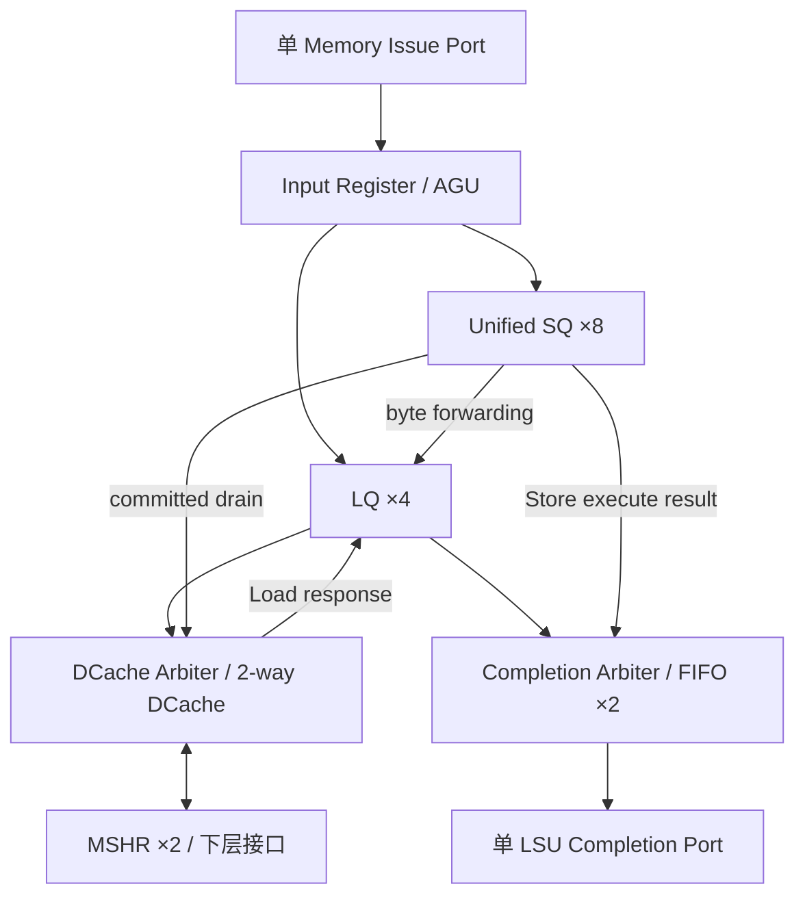

# RV32IM 访存微架构设计文档

版本：v0.7.0
接口依据：`backend.md` 第 9.6、10–11、14.6、15–17 节。

## 1. 目标与当前配置

面向 strict in-order 4-issue、OoO Completion、in-order Commit 后端。保留单 Load/Store Memory Issue Port，通过队列解耦、Store forwarding 和 non-blocking DCache 降低访存对连续前缀 Issue 的阻塞。

当前定义普通、自然对齐的 RV32I Cacheable Load/Store，以及第 3.1 节的非推测 MMIO 路径。misaligned、FENCE/FENCE.I、通用访存异常与 Bus Error 暂不实现。

| 项目 | 当前高性能基线 |
|---|---|
| Memory Issue Port | 1 个，支持 Load/Store，最多 1 条/cycle |
| 入口与 AGU | Input Register + pipelined AGU；资源充足时 II=1 |
| LQ | 4 entries，bitmap 空位分配、独立推进、乱序完成 |
| Unified SQ | 8 entries，按 Store Issue 顺序环形分配，SPEC / COMMITTED 共用 |
| DCache | 4/8/16 KiB（默认 8 KiB），2-way，`LINE_BYTES=16/32/64`（默认 32），Write-back / Write-allocate；前台最多 1 lookup/cycle |
| MSHR | 2 entries，各带完整 line refill buffer；支持 hit-under-miss / miss-under-miss、同 line Load 合并及 Store merge |
| Store forwarding | byte-wise，覆盖 SPEC 与 COMMITTED Store |
| Writeback Buffer | 2 entries，完整 dirty victim line，后台异步写回 |
| Shared Fabric Write Queue | 4 entries（16B/entry），按接收顺序排空；冲突 Read 等待、无冲突 Read 可并行 |
| Load Hit Fast Path | 无争用时 Issue 后第 3 个周期登记 CIQ DONE；后续周期消费者才可 Issue |
| Store Commit | 最多 2 Stores/cycle |
| SQ drain | 最多 1 Store/cycle，仅最老 COMMITTED Store |
| LSU Completion | 1 port，最多 1 completion/cycle，无 backpressure |
| Completion FIFO | 2 entries，参数化；每周期最多 1 入队 / 1 出队 |
| MMIO | LSU AGU 后地址分类；独立单 Outstanding 设备请求/完成通路，不进 DCache/MSHR/Fabric WQ |

LQ 数量表示已接受但尚未向 CIQ 完成的 Load 数；MSHR 数量表示可同时跟踪的不同 cache line miss 数。首版共享下层仅读取单 Outstanding，两个 MSHR 允许内部并发跟踪但下层读事务串行；单端口 DCache 的 Load/Store 带宽共享。

## 2. 模块连接



## 3. Issue 接收与队列预留

沿用后端 guaranteed-accept 协议：

| 方向 | 信号 | 含义 |
|---|---|---|
| LSU → Scheduler | `lsu_can_accept` | 入口本周期能保证接收一条请求 |
| LSU → Scheduler | `load_credit / store_credit` | 对应队列尚未预留的容量 |
| Scheduler → LSU | `issue_valid / fu_req_t` | 已获端口和队列容量的请求 |
| Backend → LSU | `kill_mask[15:0]` | 取消对应 CIQ operation |
| Commit → LSU | `load_head_valid/tag` | 指示 Commit Head 是 `EXEC` Load；MMIO 属性由 LSU 内部 AGU 决定 |
| LSU → CSR/Commit | `lsu_mmio_order_idle` | 不存在尚未完成的已提交 MMIO 副作用 |
| LSU → Backend | `completion_valid / fu_completion_t` | 单周期 Completion 事件 |

Scheduler 同时检查端口兼容性、`lsu_can_accept` 和对应 Load/Store credit；获 grant 后 `issue_fire = issue_valid`，没有第二次 ready 仲裁。`can_accept` 不组合依赖 `issue_valid`；credit 基于已登记状态，不依赖本周期释放容量。

`issue_fire` 时原子预留 LQ 或 SQ entry；Input Register / AGU 携带所分配的 entry index，后续不得再次分配。`load_credit / store_credit` 按周期初占用计算，不借用本周期释放容量。AGU 计算 `addr = src1 + imm`，并产生访问大小、byte mask、Store 对齐数据等信息。

### 3.1 Uncached MMIO（RT-Thread 最小路径）

AGU 在获得有效地址后按**SoC 参数化物理地址窗口**标记 `is_mmio`；MMIO 仍使用原 LQ/SQ 预留、单 LSU Issue/Completion，不进入 DCache、MSHR、Store Forwarding 或 Fabric Write Queue。首版只支持自然对齐的 8/16/32-bit 小端设备访问，写数据按 32-bit 字节 lane 对齐并形成对应 `wstrb`，Load 结果按 LB/LH/LW/LBU/LHU 扩展；设备窗口必须与 Cacheable 地址范围不重叠，严禁别名访问。MMIO 通过单 Outstanding、请求/完成均握手的独立设备 Bridge：`mmio_req_valid/ready, write, addr[31:0], wdata[31:0], wstrb[3:0]`，`mmio_rsp_valid/ready, rdata[31:0]`；**每次 req_fire 恰好一次 response，Write Response 必须表示设备副作用真正完成**。无响应/无限等待视作外设集成错误；本版没有设备错误 Trap。

- **MMIO Load**：AGU 登记地址后在 LQ 等待；只有后端 `load_head_valid && tag_match`（该 Load 为 Commit Head；Backend 无需知道 MMIO 地址）且**全部较老已提交 Store 已从 SQ 接管、较老 MMIO Write 已收到完成响应**，才可发送一次设备 Read；直到响应确认才允许 Load Completion，然后正常提交 GPR。读设备产生的副作用不得在获得 Head 授权前发生，Kill/旧响应不能重复交付。
- **MMIO Store**：执行阶段只登记 SQ `{addr,data,mask,is_mmio}` 并按原路径产生一次 Store Execution Completion；收到 `store_commit_fire` 后变为 COMMITTED，作为 SQ Head 才能发出设备 Write；收到 **Write Response**（副作用完成）后才 `store_takeover` 并释放 SQ。Commit 后的 MMIO Store 不依赖原 CIQ slot，绝不被 Flush kill；不得把设备 `req_ready` 误认作完成。
- **严格设备顺序**：一个时刻最多一个 MMIO 事务；MMIO 操作不能越过更老 SQ Store，进入设备前需等待这些 Store 达到 Cache/MSHR takeover 或 MMIO Write Ack。`lsu_mmio_order_idle=1` 当且仅当不存在已提交但尚未确认完成的 MMIO Store/设备请求，按周期初登记状态产生、不组合借用本周期响应；CSR/ECALL/MRET 的序列化 Issue 和 IRQ Trap Entry 等待该信号。普通 Cacheable Load/Store 的原有并发路径不变。
- **Timer**：SoC 另外提供 64-bit `mtime/mtimecmp` MMIO 寄存器与同步化后的电平 `timer_irq = (mtime >= mtimecmp)`，连接 Backend `mip.MTIP`；地址由 SoC/BSP 统一定义，Cold Reset 时可置 `mtime=0, mtimecmp=64'hFFFF_FFFF_FFFF_FFFF`；RV32 高/低 32-bit 访问顺序由驱动保证，跨时钟域时 Pending 电平同步。首版只启用 MTI，不引入其他中断控制器。

## 4. Load 执行

### 4.1 LQ 生命周期与排序

LQ 采用 **4-entry valid bitmap + free-slot priority allocation**；各 entry 独立推进，不按 FIFO 回收。每个 entry 至少保存 `alive/tag、addr_valid、addr/size、older_store_mask[7:0]、lookup_inflight、mshr_wait、forward_mask/data、result_valid、completion_queued`。`dep_ready` 由仍相关的较老 Store 地址/数据就绪状态组合产生（可寄存），**不设置独立 `DEP_WAIT` 主状态**。MMIO Load 额外维护 `is_mmio/mmio_wait_head`，不创建 Cache Lookup、MSHR 或 Forwarding Snapshot。另维护 4-entry LQ 分配顺序表（可删除任意已完成项），用于“最老可服务 Load 优先”的内部仲裁，不影响乱序完成。

- Issue 时预留 LQ；AGU 登记地址后置 `addr_valid=1`。只有 `addr_valid && dep_ready` 才能确认 forwarding snapshot 并发起有效 DCache lookup；未就绪时留队，不阻塞其他可服务 Load。
- Cache 未接收请求时保留待请求状态；已接收 lookup/miss 的 entry 通过 `lookup_inflight/mshr_wait` 跟踪，不重复发起。Miss 返回后将结果保存在 LQ，MSHR 在不再承担 waiter/Store 责任时可先行释放。
- Full forwarding 或 Cache 数据与 snapshot 合并完成后置 `result_valid`；由第 7 节在 **Fast Path 直通**与 **Completion FIFO 入队**之间只选一条所有权转移路径，避免重复发送。只有 Completion **从 LSU 端口实际发出**或 Flush kill 时才释放 LQ。

### 4.2 Older Store Mask 与 Forwarding

**利用单 Memory Port 的 strict in-order Issue**：每条 Load 接收时，所有仍需由 SQ 负责的较老 Store 已经占用 SQ（包括入口/AGU 中尚未登记地址的 Store）。无需向 Backend 请求 CIQ 年龄比较。

```systemverilog
// Load issue 同周期锁存；takeover 仅在数据可见性责任已转移时有效
lq_new.older_store_mask = sq_occupied_bitmap & ~sq_takeover_mask;
// 对所有存活 LQ entry，每次 Store takeover 时清除对应位
lq[i].older_store_mask_next = lq[i].older_store_mask & ~sq_takeover_mask;
```

新分配的年轻 Store **不得**加入已有 LQ mask。SQ slot 被复用前，旧 Store 必须已 takeover、对应 mask 位已清除。Flush 取消年轻 LQ；不会留下依赖已被 squash 的较老 Store 的 surviving Load。

1. `dep_ready` 要求 mask 中仍有效的所有较老 Store 地址和数据均已就绪；不预测未知地址，也不使用事后 replay。
2. 对 `older_store_mask` 中的 SQ entry 并行比较字节地址；按 `sq_head_ptr → sq_tail_ptr` 的逻辑顺序，后面的匹配 Store 覆盖前面的 Store，逐 byte 选择**最近的较老 Store**；未覆盖的 byte 从 DCache 获取。
3. Forwarding 比较可与只读 Cache lookup 并行，但在依赖尚未确认时不得采用 Cache 结果或发出不可撤回的 miss；在 MSHR 分配和下层 miss 请求前抑制 full-forward 的无用 miss。
4. 将 `forward_mask/data` 锁存在 LQ，直至结果合并；Store takeover、SQ drain、slot 复用不影响该快照。合并后按 LB/LH/LW/LBU/LHU 选择字节并符号/零扩展。
5. **可见性边界**：SQ 中即将 takeover 的 Store 在本周期仍参与已有 Load 的 forwarding/旁路；仅当 DCache/MSHR 已保证后续 lookup、未完成 waiter 均可观察到该 Store，才可在时钟沿清除 mask。Store hit/Refill 与 Load 读同地址的先后顺序由 DCache 仲裁保证，不得存在释放至可见之间的空窗。

COMMITTED Store 的原 CIQ tag 可失效，forwarding 只使用 SQ 顺序与 `older_store_mask`，不能依赖旧 CIQ slot 的年龄。

## 5. Store 执行、Commit 与 drain

### 5.1 Unified SQ 生命周期与顺序

SQ 采用 **8-entry 有序 Ring Buffer**，按 Store Issue 顺序分配，逻辑顺序始终为 `[COMMITTED 前缀][SPEC 后缀]`，不设置独立 Store Buffer，不额外生成全局年龄 ID：

```text
sq_head_ptr    = 最老尚未 takeover 的 COMMITTED Store（无 COMMITTED 时指向队首）
sq_commit_ptr  = 最老尚未 Commit 的 SPEC Store
sq_tail_ptr    = 下一条 Store 的分配位置
sq_occupancy   = SQ 有效 entry 数；sq_committed_cnt = COMMITTED 数
```

不变量：`sq_commit_ptr = (sq_head_ptr + sq_committed_cnt) mod 8`，`sq_tail_ptr = (sq_head_ptr + sq_occupancy) mod 8`。空/满以计数判断，不依赖指针相等。Store Issue 在 tail 预留 SPEC entry，记录 `CIQ tag、addr_valid/data_valid、addr、aligned_data、byte_mask、execute_completion_pending、drain_inflight` 等；AGU 登记地址，地址/数据及支持的执行检查完成后仅产生 **一次** execution Completion。执行完成不写 DCache；提交前不能发生不可撤回的访存副作用。

SPEC → COMMITTED 只更新原 SQ entry 标志；COMMITTED 不再依赖原 CIQ tag，按 head 有序 drain。MMIO Store 在 AGU 后记录 `is_mmio`，Commit 前不得执行设备 Write，Commit 后仅在 SQ Head 通过第 3.1 节 MMIO Bridge 完成并收到 Write Ack 才释放。`drain_inflight` 防止尚未 takeover 的请求重复发送；只有 `store_takeover` 或 SPEC Flush 可以释放 SQ entry。

同周期令 `a`=Store Issue 数（0/1）、`c`=Store Commit 数（0–2）、`t`=head takeover 数（0/1）、`k`=Flush 删除的 SPEC **年轻后缀**项数：

```text
head_next          = head + t
commit_ptr_next    = commit_ptr + c
tail_next          = tail + a - k
occupancy_next     = occupancy + a - t - k
committed_cnt_next = committed_cnt + c - t
```

指针按 mod 8 更新，计数按整数更新。Flush 周期 `a=0`；Commit 仅针对未被 kill 的 Store，takeover 仅针对周期初 COMMITTED head。所有变化同沿原子生效；Issue credit 不使用本周期 takeover/kill 释放的空位。

### 5.2 2-wide Store Commit

Backend 提供两个有序的 `store_commit_valid/tag` 候选，LSU 分别返回 `store_commit_ok`，并接收对应 `commit0_fire / commit1_fire`。

- `store_commit_ok`：候选 tag 必须按全局 Commit lane 顺序匹配 `sq_commit_ptr` 起连续的 SPEC Store（跳过非 Store 的全局 lane），且地址/数据与必要检查已完成；只检查既有状态，不依赖 `commit_fire`。
- 实际状态更新仅由对应 `commit_fire` 触发；Backend 同时检查 CIQ `DONE && !exception && !kill`，第二条以第一条实际提交为前提。
- 同一沿原子完成最多两个 SQ `SPEC → COMMITTED` 与对应 CIQ 释放；新 COMMITTED Store 最早下一周期参加 drain。
- SQ 已在 Issue 时分配，Commit 不要求新空位，也不等待 DCache。第一条可提交而第二条不可提交时，允许只提交第一条；非 Store 的全局 lane 不消耗 SQ entry。

2-wide Store Commit 改善退休突发带宽和 CIQ 回收速度；长期 Store 吞吐仍受 DCache 与下层带宽限制。该通道与 execution Completion 独立，因此不要求双 LSU Completion port。

### 5.3 DCache 接管

仅最老 COMMITTED Store 可 drain。若其请求已发出但尚未 takeover，保持 `drain_inflight` 并等待响应/重试，不重复发送。普通请求接收或 lookup 启动不等于接管；SQ 只有收到 `store_takeover` 才可释放。若 SQ Head 为 MMIO，则按第 3.1 节等待设备 Write Ack，而非发起 DCache Lookup。

`store_takeover` 表示 DCache 已不可撤销地接管地址、数据、mask 与顺序责任，保证后续相关 Load 观察到该 Store。

- Store hit：cache line 更新生效后可以 takeover。
- Store miss：目标为 **Early Takeover**；仅当 MSHR 已保存 Store 数据、保证有序 byte merge，以及既有/后续 Load 的正确可见性时才允许提前 takeover。
- 未实现上述 MSHR 保证时，SQ 保持 COMMITTED 并参与 forwarding，直到 refill 后 Store 更新生效；在途 Store 请求不得重复发送。

需要精确上报的同步 Store 错误须在 Commit 前确定；提交后总线错误的处理留待完整异常协议。

## 6. 参数化 2-way Non-blocking DCache / MSHR

### 6.1 参数与物理组织

| 项目 | 第一版基线 |
|---|---|
| 容量 | `DCACHE_SIZE_BYTES = 4/8/16 KiB`，默认 **8 KiB** |
| 相联度、Line | `NUM_WAYS = 2`，`LINE_BYTES = 16/32/64`（默认 **32**）；`NUM_SETS = DCACHE_SIZE_BYTES/(NUM_WAYS*LINE_BYTES)` |
| 替换与写策略 | 2-way 1-bit LRU；Write-back + Write-allocate |
| Tag/Data | 每 Way 的 Data RAM 为 **1R1W 简单双端口**：同步只读 R + 带 byte-enable 的只写 W，64-bit row；两 Way 独立。Tag/Valid/Dirty/LRU 元数据与 Data RAM 分开维护 |
| 并发资源 | 2 MSHR（各 `8*LINE_BYTES`-bit refill buffer、`LINE_BYTES`-byte Store overlay）、2-entry `8*LINE_BYTES`-bit Writeback Buffer |
| 下层 | 自定义 128-bit Memory Bus，16B 对齐、单次 16B、无 burst/外部 ID；共享读最多 1 outstanding（§6.7） |

`INDEX_BITS=$clog2(NUM_SETS)`；`OFFSET_BITS=$clog2(LINE_BYTES)`；`TAG_BITS=32-INDEX_BITS-OFFSET_BITS`。`LINE_BEATS=LINE_BYTES/16`（1/2/4），64-bit Data Row 数=`LINE_BYTES/8`（2/4/8）；MSHR 的 `refill_line/beat_valid/store_overlay`、WB 的 `line_data`、Refill/Install 计数与字节掩码均据此参数化。要求 `LINE_BYTES` 为 16/32/64 且容量整除组大小；第一版仍为 2-way。

### 6.2 Load Hit 时序（第一版 3-cycle Stall 目标）

以 `C0` 周期末接收 `issue_fire` 为起点，以下是**无资源冲突、Store 依赖就绪且 LSU Completion Port 可直通**的目标时序：

| 周期 | LSU/DCache 行为 | 后端可见行为 |
|---|---|---|
| C0 | Issue 接收并预留 LQ | Load 进入 EXEC |
| C1 | AGU 计算/登记地址，确认 Store 依赖和 forwarding snapshot | 依赖 Load 的消费者等待 |
| C2 | 两 Way Tag/Data RAM 同步读 | 消费者继续等待 |
| C3 | Hit Compare、Word Select、Forwarding Merge、扩展；**Fast Path 直接发出 LSU Completion** | 周期末 CIQ 写入结果并转 DONE |
| C4 | — | 依赖消费者最早可 Issue |

因此无争用的 Load-use 为 **3 个 Issue Stall cycles（C1–C3）**，不是固定访存延迟保证：Miss、Store 依赖、端口仲裁、Completion 拥塞均可延长时序。Fast Path 不依赖同周期 FU→Consumer 转发，也不要求改动 `backend.md` 的 Completion 接口。

### 6.3 Lookup、RAM 端口及同周期仲裁

**每 Way 使用独立 1R1W RAM**：R 负责 Lookup / Dirty Victim Capture，W 负责 Store Hit Write / Refill Install；MSHR Refill、Overlay 与 WB 为独立存储。前台最多接收 1 Lookup/cycle：C2 发起同步读并寄存请求 Owner，C3 完成 Hit/Miss/`RETRY` 判定，保持 §6.2 的无冲突 Fast Path。C2 并行比较两个 MSHR `line_addr`；命中在途 MSHR 时可跳过 Data RAM 读，直接走 C3 的合并/重试判定。

| 端口/资源 | 同周期仲裁与流水线规则 |
|---|---|
| 各 Way 的 R | 常规 Lookup 同时申请两 Way 的 R（命中 MSHR 的旁路除外）；Capture 只申请 Victim Way。Lookup 优先，Capture 连续让行 4 次后提升优先级并可阻塞该周期 Lookup；不同 Way 的 Capture 可并行。 |
| 各 Way 的 W | Pending Store Hit Write 与该 Way 的 MSHR Install 竞争，**同 Way 每周期最多写一个 Row**；不同 Way 可并行写。未获 grant 者保持请求及 Row index；公平仲裁，保证均能推进。 |
| R + W 同 Way | 不同 Row 可同周期读写；**相同 Row 无论 byte mask 是否重叠，均禁止同沿 R/W**。Row 地址为 `set_index * ROWS_PER_LINE + line_offset / 8`（`ROWS_PER_LINE=LINE_BYTES/8`）；grant 前做 Hazard Check，不依赖 FPGA RAM 的 read-during-write 语义。 |
| Tag/元数据与 Way Lock | 同 Set/Way 的预约、Install 发布和 Lookup 必须校验最新登记的锁/元数据；命中旧 Victim 或部分安装数据则 `RETRY`。每 Way 的 Tag/Valid/Dirty 独立更新；同 Set 多个 LRU 更新按 `Lookup Hit > Store Hit Write > MSHR1 Install > MSHR0 Install` 选一次确定性写入。 |

- **请求所有权**：LQ Load 与最老 COMMITTED SQ Store 公平仲裁产生 `lookup_valid/ready`（SQ 高水位可提高权重）；`lookup_fire` 只表示 C2 接收请求，锁存 `{owner_type,owner_idx,line_addr,set,row,mask,mshr_bypass}`。C3 恰好返回 `LOAD_HIT / STORE_HIT / MSHR_ACCEPT / RETRY` 之一；`RETRY` 仅在 LSU 内重新仲裁，**绝不重复 Backend Issue**。Full-forward Load 不占 Lookup/MSHR。
- **C2/C3 跨周期校验**：C3 以**当前已登记**的 MSHR/Way Lock、WB 可见性和 Pending Write 状态重新判定，不直接信任 C2 读出的旧 Tag/Data。优先处理同 Line MSHR；命中锁定的旧 Victim、Install 未发布 Line、不可见 WB Line 一律 `RETRY`；安全 Cache Hit 才返回数据，否则尝试 RESERVE。C2 读与前一请求的 C3 `reserve_fire` 同沿可重叠，下一周期 C3 必须识别新锁。`mshr_bypass` 失效时只能 `RETRY`，不得伪造未读取的 Hit 数据。
- **Store Hit**：C3 将 `{SQ index,set,way,row,data,byte_mask}` 放入 **1-entry Pending Store Write**；仅当目标 W 端口实际写入生效 (`store_hit_write_fire`) 才产生 `store_takeover`，不得在 Lookup 命中时提前释放 SQ。待写寄存器支持旧请求写入、下一请求同沿接替（pop+push）；若无法接收则返回 `RETRY`。
- **冲突与先后**：Pending Store Write 未生效时禁止新 Miss 把其目标 Line 选为 Victim；锁定 Victim 后，新命中旧 Line 的 Store/Load 等待或 `RETRY`。同周期 Store Hit Write 与 Capture/Lookup 读同 Row 时阻止冲突读；已在上一周期发起的读取使用锁存结果完成，不被后来写入追溯修改。Store Takeover 沿的新旧 LQ Snapshot 依 §4.2 保持旧 SQ 可见性。
- **吞吐边界**：正常 Lookup II=1，W 端口 Store/Install 可与无冲突 Lookup 并行；Capture 必须占用 R，故其 grant 周期可能阻塞全局 Lookup，但 Miss 在等待下层响应时不占读端口，仍支持 hit-under-miss。读端口争用计数供 §9 Profiling 使用。

### 6.4 MSHR / Refill：逐周期所有权与状态转移

每个 MSHR 只跟踪一个不同的 physical cache line，至少保存 `line_addr、state、reserved_set/way、victim_wb_idx、capture_req_idx、capture_rsp_idx/valid、install_row_idx、refill_line、beat_valid、load_waiter_mask[3:0]、store_overlay_mask/data`，以及下层 Read owner/进度。同 Line 请求优先合并，禁止重复分配；C3 Miss 接受沿原子 RESERVE **MSHR + Way Lock +（Dirty 时）WB Entry**。只有空闲 MSHR、未锁 Victim Way、所需 WB 空位均为周期初可用，且 Victim 不存在未生效的 Pending Store Write、旧 WB Line 不存在读可见性风险时才 `reserve_fire`；否则 `RETRY`，不借用同沿预计释放的资源。两个 MSHR 可预约同 Set 不同 Way。

| 状态 | 每周期行为 | 转移条件（状态变化发生在时钟沿） |
|---|---|---|
| `FREE` | 等待 C3 Miss 资源判定 | `reserve_fire` → `RESERVE`，同时锁定 Way、初始化首个 Load waiter 或 Store overlay |
| `RESERVE` | 维持预约/锁；Dirty 可直接申请第一个 Victim Row 的 R 端口，避免空转 | Dirty 首次 R grant → `VICTIM_CAPTURE`（无 grant 留在本态）；Clean → `READ_BEATS` |
| `VICTIM_CAPTURE` | 逐 Row 申请 Victim Way 的 R；同步 RAM 读响应下一周期存入已预留 WB Entry | **最后一个 Row 的数据已写入 WB** → `READ_BEATS`（不能仅凭最后一次 R grant） |
| `READ_BEATS` | 每次只发一个 16B Read，接收响应后更新 `refill_line/beat_valid`，共享 Fabric 单 Outstanding；允许合并 waiter/overlay | 最后一个 Beat 响应接收沿后 → `INSTALL`；该沿先保留所有合法 Overlay 更新 |
| `INSTALL` | 冻结新增 waiter/overlay；逐 Row 用目标 Way 的 W 写入 `refill_line` 与 Overlay 的 byte-wise merge | 最后一 Row 写入生效，**同时**更新 Tag/Valid/Dirty/LRU → `WAKE` |
| `WAKE` | 每个 MSHR 每周期最多向 1 个存活 LQ waiter 交接完整结果，已 Kill waiter 只清位；两个 MSHR 可同时写**不同 LQ Entry** | 全部 waiter 已交接/取消、无遗留外部响应 → `FREE`，释放 Way Lock |

- `capture_req_idx / install_row_idx` 只在对应 R/W grant 时推进；Capture 的 R response 延后一周期，携带寄存的 `{WB index,row index}` 交接数据，`capture_rsp_valid` 独立于下一次 R grant。32B Dirty Miss 在 C3 沿 RESERVE、C4 首次 R grant、C5 捕获 Row0 并读 Row1，连续无争用时 C8 捕获 Row3，C9 最早开始 Refill Read；**最后一次 R grant 不等于 Capture 完成**，所有 WB Row 已写入才置 `capture_complete`。
- `INSTALL` 的合并按每 Byte 执行 `overlay_mask ? overlay_data : refill_line`；Overlay 与最后 Refill Beat 同沿时分别登记，下一周期才允许 Install。`install_last_fire`（最后 Row 真正写入）沿原子发布新 Tag/Valid/Dirty（Dirty 取决于是否有 Store Overlay）与 LRU，提前写入的 Row 始终不可命中；首版 WAKE 期间新同 Line Lookup 仍 `RETRY`，直至释放锁。
- WAKE 只向已预留 LQ 的 `result/result_valid` **交接结果所有权**，不等待单 LSU Completion Port；LQ per-entry 写使能支持两个 MSHR 分别 WAKE，不覆盖 `result_valid`。Flush kill 优先于同周期 WAKE；已接管的 committed Store Overlay 和在途总线事务继续保留。

### 6.5 Store Overlay、Takeover 与同周期事件规则

- **Store Hit**：只在对应 W 端口 `store_hit_write_fire` 沿完成 Cache Byte Write 与 Dirty 更新，随后 `store_takeover`；写入前 SQ 保留 COMMITTED Store 并参与 Forwarding。
- **Store Miss / 在途 MSHR**：只在 `RESERVE/VICTIM_CAPTURE/READ_BEATS` 接受 Store Overlay；SQ head 按程序顺序进行 byte-wise 更新，新 Store 覆盖旧 Store 相同 Byte。`store_overlay_fire` 在同一沿保存完整 `{mask,data}` 并触发 **Early Takeover**、SQ mask 清除；不满足可见性/资源条件时 SQ 继续持有 Store，不得重复接管。`INSTALL/WAKE` 停止 Overlay，相关 Store 等待/`RETRY`，安装后经正常 Hit 路径更新。
- **允许并行**：Overlay 更新的是**新 Line**，Dirty Capture 读取的是**旧 Victim Line**；各自使用独立缓冲，Overlay 不占 RAM R/W，可与 Capture、Refill Response 同沿。最后 Beat + Overlay 同沿时先同时登记，下一周期才启动 INSTALL。
- **禁止竞态**：Store Hit Write 与相同 Row 的 Capture R 不得同沿；**已经排队的 Victim Line Store Write 必须在 Victim RESERVE 之前生效**，否则 Miss `RETRY`。被锁定的旧 Victim 禁止新 Store Hit Write；不同 Way/Row 的正常读写按 §6.3 并行。
- **Load 可见性**：仅 `store_hit_write_fire || store_overlay_fire` 可触发 `store_takeover`；前者已完成 Cache Byte Write/Dirty 更新，后者已原子保存全部 `{mask,data}` 及按 SQ 顺序覆盖旧 Overlay。takeover 沿前既有 Load 的 forwarding snapshot 仍可使用 SQ Store；沿后 Cache/MSHR 承担可见性。数据按 `Refill/Cache → Store Overlay → LQ forwarding snapshot` 的 byte 优先级合并，严禁使用旧 Line/部分 Install 数据。

### 6.6 Dirty Victim 与 Writeback

2-entry Writeback Buffer 保存 `{state,line_addr,line_data[8*LINE_BYTES-1:0],capture_row_valid,beat_idx}`，状态至少区分 `FREE/CAPTURING/READY/DRAINING`。Dirty Victim 在 RESERVE 时预留 WB Entry；Capture 使用**Victim Way 的 R**（64-bit Row/cycle、同步返回后一周期写入 WB），完整数据/地址已转交 WB 后才能覆盖 Cache Way。Clean Victim 无需 WB；WB `READY` 后按 §6.7 逐笔发送 `LINE_BEATS` 个 16B Full-Byte-Enable Write，满足全部接管及写后读可见性保证后释放。

如果请求命中仍由 WB/下层持有且写后读尚不可见的旧 Victim Line，继续等待/`RETRY`，不从下层读回旧数据。MSHR 释放不等待该 WB 完成；WB 不依赖已释放 MSHR 的 slot/tag。WB forwarding 留作后续优化。

### 6.7 自定义 128-bit Memory Bus 与所有权

采用与 `miniTensor.md` §4.2 兼容的 **16B/beat、16B 对齐、无 Burst/外部 ID** 接口：

```systemverilog
// 从 Bus Master 视角定义方向
output logic         mem_rd_valid;
input  logic         mem_rd_ready;
output logic [31:0]  mem_rd_addr;
input  logic         mem_rsp_valid;
output logic         mem_rsp_ready;
input  logic [127:0] mem_rsp_data;
output logic         mem_wr_valid;
input  logic         mem_wr_ready;
output logic [31:0]  mem_wr_addr;
output logic [127:0] mem_wr_data;
output logic [15:0]  mem_wr_be;
```

- **Cache Line Adapter**：一条 Refill/WB 拆成 `LINE_BEATS=LINE_BYTES/16` 笔；第 `b` 笔地址为 `line_base+16*b`，低 `128*b` 位对应一笔 128-bit 数据。WB 和当前 miniTensor DMA 均使用 `mem_wr_be=16'hFFFF`。
- **Read**：`rd_valid && rd_ready` 接收一笔 16B 请求；`rsp_valid && rsp_ready` 结束该笔事务。首版**整个共享 Fabric 最多一个未完成 Read**，从请求接收到响应完成期间锁存 owner（CPU MSHR/miniTensor），响应只能交给该 owner；下一笔读须等待前笔完成。MSHR 在收到完整 `LINE_BEATS` 个响应后才能进入 `INSTALL`。请求/响应在被反压时字段保持稳定，接受请求前预留响应空间。
- **Write Acceptance（首版基线）**：`wr_fire = mem_wr_valid && mem_wr_ready` 原子接管一笔 `{addr,data,be}`。共享 Fabric 配置 **4-entry、16B/entry 的有序 Write Queue**；`wr_ready` 仅在队列有已登记空位且能可靠锁存该笔写入时为 1，满时反压，未握手的请求及字段保持稳定。队列内写入按接收顺序向下层发送，同字节的多次写不可乱序或丢失；无 B 通道。WB 的全部 Beat 完成上游 `wr_fire` 后即可释放，**不必等待物理写完成**，数据与可见性责任转交 Fabric。
- **Write Visibility / Ordering**：Fabric 仅在下层**写入已生效**，或下层明确保证“已接管的写对后续冲突读有序可见”时，才可移除对应 Pending Write。否则必须保留其可见性跟踪并取得下层完成确认，不能把普通下层 `ready` 擅自当作写完成。共享 CPU WB/miniTensor DMA 的所有尚未达到上述可见性点的写入均参与 Hazard Check：对后续 16B Read，若地址与任一 Pending Write 的有效 `be` 字节重叠，则暂不接受/下发该 Read；无冲突 Read 可以旁路继续执行。**同周期冲突 Write 与 Read 按 Write 先于 Read 排序**；Fabric 保持整个共享下层最多 1 个未完成 Read 及原有 Read owner 不变量。下层必须实现或明确证明上述顺序保证。
- **共享仲裁（推荐 SoC 集成方式）**：CPU Cache Line Adapter 与 miniTensor uncached DMA 经公平仲裁接入同一 Fabric；Write Queue 出队须保证前进性，不能被持续 Read 饿死。此处仅约束 Fabric 内已经交接的访存顺序，不提供硬件 Cache Coherence；CPU 与 DMA 不得通过 cacheable/uncached alias 并发访问同一缓冲区，DMA Buffer 的 CPU uncached 路径/软件同步另行定义。
- **Cold Reset（首版）**：仅支持**整个 CPU/LSU/Cache/Fabric/Memory Controller 协调的 Cold Reset**；停止接收新请求，复位前未写回的 Dirty Line、COMMITTED SQ 与 Pending Write **不保证保留**，软件必须重新初始化相关内存。重新允许 Read/Write 前，下层必须已取消、排空或可靠隔离旧事务，确保旧 Read Response 不会被无 ID 的新 owner 接收；不能只清空 MSHR/WQ 的 valid 就立即重用通道。需要保留内存内容的 Warm/CPU-only Reset 暂不支持，须另定义 SQ drain、Dirty Flush、Fabric 写入完成与旧响应隔离协议。
- **范围限制**：当前无外部总线错误反馈；FENCE、精确 Bus Error 及外部一致性不在本版契约内。MMIO 走第 3.1 节的独立完成确认接口，不可误用这里无 B 通道的普通内存写入接收协议。多 Outstanding/Transaction ID 仅保留为 §9 的可选扩展，不影响 LQ/SQ/MSHR 内部接口。

### 6.8 同周期优先级与关键不变量

- **状态/响应优先级**：Flush kill 对 LQ waiter 交接与 Completion 优先；C3 对未被 kill 的在途 `lookup_fire` 必须唯一返回 `LOAD_HIT / STORE_HIT / MSHR_ACCEPT / RETRY`；被 kill 请求仅取消 Owner。两个 MSHR 同周期操作同 Set 时，Way Lock 独立，LRU 按 §6.3 固定仲裁。
- **前进性**：R 端口 Capture 采用有界优先级提升；W 端口 Store Hit Write / Install 公平仲裁。RAM 读/写 grant 不得遗漏或重复，Owner 和 Row index 在未获 grant 时保持。
- **建议断言**：同 Way 不存在同 Row R/W；同 `(set,way)` 不被两个 MSHR 预约；同 Line 不重复分配 MSHR；未完成 Capture 不覆盖 Dirty Victim；`store_takeover` 必有 Cache Write/Overlay 接管；Kill waiter 不写 LQ；每个存活 Load/Store 仅一次 LSU Completion；Fabric 已接受 Write 不丢失/乱序，同字节冲突 Read 不越过未可见 Write，Reset 后无旧 Response 误归属。

## 7. Completion 汇聚与 Load Hit Fast Path

Load hit、miss return、full-forward 和 Store execute 结果保存在对应 LQ/SQ 的 pending 状态，由单 LSU Completion Port 输出（最多 1/cycle，无 backpressure）。**Load Hit Fast Path** 允许 C3 的 Hit 结果在组合仲裁获选时直接输出，不额外经历 FIFO 存储一级：

1. 仅在 FIFO 为空、没有必须先处理的 pending Completion、当前端口可分配且 `!kill_mask[tag]` 时直通；否则结果锁存 LQ `result_valid`，进入后续公平仲裁，不丢失、不重复输出。
2. 其他结果和未直通的 Hit 通过 2-entry Completion FIFO 缓冲；FIFO 最多 1 入队/1 出队，每个源结果只拥有一次入 FIFO 或直通的发送权。多个 MSHR waiter 同时完成时逐个排队。
3. LQ 只有在 Completion **实际从 LSU Port 发出**或 Flush kill 时才释放；直通与入 FIFO 互斥，入 FIFO 后原源 pending 清除。
4. Kill 与当周期 Hit/Completion 同时命中时 kill 优先；FIFO/内部返回通过握手或预留空间消除反压丢失。所有未被 kill 的 operation 最终恰好发送一次 Completion；最早为 Issue 的下一周期。

**3-cycle Load-use 为无争用 Fast Path 目标**，并非保证上限；原有单 Completion Port 和 Backend CIQ 下一周期结果可见规则不变。

## 8. Flush 与旧响应隔离

Backend 继续采用 valid-only，不增加 generation 到 `tag_t`。

1. Flush 同步取消命中 `kill_mask` 的入口/AGU、LQ、SPEC SQ、pending 结果和 FIFO 有效项。SQ 被 kill 的 SPEC Store 必须构成最年轻的连续后缀，按 5.1 节回退 tail/计数；COMMITTED 前缀不变。kill 优先于同周期 Completion；surviving operation 保留。
2. COMMITTED Store（含等待 Write Ack 的 MMIO Store）及 DCache 已接管的 Store 数据必须保留，不受旧 CIQ slot 后续复用和 kill 影响；surviving LQ 的 `older_store_mask` 仅因真正 takeover 清位。
3. 不可撤回的 Cache/Bus 请求由内部 MSHR owner 和有效 waiter 关联；取消时清除被 kill waiter 的返回权限，旧响应可用于 Refill，但不得写入复用后的 LQ/CIQ。外部总线无 ID，唯一 Read owner 在响应完成前不得释放或复用。
4. 内部 MSHR/请求 owner 在旧响应消费或取消确认前不得复用；若未来使用本地 transaction ID/epoch，须证明不发生回绕误匹配。共享 MSHR 仅取消被 kill 的 waiter，保留 surviving waiter 与 committed Store 数据。

验证环境可维护 `debug_allocation_generation` 检查跨生命周期错误，不进入后端硬件协议。

## 9. Profiling 后的扩展选项

**以下方案当前不启用，不改变本版单 Memory Issue Port / 单 Completion port 基线。**

### 9.1 非对称双 Memory Issue Port

| 项目 | 候选扩展 |
|---|---|
| MEM0 | Load/Store，独立入口寄存器与 AGU |
| MEM1 | Load-only，独立入口寄存器与 AGU |
| 共享状态 | 统一 LQ/SQ、forwarding、DCache、MSHR、下层接口 |
| 同周期组合 | Load+Load、Store+Load、Load+Store；不支持双 Store Issue |
| 队列写入 | LQ 双分配，SQ 单分配；LQ 可结合 profiling 评估 4→8 项 |

Scheduler 在连续前缀内共同预约端口与队列 credit：Store 固定 MEM0，Load 优先 MEM1、可回退 MEM0，避免较老 Load 无谓占用 Store 的唯一端口。两个 Load 需两个 LQ credit，Store+Load 需各一个 SQ/LQ credit。

同组较老 Store 到年轻 Load 须通过 AGU bypass 或等待覆盖；较年轻 Store 不能向较老 Load 转发。

双 Issue 搭配单 lookup DCache 可改善突发接收与前缀阻塞，但持续 cache 吞吐仍受单端口限制。若结果带宽成为瓶颈，可扩展到两个通用 LSU Completion port，避免同周期重复 tag，并保留 pending 机制处理超过两个结果的突发。

### 9.2 Banked DCache

若 profiling 显示单 lookup 持续限制吞吐，再评估 2-bank DCache：不同 bank 可并行访问；同 bank 较老优先，另一请求留队重试。

Bank 数独立于 2-way 相联度。Tag/Data 访问、Store/refill 端口、MSHR 分配与 Completion 带宽均须匹配目标吞吐，不能仅拆分 Data RAM 就视为完成双访问设计。

### 9.3 其他候选优化（均非第一版实施重点）

| 候选 | 价值及启用条件 |
|---|---|
| **Load 访存地址预测 / Speculative Lookup** | 为争取 **2-cycle Load-use Stall**，探索用 Load PC 历史地址/步长等预测有效地址；若 C0 得到预测地址，C1 可与 AGU 真实地址计算并行启动**只读、无副作用**的 RAM lookup，C2 验证后直通 Completion、C3 消费者 Issue。预测错误必须丢弃结果并使用真实地址重试；未校验前不得分配不可撤回 Miss、改变 LRU 或完成 Load，且仍须满足 Store 依赖/forwarding 约束。以上仅为候选思路，具体预测器尚未定型，需评估准确率、错误代价、Fmax 与能耗。 |
| AGU/Lookup 更紧凑流水 | 减少一周期但可能拉长 Issue 关键路径；须同时评估 IPC×Fmax。 |
| Critical-word-first / Early Restart | Miss 先返回所需 Word，需精确的 beat-valid、Store overlay 和 waiter 可见性证明。 |
| Writeback Buffer forwarding | 命中待写回 Victim 时直接使用完整缓冲数据，减少等待下层写可见性完成。 |
| Fabric Write-to-Read Forwarding | 若 Pending Write 冲突导致 Read Stall 明显，可在 Fabric 从最新有效 Byte Mask 合并数据后转发，减少 Read 等待；必须覆盖完整 Read 数据或与下层数据正确合并。 |
| Fabric Write Queue 扩容 / Write Combining | 当 Queue 满导致 WB 反压明显时评估 4→8 entries；对相邻/同 Beat Write 做合并以降低下层流量，须严格保持 Byte Mask 与同地址写入顺序。 |
| Tag-first / Selected-way Read | 若 Dirty Capture 的 R 端口争用显著降低 IPC，可评估提前选 Way、只读命中 Way；需权衡 Tag 访问时序、面积与 Fmax。 |
| WAKE Published-but-pinned Hit | Install 完整发布后解除新同 Line Load 的 Access Block、仍保留 Replacement Lock 和 WAKE 的数据快照；新 Store 继续等待。仅当 WAKE `RETRY` 明显影响 IPC 且能证明结果版本正确时启用。 |
| Dirty Capture / Refill Read 重叠 | 两者使用不同资源，可并行推进并独立跟踪完成；Install 同时等待 `capture_complete && refill_complete && overlay_finalized`，在 Dirty Miss Capture 延迟显著时评估。 |
| Locked-way Read 抑制 / MSHR CAM 扩展 | 首版已有两项 MSHR 地址预匹配；若 RAM R 争用高，再评估在命中非锁 Way 已被 Tag 确认时不读取被锁 Way，以及更积极的 MSHR 请求旁路，必须保持 C3 重新校验。 |
| Pipelined SQ Drain | 若最老 Store 必须等待 Hit Write/Overlay Takeover 才能服务下一 Store、导致长期 Store 吞吐不足，再评估多条已提交 Store 的有序在途 drain 与 Pending Write forwarding；不改变当前首版保证。 |
| 4-way / 增加 LQ、MSHR、预取 | 仅在容量 Miss、并发 Miss 或带宽确实主导时启用，避免增加面积和拥塞。 |

### 9.4 Cache Line Profiling 与扩展条件

首先分别综合/测试 `LINE_BYTES=16/32/64`（其他配置一致），比较 IPC、Miss Rate、Miss Penalty、下层 Read Busy 周期、Fmax/面积；默认 32B 不代表性能最优。若 32B 相比 16B 收益不明显，优先使用 16B，**不启用多 Outstanding/外部 Transaction ID**。若较大 Line 有明显收益，也只在下层单 Outstanding 成为主要瓶颈时评估扩展。

保留可选的 **128-bit 多 Outstanding + Read Transaction ID**：仅扩展共享 Fabric/Memory Adapter，miniTensor 仍通过无 ID 的单 Outstanding DMA 口接入；须由物理 Memory Controller 实际支持并发，否则单加 ID 不带来吞吐收益。

同时记录 LSU 端口/credit、LQ/SQ/MSHR 满、Load-use Stall、Forwarding、Completion、Lookup/Capture R 争用、Store/Install W 争用、`RETRY` 原因、Dirty Capture 周期、WAKE 占用、Overlay Takeover、**Fabric WQ Full/冲突 Read Stall/WB 反压周期**以及候选双 Load bank 冲突；结合 IPC×Fmax 与面积决定扩展方向。

## 10. RTL 落地时尚需封闭的边界

本版已定义 **C2/C3 跨周期校验、R/W Row Hazard、原子 RESERVE、Capture 返回归属、双 MSHR WAKE、Overlay/Install 发布及同周期优先级**，并增加 **M-mode RTOS 所需的非推测 MMIO Device Ack**；§6.7 进一步冻结了 **Fabric Write Acceptance、冲突 Read Ordering 与 Cold Reset** 契约。RTL 仍须验证目标 FPGA RAM 时序、byte-enable、仲裁/断言，且由实际 SoC Memory Controller **证明或实现下层写入可见性点与旧事务隔离**；Warm Reset、DMA 软件同步、精确 Bus Error 暂未定义。

背景参考：[gem5 官方 Classic Caches 文档](https://www.gem5.org/documentation/general_docs/memory_system/classic_caches/)介绍 Non-blocking Cache 的 MSHR/Write Buffer 角色；本版参数和行为是项目自己的设计选择。
