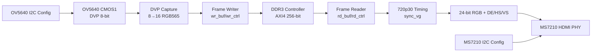
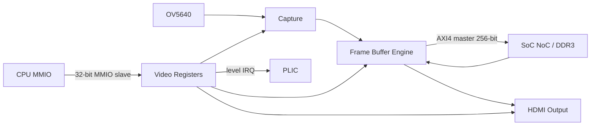

# 视频通道落地计划（OV5640 + DDR3 帧缓冲 + HDMI，盘古 200Pro）

> 状态：v0.1，2026-10-25  
> 目标读者：负责视频通道的 RTL/FPGA 同学，以及负责 SoC/NoC/DDR3/中断的队友  
> 适用范围：盘古 676 / 200Pro（`PG2L200H-6IFBG676`，以实际板卡为准）  
> 参考实现：官方 `HDMI_DDR3_OV5640_100H` 例程  
> 结论：**先做独立视频子系统并上板，再把它包成 SoC 的 AXI4 master + MMIO slave。**

---

## 1. 结论与范围

第一版视频通道只做：

```text
OV5640（单目，CMOS1，DVP 8-bit）
        │ pclk / vsync / href / data[7:0]
        ▼
8→16 bit 拼接（RGB565）
        ▼
DDR3 双缓冲帧缓存（1280×720×16bit × 2）
        ▼
720p30 时序生成
        ▼
24-bit 并行 RGB + DE/HS/VS + PIXCLK
        ▼
MS7210 HDMI PHY
        ▼
HDMI 输出
```

第一版**不做**：

- 不做双目同时采集；
- 不做 1080p；
- 不做 scaler；
- 不做 OSD/检测框叠加；
- 不做 CPU 直接读写 framebuffer；
- 不做硬件 cache coherence；
- 不直接把 FPGA 引脚当 TMDS 输出（板上有 MS7210 HDMI PHY）。

后续按“测试图案 → 摄像头预览 → MMIO/中断 → 接 SoC → AI 叠加”的顺序加。

---

## 2. 已冻结的决策

| ID | 决策 | 选择 |
| --- | --- | --- |
| D1 | 最终演示目标 | 先做 720p30 实时预览；AI 叠加后置 |
| D2 | 摄像头 | 单目 OV5640，CMOS1，DVP 8-bit |
| D3 | 开发顺序 | 先独立 `video_top` 上板，再包成 SoC 子系统 |
| D4 | 复用策略 | 复用官方 OV5640/DDR3/HDMI 例程 RTL/IP，重写顶层和 SoC 接口 |
| D5 | 最终 SoC 接口 | AXI4 master（256-bit）+ 32-bit MMIO slave + level IRQ |
| D6 | 分辨率/格式 | 1280×720@30，RGB565，双缓冲 |
| D7 | 验收顺序 | HDMI 测试图案 → OV5640 预览 → MMIO/IRQ → SoC → AI |
| D8 | 视频数据所有权 | 视频子系统拥有 framebuffer；CPU 只配置，不写实时帧 |

---

## 3. 硬件与资料事实

### 3.1 板卡与器件

- 盘古 676 系列底板：`MES2L676-BASE-V1.2`。
- 你的板卡是 200Pro，目标器件应为 `PG2L200H-6IFBG676`；资料包主要是 100Pro+（`PG2L100H`），**PDS 工程必须按实际 200H 重建**。
- 官方工程中的 `.sbit` 是 100H 的，不能直接烧到 200H。

### 3.2 摄像头

- 摄像头模组为 **OV5640**，使用 DVP 8-bit 接口。
- 例程支持双目 OV5640，CMOS1/CMOS2 二选一。
- 单目接口：
  - `cmos1_pclk`
  - `cmos1_vsync`
  - `cmos1_href`
  - `cmos1_data[7:0]`
  - `cmos1_scl` / `cmos1_sda`（SCCB/I2C）
  - `cmos1_reset`
- 8-bit DVP 每个像素输出两个字节，例程用 `cmos_8_16bit` 拼成 RGB565。
- 720p30 时像素率约 37.125 MHz，DVP `pclk` 约为 74.25 MHz（2 字节/像素）。

### 3.3 HDMI 输出

- 板上是 **MS7210 HDMI TX PHY**，不是 FPGA 直接输出 TMDS。
- FPGA 输出：
  - `pix_clk`（720p30 约 37.125 MHz）
  - `de_out`
  - `hs_out`
  - `vs_out`
  - `r_out[7:0]` / `g_out[7:0]` / `b_out[7:0]`
- MS7210 通过 I2C 初始化，例程使用 `ms72xx_ctl` / `ms7210_ctl`。
- HDMI 输出侧需要 `rstn_out`、`iic_tx_scl`、`iic_tx_sda`。

### 3.4 DDR3 与帧缓冲

- 官方例程使用 Pango DDR3 控制器，DDR3 数据位宽 32-bit。
- 帧缓冲 AXI 接口是 **256-bit 数据、28-bit 地址、4-bit ID、AXI4（支持 INCR burst）**。
- 例程参数：
  - `MEM_DQ_WIDTH = 32`
  - `axi_wdata[255:0]`
  - `axi_wstrb[31:0]`
  - `axi_awlen[3:0]` / `axi_arlen[3:0]`，最大 16 beat。
- 1280×720×2B = **1,843,200 B/帧**，约 1.76 MiB。
- 双缓冲建议每个 buffer 按 **2 MiB** 对齐，共保留 **4 MiB**。
- 720p30 写+读带宽约 **110.6 MB/s**，相对 DDR3 4.26 GB/s 很小。

### 3.5 官方参考工程

资料路径（本机）：

```text
/home/blossilver/Downloads/pango_development_doc/7_FMC扩展子卡及Demo/2_Demo/HDMI_DDR3_OV5640_100H/
```

关键文件：

| 文件 | 作用 |
| --- | --- |
| `source/rtl/hdmi_ddr_ov5640_top.v` | 官方顶层，摄像头/DDR3/HDMI 连接参考 |
| `source/rtl/reg_config.v` | OV5640 寄存器配置 |
| `source/rtl/i2c_com.v` / `iic_dri.v` | I2C/SCCB 驱动 |
| `source/rtl/cmos_8_16bit.v` | 8-bit DVP → 16-bit RGB565 |
| `source/rtl/fram_buf.v` | 帧缓冲顶层 |
| `source/rtl/wr_buf.v` / `wr_ctrl.v` / `wr_cmd_trans.v` | 写帧缓存 |
| `source/rtl/rd_buf.v` / `rd_ctrl.v` | 读帧缓存 |
| `source/rtl/wr_rd_ctrl_top.v` | DDR3 AXI 读写控制 |
| `source/rtl/sync_vg.v` | 1280×720 视频时序 |
| `source/rtl/ms72xx_ctl.v` / `ms7210_ctl.v` | HDMI PHY I2C 初始化 |
| `source/rtl/power_on_delay.v` | 上电/复位延时 |
| `HDMI_DDR3_OV5640_test.fdc` | 100H 管脚/时钟约束参考 |
| `ipcore/ddr3_test/`、`ipcore/pll/`、`ipcore/wr_fram_buf/`、`ipcore/rd_fram_buf/` | PDS IP 参考 |

---

## 4. 总体架构

### 4.1 两个顶层，分阶段使用

```text
阶段 A：video_standalone_top
  摄像头 + DDR3 + HDMI 全部自己带，先上板出图

阶段 B：video_subsys
  去掉 DDR3 引脚，改成 AXI4 master + MMIO slave，接队友的 SoC/NoC/DDR3
```

这样视频和 SoC 可以并行开发，不会互相阻塞。

### 4.2 阶段 A：独立视频顶层



### 4.3 阶段 B：SoC 视频子系统



---

## 5. 模块划分与目录

建议新增：

```text
rtl/video/
├── video_defs.vh                 // 参数、格式、状态宏（Verilog `define）
├── video_top.v                  // 阶段 A 独立顶层
├── video_subsys.v               // 阶段 B SoC 子系统
├── video_regs.v                 // MMIO 寄存器 + 状态 + IRQ
├── video_capture_wrap.v         // OV5640 配置 + DVP 8→16
├── video_framebuf_wrap.v        // fram_buf + wr_rd_ctrl_top 封装
├── video_hdmi_wrap.v            // sync_vg + RGB 扩展 + MS7210 配置
├── video_axi_master.v           // 原生 AXI 通道 → 标准 AXI4 master
├── video_async_fifo.v           // 跨时钟域 FIFO
├── legacy/                      // 官方 RTL 原样保留，加来源注释
│   ├── reg_config.v
│   ├── i2c_com.v
│   ├── iic_dri.v
│   ├── cmos_8_16bit.v
│   ├── fram_buf.v
│   ├── wr_buf.v
│   ├── wr_ctrl.v
│   ├── wr_cmd_trans.v
│   ├── rd_buf.v
│   ├── rd_ctrl.v
│   ├── wr_rd_ctrl_top.v
│   ├── sync_vg.v
│   ├── ms72xx_ctl.v
│   ├── ms7210_ctl.v
│   └── power_on_delay.v
└── test/
    ├── tb_video_capture.v
    ├── tb_video_framebuf.v
    ├── tb_video_hdmi.v
    └── tb_video_top.v
```

原则：

- **本文档新增的视频 RTL、wrapper 和 testbench 全部使用 Verilog-2001**，不使用 SystemVerilog。
- 官方 RTL **尽量不改**，放在 `legacy/`，保留原始头注释和来源。
- 官方代码是 active-low reset，wrapper 边界统一转换成项目约定的复位极性。
- 官方 Verilog 代码可能需要从 ARES 的严格 lint 中排除，或加明确的 lint waiver，不要为了 lint 改坏视频时序。

### 5.1 Verilog 编码约束

由于后续工具限制，视频通道按纯 Verilog 开发：

| 禁止使用（SystemVerilog） | 改用（Verilog-2001） |
| --- | --- |
| `logic` | `wire` / `reg` |
| `always_ff` / `always_comb` | `always @(posedge clk)` / `always @(*)` |
| `interface` / `modport` | 显式端口列表 + 扁平总线 |
| `package` / `import` | `video_defs.vh` 里的 `define` / `localparam` |
| `typedef` / `struct` / `enum` | 扁平 `wire/reg` + `localparam` 编码 |
| `.sv` 文件 | `.v` 文件 |
| SV 断言 `assert property` | 仿真用的 `if` 检查任务，或 PDS/Verilator 支持的简单 immediate assertion |

补充约定：

- 模块端口全部显式声明方向、位宽，不使用接口传递 AXI。
- 跨模块常量统一放 `video_defs.vh`，用 `` `define `` 或模块 `parameter`。
- 状态机用 `localparam` 定义状态编码，用 `reg [N:0] state, next_state`。
- 复位统一为同步、高有效（如果沿用官方 active-low 模块，则在 wrapper 边界取反）。
- 时序逻辑一律用非阻塞赋值 `<=`，组合逻辑用阻塞赋值 `=`。
- testbench 也用 Verilog，不依赖 SV class/random 等特性；需要随机激励时用 `$random`。
- 如果 SoC 集成层必须用 Verilog，则 `video_subsys.v` 只暴露扁平端口，不引用 ARES 的 SV `interface`/`package`。
- 注意：ARES core 现有 RTL 仍有 SystemVerilog 的 `package`/`interface`/`struct`。本文档只保证**视频通道新增代码**是纯 Verilog，并通过显式端口与 core/SoC 隔离；如果整个仓库也必须转成纯 Verilog，那是独立的迁移项目，需要先评估 PDS 对现有 SV 的支持范围和转换成本，不能只靠视频 wrapper 解决。

---

## 6. 数据通路

### 6.1 摄像头采集

```text
cmos1_pclk
  ├─ cmos1_data[7:0]  → 8→16 拼接 → rgb565
  ├─ cmos1_href        → de
  └─ cmos1_vsync       → frame start/end
```

要点：

- `cmos_8_16bit` 用 `pclk` 的下降沿/上升沿关系拼两个字节；先按官方实现，不要自己猜时序。
- `vsync` 上升沿作为新帧开始；`href` 高表示行有效。
- `cmos_init_done` 来自 `reg_config`，未完成前不要写帧缓存。
- 第一版只开 CMOS1，CMOS2 的引脚和逻辑可以保留但不使用。

### 6.2 帧缓存写入

```text
vin_clk / vsync / de / rgb565
        │
        ▼
wr_buf（行缓冲、跨时钟）
        │
        ▼
wr_ctrl / wr_cmd_trans（AXI burst）
        │
        ▼
DDR3 framebuffer
```

要点：

- 一帧 1280×720×2B = 1,843,200B。
- 一行 2560B；256-bit AXI 每 beat 32B，一行 80 beat = 5 个 16-beat burst。
- 写帧完成信号 `frame_wr_done` 必须对应“最后一行有效像素写完”，不能只看 vsync。
- 写地址 = `FB_BASE[wr_idx] + line * stride`。

### 6.3 帧缓存读取

```text
DDR3 framebuffer
        │
        ▼
rd_buf（行预取、跨时钟）
        │
        ▼
sync_vg（720p30 时序）
        │
        ▼
RGB565 → 24-bit RGB
```

要点：

- 读侧按 HDMI 的 `de` 逐行取数；一行 2560B。
- `rd_ctrl` 的读 burst 要提前一行启动，避免 underflow。
- `rd_buf` 的 FIFO 深度按官方参数；如果出现 underflow，先加行预取深度，不要改时序参数。
- HDMI 输出前把 RGB565 扩展成 24-bit：
  - `R = {rgb565[15:11], 3'b000}`
  - `G = {rgb565[10:5], 2'b00}`
  - `B = {rgb565[4:0], 3'b000}`

### 6.4 双缓冲

```text
wr_idx  : 当前写入 buffer（0/1）
rd_idx  : 当前读出 buffer（0/1）
```

规则：

1. 复位后先等第一帧 `frame_wr_done`，HDMI 输出测试图案/黑屏。
2. 第一帧完成后，`rd_idx = 刚写完的 buffer`，开始读。
3. 后续每帧写完：
   - 如果读侧已经读完上一帧，切换 `wr_idx`；
   - 如果读侧还没读完，丢弃新帧或覆盖旧帧，并置 `frame_drop`。
4. **永远不允许 `wr_idx == rd_idx` 且同时读写**。
5. 第一版双缓冲足够；三缓冲后续再加。

---

## 7. 时钟、复位、CDC

### 7.1 时钟域

| 时钟 | 来源 | 典型频率 | 用途 |
| --- | --- | --- | --- |
| `sys_clk` | 板载晶振 | 以实际板卡为准 | 配置、控制、PLL 参考 |
| `clk_p/n` | 板载 125MHz 差分 | 125 MHz | DDR3 参考时钟 |
| `cmos1_pclk` | OV5640 | 约 74.25 MHz | DVP 采集 |
| `pix_clk` | PLL | 37.125 MHz | 720p30 HDMI 输出 |
| `cfg_clk` | PLL | 10 MHz | MS7210 I2C 配置 |
| `clk_25M` | PLL | 25 MHz | OV5640 I2C 配置 |
| `core_clk` | DDR3 IP 输出 | 由 IP 决定 | 帧缓存/AXI 主时钟 |

> 注意：官方源码注释 `sys_clk 50MHz`，但官方 FDC 把 `sys_clk` 约束成 `37.000ns`（约 27MHz）。这两个不一致。P0 必须用实际板卡/示波器或原理图确认，不能照抄注释。

### 7.2 CDC 位置

```text
cmos1_pclk 域  →  core_clk 域   : wr_buf 内异步 FIFO
core_clk 域   →  pix_clk 域    : rd_buf 内异步 FIFO
sys_clk 域    →  cfg_clk 域    : I2C 配置，慢速，不需要高吞吐
```

- 摄像头 `pclk` 是输入时钟，必须 `create_clock`。
- 不要把 `pclk` 直接当 AXI 时钟。
- 所有跨域控制信号用握手/电平同步，不要直接打两拍多 bit 总线。

### 7.3 复位顺序

```text
上电
  → PLL lock
  → DDR3 初始化完成（ddr_init_done）
  → HDMI PHY 初始化（init_over）
  → OV5640 复位释放 + I2C 配置完成（cmos_init_done）
  → 允许写帧缓存
  → 第一帧完成
  → 允许 HDMI 读帧缓存
```

每个域用各自的同步复位；不要用一个异步复位直接扇出到所有时钟域。

---

## 8. 帧缓冲地址映射

### 8.1 独立阶段

```text
DDR3 物理地址由 Pango DDR3 IP 决定，视频内部使用 28-bit 字节地址。
FB_BASE0 = 0x0100_0000
FB_BASE1 = 0x0120_0000   // 2 MiB 步进
```

具体值可在 `video_defs.vh` 或模块 `parameter` 中配置，不要求与 SoC 地址一致。

### 8.2 SoC 阶段建议

沿用 SoC 计划的地址映射：

```text
0x8000_0000 - 0x8000_FFFF   Boot ROM 64 KiB
0x8010_0000 - 0xBFFF_FFFF   DDR3 cached（约 1 GiB）
0xC000_0000 - 0xC0FF_FFFF   MMIO / NoC 外设
0xC100_0000 - 0xFFFF_FFFF   DDR3 uncached alias（physical + 0x4000_0000）
```

视频帧缓冲建议：

```text
物理地址：
  VIDEO_FB0 = 0x8100_0000
  VIDEO_FB1 = 0x8120_0000
CPU/MT uncached alias：
  VIDEO_FB0_ALIAS = 0xC100_0000
  VIDEO_FB1_ALIAS = 0xC120_0000
```

保留：

```text
0x8100_0000 - 0x813F_FFFF   4 MiB 视频帧缓冲
0x8140_0000 以后             其他大 buffer / MT
```

规则：

- 视频 AXI master 直接访问物理 DDR3 区间；
- CPU 只通过 MMIO 配置，不直接写实时帧；
- 如果后续 MT 要读帧，走 uncached alias，或由视频写入 MT 指定的 buffer；
- 不允许同一帧同时被 CPU cached 访问和视频 DMA 访问。

---

## 9. AXI 接口契约

### 9.1 视频 AXI4 master

| 项目 | 值 |
| --- | --- |
| 协议 | AXI4（不是 AXI4-Lite） |
| 数据位宽 | 256-bit |
| 地址位宽 | 32-bit（视频内部可截 28-bit） |
| ID 位宽 | 4-bit |
| Burst | INCR |
| 最大 burst | 16 beat（`awlen/arlen = 15`） |
| Beat 大小 | 32B（`awsize/arsize = 5`） |
| 写 `wstrb` | 32-bit |
| 读 outstanding | 1–2 个 burst（第一版 1 个） |
| 写 outstanding | 1 个 burst（第一版） |
| QoS | 视频最高（建议 `awqos/arqos = 0xF`） |
| ID | 固定 `4'd2`（示例，按 NoC 分配） |

AXI4 全信号建议：

```text
AW: awid, awaddr, awlen, awsize, awburst, awlock=0, awcache=0,
    awprot=0, awqos=VIDEO_QOS, awregion=0, awuser=0, awvalid, awready
W : wdata, wstrb, wlast, wvalid, wready
B : bid, bresp, bvalid, bready
AR: arid, araddr, arlen, arsize, arburst, arlock=0, arcache=0,
    arprot=0, arqos=VIDEO_QOS, arregion=0, aruser=0, arvalid, arready
R : rid, rdata, rresp, rlast, rvalid, rready
```

如果队友 SoC 只有 128-bit AXI：

- 方案 A：在 `video_axi_master` 内做 256→128 宽度转换；
- 方案 B：视频帧缓存内部也降到 128-bit；
- 第一版建议保留 256-bit，在 SoC 边界加宽度适配，避免改官方 framebuf。

### 9.2 视频 MMIO slave

| 项目 | 值 |
| --- | --- |
| 协议 | 32-bit 单 outstanding 请求/响应（可包成 AXI4-Lite） |
| 地址窗口 | 4 KiB |
| 建议基址 | `0xC000_2000`（示例，待 SoC MMIO map 冻结） |
| 写完成 | 必须等寄存器副作用完成再回响应 |
| 中断 | level，接 PLIC |

---

## 10. MMIO 寄存器建议

> 偏移相对 `VIDEO_BASE`；所有寄存器 32-bit，自然对齐。  
> `W1C` = 写 1 清除。

| Offset | 名称 | 访问 | 说明 |
| --- | --- | --- | --- |
| `0x000` | `VIDEO_ID` | RO | magic/version，例如 `0x41524553` |
| `0x004` | `VIDEO_CTRL` | RW | bit0 enable；bit1 capture_en；bit2 hdmi_en；bit3 double_buffer；bit4 irq_en；bit5 test_pattern_en |
| `0x008` | `VIDEO_STATUS` | RO | bit0 ddr_init_done；bit1 cam_init_done；bit2 hdmi_init_done；bit3 frame_wr_done；bit4 frame_rd_done；bit5 frame_drop；bit6 vsync_seen；bit7 fifo_overflow |
| `0x00C` | `VIDEO_IRQ_STATUS` | W1C | bit0 frame_start；bit1 frame_done；bit2 frame_drop；bit3 error |
| `0x010` | `VIDEO_IRQ_EN` | RW | 对应 `VIDEO_IRQ_STATUS` 的使能位 |
| `0x014` | `FB_BASE0` | RW | buffer0 物理基址，建议 2 MiB 对齐 |
| `0x018` | `FB_BASE1` | RW | buffer1 物理基址，建议 2 MiB 对齐 |
| `0x01C` | `FB_STRIDE` | RW | 行字节数，1280×2 = 2560 = `0x0000_0A00` |
| `0x020` | `FB_WIDTH` | RW | 1280 |
| `0x024` | `FB_HEIGHT` | RW | 720 |
| `0x028` | `FB_FORMAT` | RW | 0=RGB565；1=RGB888；2=YUV422（第一版只实现 0） |
| `0x02C` | `FB_ACTIVE` | RO | bit0 当前写 buffer；bit1 当前读 buffer |
| `0x030` | `FRAME_SEQ` | RO | 已完成帧计数 |
| `0x034` | `FRAME_DROP` | RO | 丢帧计数 |
| `0x038` | `CAM_CTRL` | RW | bit0 camera reset；bit1 start config；bit2 test pattern |
| `0x03C` | `CAM_STATUS` | RO | bit0 busy；bit1 done；bit2 ack error |
| `0x040` | `HDMI_STATUS` | RO | bit0 init done；bit1 pll lock |
| `0x044` | `TEST_PATTERN` | RW | 0=off；1=color bar；2=checker；3=moving box |
| `0x048` | `FIFO_STATUS` | RO | bit[15:0] overflow count；bit[31:16] underflow count |
| `0x04C` | `AXI_STATUS` | RO | bit0 read error；bit1 write error；bit2 timeout |
| `0x050` | `VIDEO_VERSION` | RO | 版本号 |

软件流程：

```c
video_write(FB_BASE0, 0x81000000);
video_write(FB_BASE1, 0x81200000);
video_write(FB_STRIDE, 1280 * 2);
video_write(FB_WIDTH, 1280);
video_write(FB_HEIGHT, 720);
video_write(FB_FORMAT, 0);          // RGB565
video_write(VIDEO_IRQ_EN, FRAME_DONE | FRAME_DROP | ERROR);
video_write(VIDEO_CTRL, ENABLE | CAPTURE_EN | HDMI_EN | DOUBLE_BUFFER | IRQ_EN);
```

等待：

```c
while (!(video_read(VIDEO_STATUS) & FRAME_WR_DONE)) ;
while (!(video_read(VIDEO_STATUS) & HDMI_INIT_DONE)) ;
```

---

## 11. 官方 demo 复用清单

### 11.1 直接复用

| 模块 | 用途 | 备注 |
| --- | --- | --- |
| `reg_config.v` | OV5640 I2C 寄存器配置 | 只用 CMOS1；保留 CMOS2 但不使能 |
| `i2c_com.v` / `iic_dri.v` | I2C/SCCB 位级驱动 | 检查 20kHz/400kHz 配置 |
| `cmos_8_16bit.v` | 8-bit DVP → RGB565 | 官方实现，先用不改 |
| `fram_buf.v` | 帧缓冲顶层 | 包一层 `video_framebuf_wrap` |
| `wr_buf.v` / `wr_ctrl.v` / `wr_cmd_trans.v` | 写帧缓存 | 保留 AXI burst 行为 |
| `rd_buf.v` / `rd_ctrl.v` | 读帧缓存 | 保留行预取 |
| `wr_rd_ctrl_top.v` | AXI 读写控制 | 保留 burst 长度/时序 |
| `sync_vg.v` | 720p30 时序 | 参数已为 1280×720 |
| `ms72xx_ctl.v` / `ms7210_ctl.v` | HDMI PHY 配置 | 只保留 TX 路径 |
| `power_on_delay.v` | 上电延时 | 保留 |

### 11.2 必须重写/新增

| 文件/模块 | 原因 |
| --- | --- |
| `video_top.v` | 官方顶层是 100H 板级顶层，不含 SoC 接口 |
| `video_subsys.v` | 新的 AXI4 master + MMIO slave 边界 |
| `video_regs.v` | 新的寄存器/状态/IRQ |
| `video_axi_master.v` | 补齐 AXI4 全信号、QoS、错误/超时 |
| `video_async_fifo.v` | 明确 CDC 边界，替代隐式跨域 |
| `video_defs.vh` | 参数、格式、状态宏 |
| PLL/DDR3 IP | 200H 重新生成，不能复用 100H 配置 |
| FDC | 200Pro 管脚/时钟重新核对 |
| 测试平台 | 新的 camera model、DDR3 AXI model、HDMI checker |

### 11.3 不要复用

- 100H 的 `.sbit` / bitstream；
- 100H 的 PDS 工程文件直接当 200H 工程；
- 官方 FDC 的管脚不加核对直接用于 200Pro；
- 官方顶层里的双摄像头选择/板级 LED 等无关逻辑；
- 官方工程里的仿真波形/编译产物。

---

## 12. PDS / 200Pro 迁移

### 12.1 工程

1. 新建 PDS 工程，器件选 `PG2L200H-6IFBG676`（以实际板卡为准）。
2. 顶层：阶段 A 用 `video_top`；阶段 B 用 `video_subsys`。
3. 源文件：官方 RTL + 新 wrapper；IP 重新生成。
4. 约束：从官方 `HDMI_DDR3_OV5640_test.fdc` 复制后逐项核对。
5. 生成 `.sbit`，用 Pango Programmer 烧录。

### 12.2 PLL

建议输出：

| 输出 | 频率 | 用途 |
| --- | --- | --- |
| `pix_clk` | 37.125 MHz | 720p30 HDMI |
| `cfg_clk` | 10 MHz | MS7210 I2C |
| `clk_25M` | 25 MHz | OV5640 I2C |
| `core_clk` | 由 DDR3 IP 输出 | 帧缓存/AXI |

`sys_clk` 和 `clk_p/n` 从板卡输入；`clk_p/n` 125MHz 差分给 DDR3 参考。

### 12.3 约束要点

- `sys_clk`：以实际晶振为准；官方 FDC 是 37ns，源码注释是 50MHz，必须核对。
- `clk_p/n`：125MHz 差分，`create_clock -period 8.000`。
- `cmos1_pclk`：输入时钟，约 74.25MHz，`create_clock`；如果实际 pclk 随分辨率变化，约束要覆盖最坏情况。
- `pix_clk`：PLL 生成，`create_generated_clock`。
- DDR3：直接使用 Pango DDR3 IP 生成的时钟/时序约束，不要手写。
- 异步组：
  - `cmos1_pclk` 与 `core_clk` 异步；
  - `pix_clk` 与 `core_clk` 异步；
  - `sys_clk` 与 `clk_p` 异步；
  - I2C 是慢速静态信号，可设 false path。
- DVP 输入：建议加 `set_input_delay`，至少要把 pclk 到数据的采样关系约束清楚。
- HDMI 输出：`pix_clk` 到 RGB/DE/HS/VS 的输出延迟约束；先保证功能，再做时序收敛。

### 12.4 管脚核对

官方 FDC 中可参考的 CMOS1 管脚：

| 信号 | 管脚 |
| --- | --- |
| `cmos1_pclk` | `Y22` |
| `cmos1_vsync` | `Y23` |
| `cmos1_href` | `W18` |
| `cmos1_scl` | `W21` |
| `cmos1_sda` | `U14` |
| `cmos1_reset` | `T20` |
| `cmos1_data[7:0]` | `V14, V18, Y21, T15, W25, Y26, U20, T14` |

HDMI 输出参考：

| 信号 | 管脚 |
| --- | --- |
| `pix_clk` | `T24` |
| `de_out` | `N19` |
| `hs_out` | `R20` |
| `r_out[7:0]` | `P16, K25, K26, L24, L25, L22, L23, N21` |
| `g_out[7:0]` | `N22, N23, N24, P23, P24, R25, P25, T25` |
| `b_out[7:0]` | `T22, R22, N18, M21, M22, P20, P21, P19` |

> 这些是官方 100H 例程的 FDC 值。200Pro 如果是同底板/同封装，大概率一致，但必须逐项核对；不要盲抄。

---

## 13. 验证计划

### 13.1 单元级

| 测试 | 内容 | 通过标准 |
| --- | --- | --- |
| `tb_video_capture` | 生成 8-bit DVP 流，检查 8→16 拼接、vsync/href | 像素顺序、RGB565 正确 |
| `tb_video_hdmi` | `sync_vg` 720p30 时序 | H_ACT=1280、V_ACT=720、DE/HS/VS 位置正确 |
| `tb_video_framebuf` | AXI memory model，写一帧再读一帧 | 逐像素一致；backpressure 下不丢 |
| `tb_video_axi` | AXI4 握手、burst、错误注入 | 不挂死；错误可观测 |
| `tb_video_regs` | MMIO 读写、W1C、IRQ | 寄存器语义正确 |

### 13.2 集成级

| 测试 | 内容 | 通过标准 |
| --- | --- | --- |
| `tb_video_top` | camera model + DDR3 AXI model + HDMI checker | 第一帧、双缓冲、丢帧计数正确 |
| 背压测试 | DDR3/AXI 随机 ready | 不丢像素、不死锁 |
| CDC 测试 | pclk/core_clk/pix_clk 不同频 | 无亚稳态、无 FIFO 溢出 |
| 长时间 | 10k 帧 | 无漂移、无累积错误 |

### 13.3 板上验收

| 阶段 | 验收 |
| --- | --- |
| V0 | HDMI 彩色条纹/棋盘格稳定 720p30，PLL lock，10 分钟无闪屏 |
| V1 | OV5640 I2C 配置完成，摄像头实时预览，帧计数递增 |
| V2 | DDR3 双缓冲预览，快速移动无撕裂，10k 帧无丢帧/溢出 |
| V3 | CPU 通过 MMIO 改测试图案/缓冲区，IRQ 正常 |
| V4 | 接入 SoC/NoC，视频与 CPU/MT 并发，QoS 正常 |
| V5 | AI 检测框叠加（可选） |

---

## 14. 里程碑

> 工作量按“有 Verilog 基础、但不熟 PDS”估算；如果完全不熟 PDS，乘 1.5–2。

| 里程碑 | 内容 | 预计 | 退出条件 |
| --- | --- | --- | --- |
| M0 | PDS 200H 工程 + PLL + HDMI 测试图案 | 2–4 人日 | 板上 HDMI 稳定出 720p30 彩条 |
| M1 | OV5640 I2C + DVP 采集 + 内部图案 | 3–5 人日 | 摄像头配置完成，能抓到稳定帧 |
| M2 | DDR3 帧缓存写/读 + 实时预览 | 4–6 人日 | 摄像头 → DDR3 → HDMI 实时预览 |
| M3 | 双缓冲 + MMIO + IRQ | 3–5 人日 | 无撕裂，CPU 可配置，IRQ 可观测 |
| M4 | SoC 集成：AXI4 master + MMIO slave | 5–8 人日 | CPU 控制视频，NoC 并发正常 |
| M5 | AI 叠加（可选） | 5–10 人日 | 检测框稳定叠加，帧率可接受 |

第一周只做 M0：

1. 建 200H PDS 工程；
2. 跑官方 HDMI 测试图案；
3. 核对 `sys_clk` 实际频率和 CMOS1/HDMI 管脚；
4. 把 `sync_vg`/`ms72xx_ctl` 的仿真跑起来。

---

## 15. 风险与现场核对

| 风险 | 影响 | 缓解 |
| --- | --- | --- |
| 200Pro 与 100Pro+ 管脚不同 | 上板无显示/摄像头无数据 | P0 逐项核对 FDC、原理图、点位图 |
| `sys_clk` 实际 27MHz 而非 50MHz | PLL/时序参数错 | 以 FDC/原理图/实测为准 |
| DDR3 IP 是 100H 配置 | 200H 不工作 | 在 200H 工程重新生成 DDR3 IP |
| AXI 256-bit 与 SoC 128-bit 不匹配 | 无法直接接 NoC | 视频侧加 256→128 适配，或 SoC 暴露 256-bit slave |
| 摄像头 pclk 跨域 | 偶发花屏/丢像素 | 异步 FIFO + 正确 clock constraint |
| HDMI PHY I2C 初始化失败 | 黑屏 | 先测试图案，再查 MS7210 初始化状态 |
| 双缓冲切换错误 | 撕裂/黑屏 | 严格 `wr_idx != rd_idx`，用 frame_done 切换 |
| 官方代码风格与 ARES lint 冲突 | CI 红 | legacy 目录隔离 + lint waiver，不改视频逻辑 |
| 视频与 MT 抢 DDR3 | 帧率下降/延迟 | NoC QoS：video > CPU > MT，视频 burst 限长 |

### 现场核对清单（P0 必做）

- [ ] 板卡实际 FPGA 型号：`PG2L200H-6IFBG676`？
- [x] 摄像头模组：OV5640（已确认）
- [ ] 摄像头接在 CMOS1 还是 CMOS2？
- [ ] 是否使用 FMC-LPC-IO 子卡？
- [ ] `sys_clk` 实际频率（27MHz / 50MHz / 其他）？
- [ ] `clk_p/n` 是否 125MHz 差分？
- [ ] DDR3 颗粒型号/位宽/容量？
- [ ] HDMI PHY 是 MS7210 还是其他？
- [ ] PDS 版本和 license 是否支持 200H？
- [ ] 官方 FDC 的 CMOS1/HDMI 管脚与 200Pro 点位图是否一致？

---

## 16. 与 SoC/队友的边界

| 责任 | 视频 owner | SoC owner |
| --- | --- | --- |
| 摄像头 DVP/I2C | 是 | 否 |
| 8→16 / RGB565 | 是 | 否 |
| 帧缓存写/读 | 是 | 否 |
| HDMI 时序/PHY 配置 | 是 | 否 |
| 视频 MMIO 寄存器 | 是 | 提供地址窗口/总线 |
| 视频 AXI4 master | 是 | 提供 NoC slave 端口 |
| DDR3 控制器 | 阶段 A 自己带；阶段 B 用 SoC 的 | 是 |
| NoC/QoS/地址译码 | 否 | 是 |
| PLIC/中断号 | 提供 IRQ 电平 | 分配 source/context |
| PLL/板级管脚 | 提供需求 | 板级 owner 统一约束 |

集成契约（阶段 B）：

```text
video_subsys
  ├─ video_axi_master : AXI4, 256-bit data, 32-bit addr, 4-bit ID
  ├─ video_mmio_slave : 32-bit, 4KiB window
  ├─ video_irq        : level
  ├─ clk / rst        : 与 SoC 同域（AXI 侧）
  └─ camera/hdmi 物理引脚留在 board top
```

---

## 17. 下一步

1. 按第 15 节做现场核对，确认 OV5640/200H/管脚/时钟。
2. 建 200H PDS 工程，先跑 M0 的 HDMI 测试图案。
3. 把官方 RTL 复制到 `rtl/video/legacy/`，加来源注释，不改逻辑。
4. 写 `video_top` / `video_regs` / `video_axi_master` 三个 wrapper。
5. 先仿真 `sync_vg` + `framebuf`，再上板。
6. 每完成一个里程碑，更新本文档的“验收”和“风险”两节。

---

## 附录 A：720p30 时序参数

官方 `sync_vg.v` 默认：

```text
H_TOTAL = 1650
H_SYNC  = 40
H_BP    = 220
H_ACT   = 1280
H_FP    = 110

V_TOTAL = 750
V_SYNC  = 5
V_BP    = 20
V_ACT   = 720
V_FP    = 5
```

像素时钟 37.125 MHz，帧率约 30Hz。

## 附录 B：带宽计算

```text
1280 × 720 × 2 B = 1,843,200 B/帧
写：1,843,200 × 30 = 55.3 MB/s
读：1,843,200 × 30 = 55.3 MB/s
合计：约 110.6 MB/s
DDR3 理论：4.26 GB/s
占用率：约 2.6%
```

## 附录 C：AXI burst 计算

```text
一行 = 1280 × 2 B = 2560 B
256-bit AXI = 32 B/beat
2560 / 32 = 80 beat/行
80 / 16 = 5 个 16-beat burst/行
```

## 附录 D：参考资料

本机资料：

```text
/home/blossilver/Downloads/pango_development_doc/7_FMC扩展子卡及Demo/2_Demo/HDMI_DDR3_OV5640_100H/
/home/blossilver/Downloads/pango_development_doc/4_IC_datasheet/OV5640/
/home/blossilver/Downloads/pango_development_doc/3_Hardware/
/home/blossilver/Downloads/pango_development_doc/1_Demo_document/
```

官方例程是板卡厂商资料，复制到仓库时保留原始版权/来源注释，并确认竞赛/项目对第三方代码的使用规则。
