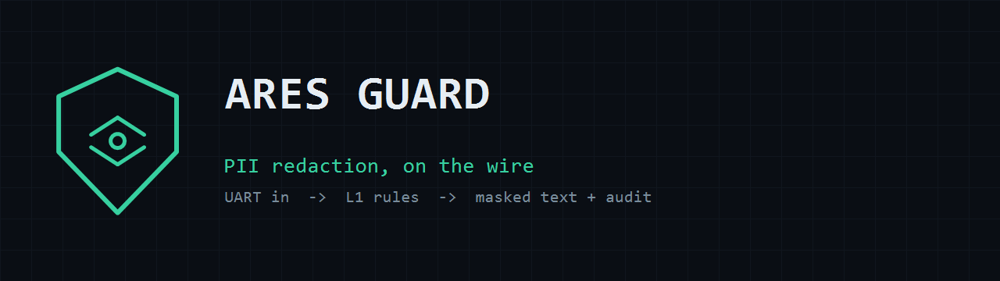

# guard —— 隐私守门人（PII 脱敏网关）



```
    _    ____  _____ ____     ____ _   _    _    ____  ____
   / \  |  _ \| ____/ ___|   / ___| | | |  / \  |  _ \|  _ \
  / _ \ | |_) |  _| \___ \  | |  _| | | | / _ \ | |_) | | | |
 / ___ \|  _ <| |___ ___) | | |_| | |_| |/ ___ \|  _ <| |_| |
/_/   \_\_| \_\_____|____/   \____|\___//_/   \_\_| \_\____/
```

*PII redaction, on the wire — UART in, masked text + audit out.*

部署在数据源头、在文本离开设备前完成脱敏的分层降级网关原型。目标平台盘古 200Pro+
（PG2L200H），控制面复用 ARES 单发射流水核，数据面在 miniTensor 上扩展。

路线与预算见 `TODO.md`。
**只想上手**：PC 上 `./run.sh demo`；板子上看 [docs/board-bringup.md](docs/board-bringup.md)。

## 当前状态（2026-11-15）

| 阶段 | 状态 |
|---|---|
| 本机开发平台（仿真/金标/语料/一致性测试） | ✅ 就绪 |
| L1 规则层：身份证 18/15、手机、银行卡、邮箱、IPv4、USCC、车牌 | ✅ 1000 例 / 2670 span 全一致，另 43 例手工边界 |
| 顶层 `l1_engine`（5 引擎并行）+ 吞吐基准 | ✅ 1 字节/拍，150 MB/s @150 MHz（吞吐折算，非 Fmax） |
| 红action 金标：重叠合并 + token/mask + 审计 JSON | ✅ |
| 关键词提示（8 词，金标 + RTL 并行匹配） | ✅ 108 例一致 |
| 端到端 demo（文本进 → 脱敏 + 审计 JSON，RTL 检测在环） | ✅ `make demo` |
| RTL 合并 + mask 替换器（`l1_redact_top`，1 字节/拍） | ✅ 1000 例字节+审计全一致 |
| 本机入口 `./run.sh`（serve/demo/text/file/repl/report/serial） | ✅ 网页工作台 ≈5 ms 出结果 |
| **上板：串口进 → 脱敏 → 串口出（盘古 200Pro+）** | ✅ 25 MHz 过时序、位流已出，见 [docs/board-uart.md](docs/board-uart.md) |
| 关键词提示 / 档位头上串口（摘要行 `kw`/`kwm`/`mode`） | ✅ 金标+上位机+TB 同源 |
| **L2 INT4 语义层**（miniTensor 4×4 MXU，权重由 corpus 训练） | ✅ 已进板级位流（摘要行 `l2=`/`l2m=`）；12 例对金标；见 [docs/l2-int4.md](docs/l2-int4.md) |
| **L2b 实体层：人名/地址** | ✅ host 侧可用（`demo.py --entities`）；RTL 模块 `l2_entity.sv` 16 例对金标；**板级接线未做**（见 docs/l2-int4.md §7.3） |
| L2（INT4 语义层） | ⬜ M3 |

**上板实测**（PDS 2025.2-SP3，`guard_board_top`）：

| 项 | 值 |
|---|---|
| 资源 | **4,785 LUT (3.0%) / 2,947 FF / 10 APM / 0.5 DRM / 1 PLL** |
| 时钟 | 27 MHz → GTP_GPLL → **25 MHz** 核心 |
| 时序 | WNS **+5.0 ns**（MET）、TNS 0 → Fmax ≈ 28.7 MHz |
| 串口 | 115200 8N1（8× 过采样；3 Mbaud 通路已仿真），RX **B24** / TX **C24** |
| 帧边界 | LF 或空闲 300000 位时间（≈2.6 s） |
| 位流 | `generate_bitstream/guard_board_top.sbit`（9,188,552 B） |

> 27 MHz 一开始不收敛（WNS −38.2 ns，≈75 ns 路径）。2026-11-17 分块定位到
> **文本引擎**，把邮箱/IPv4/USCC 改成**逐字节增量校验**后文本块 +22.4 ns，
> 整板 25 MHz 收敛（+4.7 ns），LUT 6,912 → 4,749（含 L2）。过程与数据见
> [docs/board-uart.md §2.1](docs/board-uart.md)。

## 快速开始：PC 本机

**边打边看**：`./run.sh serve` 起一个本地网页（仅监听 127.0.0.1），左边输入/粘贴，
右边约 5 ms 出脱敏结果（全 RTL），下方是审计表与关键词提示；可切 mask（全 RTL）/
token（金标渲染）。

```bash
cd guard
./run.sh serve                                  # 网页工作台 http://127.0.0.1:8766
./run.sh demo                                   # 全 RTL：检测 + 合并 + mask 替换
./run.sh text "手机 13800138000 邮箱 a@b.co"     # 一段文本
./run.sh file 某个.txt --policy token --json audit.json
./run.sh repl                                   # 交互模式
./run.sh report examples/sample.txt              # 只统计
```

金标命令行：

```bash
python3 -m host.golden.cli ../some/text.txt --redact
printf '身份证 11010519491231002X' | python3 -m host.golden.cli
```

## 快速开始：上板（盘古 200Pro+）

操作手册：[docs/board-bringup.md](docs/board-bringup.md)（含烧写步骤、成功判据、故障表）。
设计细节：[docs/board-uart.md](docs/board-uart.md)。

```powershell
# 在仓库根目录
powershell -ExecutionPolicy Bypass -File guard\tools\build_guard.ps1    # PDS 出位流（~6 min）
powershell -ExecutionPolicy Bypass -File guard\tools\program_guard.ps1  # JTAG 烧写（~30 s）
python guard\tools\serial_host.py --ports                              # 找串口
python guard\tools\serial_host.py -p COM5 --text "手机 13800138000"     # 发一行，收脱敏+审计
python guard\tools\serial_host.py -p COM9 --repl                            # 交互：敲文本 + 回车，:q 退出
python guard\tools\serial_host.py -p COM5 --file guard\examples\sample.txt --check
```

## make 目标

| 目标 | 作用 |
|---|---|
| `make test` | 全套：63 单测 + 1000 向量 + 43 边界 + 108 关键词 + 1000 脱敏 + 200 demo + **18 板级** + 257 摘要格式 |
| `make golden` | 只跑 Python 单测 |
| `make vectors` / `make sim` | 生成向量 / 回放比对（1000 例） |
| `make edges` / `make kw` | 手工边界集 / 关键词匹配器 |
| `make redact` / `make demo-check` | RTL 合并+替换一致性 / 检测+金标脱敏端到端（200 例） |
| `make demo` | 端到端 demo（`examples/sample.txt` → 脱敏 + 审计 JSON） |
| `make bench` | 吞吐基准（1 字节/拍） |
| `make lint` | Verilator lint（规则层） |
| `make board-vectors` / `make board-sim` | 板级向量 / 位级 UART 端到端（18 例） |
| `make board-sim-3m` | 同一套 18 例跑 **3 Mbaud** 通路（8× 过采样） |
| `make report-sim` | 审计摘要格式化穷举（0..255，257 例） |
| `make board-lint` | Verilator lint（含板级桥 + PLL 仿真模型） |
| `make clean` | 清 `build/` |

> Verilator 并行度：默认 `JOBS=0`（全核）。受限机器或 Verilator 5.020 的线程池
> bug 用 `make JOBS=2 test`（见 [docs/board-uart.md §10.5](docs/board-uart.md)）。

## 依赖

- PC 侧：`verilator >= 5.0`（本机 5.040；5.020 也可，见 docs/board-uart.md §10.5）、
  `python3 >= 3.10`（本机 3.12，只用标准库）、`make`；
- 上板侧：PDS 2025.2-SP3（`D:\Pango\PDS_2025.2-SP3-EN-ads`）、`pyserial`（只有上位机用）；
- **不需要 torch**：L1 是纯规则，L2 上板前的量化评估才会用到（可复用 `gesture-env` 的 venv）。

## 文档

| 文档 | 内容 |
|---|---|
| [docs/board-uart.md](docs/board-uart.md) | 上板设计与验证：串口协议、三个机制、资源时序、PDS 流程、这一轮修掉的问题 |
| [docs/board-bringup.md](docs/board-bringup.md) | **上板操作手册**：出位流 → 烧写 → 串口第一测 → 验收 → 故障表 |
| [TODO.md](TODO.md) | 按路线的任务清单 |

## 目录

```
guard/
├── Makefile              # 见上表；board-* / report-sim 是板级新增
├── TODO.md               # 按路线的任务清单（勾选式）
├── docs/                 # plan / m1 / m2 / board-uart / board-bringup
├── rtl/l1/               # 规则层 RTL
│   ├── l1_digit_engine.sv    # 数字类（身份证/手机/银行卡）
│   ├── l1_text_engines.sv    # 邮箱 / IPv4 / USCC / 车牌
│   ├── l1_keyword_match.sv   # 关键词提示（并行比较器）
│   ├── l1_engine.sv          # 顶层（5 引擎同流并行）
│   └── l1_redact.sv          # 合并 + mask 替换 + 审计
├── rtl/board/            # 板级：串口桥（不进 PC 回环）
│   ├── guard_uart_baud.sv    # 分数分频波特率（8× 过采样）
│   ├── guard_uart_rx.sv / guard_uart_tx.sv
│   ├── guard_fifo.sv         # 8 位同步 FIFO（FWFT）
│   ├── guard_report.sv       # 审计摘要格式化（BCD 比较树）
│   ├── guard_uart_core.sv    # 帧边界 / 流控 / 帧间软复位 / TX 整形
│   ├── guard_pll.v           # PDS：GTP_GPLL 27 MHz → 25 MHz
│   ├── guard_pll_sim.sv      # 同端口的行为级模型（Verilator 用）
│   └── guard_board_top.sv    # 引脚、复位同步、LED
├── fpga/pango/           # PDS 流程
│   ├── flow_guard.tcl        # compile → synthesize → dev_map → pnr → 位流
│   ├── guard_board.fdc       # 引脚 + 生成时钟约束（uart_rx=B24）
│   └── program_guard.tcl     # JTAG 下载（ASCII-only，端口 60000）
├── sim/                  # tb_l1_engine / tb_l1_bench / tb_l1_keywords /
│                         # tb_l1_redact / tb_guard_uart / tb_guard_report
├── host/
│   ├── golden/           # 金标：规则 + 红action/审计 + 关键词 + CLI + 板级协议
│   └── corpus/           # 合成 PII 语料
├── tools/
│   ├── gen_vectors.py / gen_edges.py / gen_keyword_vectors.py
│   ├── gen_board_vectors.py  # 板级向量（.in/.exp/.pace）
│   ├── gen_keywords.py       # 关键词表 → SV package
│   ├── build_guard.ps1 / program_guard.ps1   # 上板：出位流 / 烧写
│   ├── serial_host.py        # 上位机：发文本、收结果、--check
│   └── guard_cli.py / guard_server.py / demo.py / verify_demo.py
├── run.sh                # 本地入口（自动构建 → tools/guard_cli.py；serial 子命令直通）
├── examples/             # sample.txt（含 PII）/ clean.txt（无 PII）
├── tests/                # 金标单测（unittest）
└── vendor/               # ARES core / miniTensor 拷贝，见 PROVENANCE.md
```

## 四条硬约定

1. **金标与 RTL 一一对应**：判定写在 `host/golden/pii_rules.py` 和 `rtl/l1/*.sv` 两处，
   任何一侧改规则，另一侧必须同步；`make test` 会用同一批向量把两边拉齐。
2. **坐标按字节**：span 的 `start/len` 是 UTF-8 字节偏移，和 RTL 字符流天然一致。
3. **一致性靠向量**：语料随机合成，期望值由金标生成；RTL 必须在全部用例上逐条对齐。
   新增规则先加金标单测，再加向量。
4. **板上与 PC 同一份 RTL + 同一份金标**：`make board-sim` 把真实 UART 位定时打在
   `guard_board_top` 上，期望值来自 `host/golden/board_proto.py`，和
   `serial_host.py --check` 是同一份实现 —— 仿真 PASS ⇔ 板上 PASS。

## L1 当前判定的边界（都已写进测试）

- 数字游程：`' '`、`'-'` 在游程内透明（`138 0013 8000` 是 13 字节的 span）；尾部透明字符不计入；
- `X`/`x` 只在前 17 位之后作为身份证校验位；
- 位数 > 19 的游程整段作废；
- 优先级 ID18 > ID15 > 手机 > 银行卡（18 位走身份证分支，不做银行卡回退）；
- 出生日期按"能被 4 整除即闰年"判断（忽略世纪规则），日上限按月份区分。
- **板级**：mask 策略只有 1:1 长度；token（`[MOBILE_1]`）仍在 host 侧；输出把 LF 补成
  CRLF；上位机必须按回读节奏发（`serial_host.py` 自带 pace），否则 `ovf=001`。